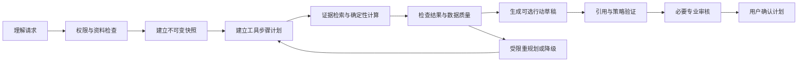
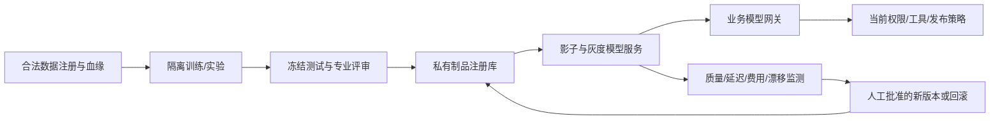

# 电子钱包 AI Agent — 模型训练、对齐与生产 ML 工程补充

> 版本：1.1 · 日期：2026-10-14（Australia/Sydney）  
> 状态：E0规则/工具/模板基线和合成回归已实现；后续训练配方仍是设计。没有启动训练、租用GPU或部署神经模型。  
> 官方资料核查批次时间：`2026-10-14T05:00:26Z`；库/API可用性和许可证实施时复核。

配套文件：[README.md](README.md) 定义业务、权限、账本和隐私；[CLAUDE.md](CLAUDE.md) 定义工程约束。本文补齐用户图片中的九类能力，所有训练规模、阈值、显存和预算均为初始设计假设，需实验验证。

**当前代码证据**：[E0模型卡](ml/registry/e0-model-card.md)、[合成数据清单](fixtures/synthetic/manifest.json)、[回归报告](reports/e0-eval.json)、[实施状态](docs/IMPLEMENTATION.md)。运行 `npm run eval` 可重跑200条合成任务与50条工具轨迹；这些是有限模板回归，不是训练或独立模型质量证明。

**方案覆盖、代码实现、实验验证和实际个人技能是不同的完成层级。** 本次补齐方案覆盖；后续必须以可复现结果证明模型是否有改善。完成应用不要求从零预训练大模型，也不要求为了技术清单强行把RL用于真实投资。

## 导航

- [1. 能力落地与实施层级](#coverage)
- [2. Agent规划与工具闭环](#planning)
- [3. NLU、NLG与信息检索](#language)
- [4. 训练数据、授权和数据血缘](#data)
- [5. LLM训练、SFT与对齐](#sft)
- [6. 强化学习、RLHF与DPO](#rlhf)
- [7. 模型蒸馏与优化](#distillation)
- [8. 评测与实验设计](#experiments)
- [9. 多GPU、混合精度和量化](#gpu)
- [10. Python、PyTorch和Rust职责](#languages)
- [11. 生产ML部署与监测](#production)
- [12. 扩展排期、算力与成本](#delivery)
- [13. 可检查的验收交付物](#acceptance)
- [14. 官方文档与原始论文](#sources)

<a id="coverage"></a>
## 1. 能力落地与实施层级

| 能力 | 在电子钱包中的具体用途 | 路线 | 不能据此声称 |
|---|---|---|---|
| Agentic AI/planning/tool use | 分解分析任务、读取快照、取证、计算、检查和重规划 | 首版必做，见第2节 | 模型拥有无限自主行动权 |
| LLM training/SFT/alignment | 统一意图、结构、引用、拒绝与解释风格 | 基线之后，见第4–5节 | 微调使行情预测必然更准 |
| RL/RLHF | 合成环境优化工具选择；用人类偏好改善解释 | 隔离研究，见第6节 | DPO等于已完成PPO训练或安全证明 |
| Distillation/optimisation | 小模型承担分类与标准解释，减少费用和时延 | 质量允许才上线，见第7节 | 教师标签天然正确 |
| Evaluation/experimentation | 衡量每项改动质量、成本、安全与统计差异 | 贯穿所有阶段，见第8节 | 训练loss/用户点击证明金融收益 |
| NLU/NLG/IR | 理解问题、解析金额/日期、检索授权证据、受控生成 | 首版必做，见第3节 | 向量相似度等于事实可信度 |
| Multi-GPU/AMP/quantisation | 在需要时训练或服务较大私有模型 | 按容量条件启用，见第9节 | 模型权重装下就必定能运行 |
| Python/PyTorch/Rust | 业务与数据、训练、必要性能扩展及互操作 | Python必做，其余随扩展，见第10节 | 多语言本身提升分析准确性 |
| Production ML deployment | 版本登记、推理容量、评测门槛、漂移和回滚 | API/私有模型均有治理，见第11节 | 模型服务上线等于业务合规 |

建议顺序：确定性业务与无训练基线 → NLU/检索/规划评测 → 小规模SFT → 人类偏好/DPO → 蒸馏/量化 → 私有ML服务 → 条件充分时多GPU/RLHF。各步骤允许因没有收益而保持原方案，但研究文档和验证路径必须完整。

<a id="planning"></a>
## 2. Agent规划与工具闭环

### 2.1 有界计划状态机



执行计划是结构化业务记录，不是隐藏思维链。保留简短理由和工具结果引用足以支持解释；不要求输出或保存模型完整内部推理。每次模型提议工具步骤，后端独立校验。

任务状态：`RECEIVED → CLARIFYING/AUTHORIZED → PLANNED → EXECUTING → VALIDATING → DRAFT_READY → REVIEW_PENDING/COMPLETED`；失败可进入`DEGRADED/BLOCKED/CANCELLED`。这里COMPLETED仅表示分析或计划生成完成，不代表金融交易完成。

### 2.2 Plan、Step、Observation契约

```json
{
  "plan_id": "plan_synthetic_001",
  "intent": "monthly_cashflow_and_risk",
  "snapshot_id": "snapshot_synthetic_001",
  "policy_version": "policy-1",
  "budget": {"max_tool_calls": 8, "max_seconds": 120, "max_replans": 2},
  "steps": [
    {"id": "s1", "tool": "read_financial_summary", "depends_on": [],
      "arguments": {"snapshot_id": "snapshot_synthetic_001"}},
    {"id": "s2", "tool": "compute_cashflow_risk", "depends_on": ["s1"],
      "arguments": {"snapshot_id": "snapshot_synthetic_001", "scenario_id": null}}
  ],
  "stop_conditions": ["consent_revoked", "snapshot_invalid", "quota_exhausted"],
  "mock": true
}
```

每步实际契约还包括允许工具、输入Schema、输出证据/指标、权限用途、质量前置条件、幂等性、超时、结果状态。`Observation`记录`step_id, result_ref, quality, error_code, retryable, elapsed, cost`，不把全量私人数据复制到计划。

计划步骤是DAG：独立且不会改变状态的只读查询可并行，依赖步骤按拓扑执行；确认、授权、版本变化和变更行为串行。模型可提出计划，确定性执行器可以剪掉未授权步骤，不能由“任务重要”放宽限制。

### 2.3 重规划与记忆

银行失联、资料不足、市场冲突或工具失败时重规划：去掉不可用数据、使用只读历史说明、返回待补资料或确定性模板。最多2次重规划且共享8次调用/120秒预算，禁止每次重规划重置额度。

短期记忆仅保存当前任务状态与引用；长期只保存用户明确批准的目标/预算/偏好和有效授权。不要从聊天推断敏感长期画像。历史任务仍需重验权限；被撤回的证据或状态不能因“记忆里有”继续使用。

### 2.4 规划验收

设计50个可重现任务，包括缺工资、账户重复、过期持仓、错误证据、工具超时、用户撤回和复合生活目标。检查依赖合法、终止有界、工具选择正确、错误后不伪造完成。工具轨迹正确率与任务完成率分开报告；非法动作必须由网关拒绝，即使模型计划本身错误。

<a id="language"></a>
## 3. NLU、NLG与信息检索

### 3.1 NLU：理解意图、槽位和上下文

意图集：`import_receipt, query_transactions, explain_spending, monthly_statement, cashflow_scenario, portfolio_risk, market_context, budget_change, privacy_request, unsupported_trade`。实体/槽位：金额、币种、期间、账户别名、商户、类别、目标、地区、数据新鲜度要求；生活状态仅处理用户主动声明。

流程：规则解析金额/时间候选 → 意图/实体模型或结构化LLM → 槽位Schema校验 → 将别名映射到当前允许账户 → 必要澄清 → 分派业务工作流。处理“上个月”需用户时区，处理“这个账户”需明确可见上下文；“500元”在多币种场景不能一律解释CNY。

否定/纠正例：“不是房租，是退还押金”“别发给家庭成员”“我还在职，只是模拟失业”。负面授权立即阻断/提示，不将其作为无效闲聊；状态模拟不能改写真实LifeProfile。置信度须经过标注集校准，不接受模型自报“99%确信”；关键金额/币种/账户不清楚就澄清。

NLU验收包括意图Macro-F1、实体/槽位exact match、否定/纠正成功率、多轮资源指代准确率、关键歧义正确澄清率；按语言、凭证类型和新用户/长会话分组，不能只算易例平均。

### 3.2 信息检索：结构化查询优先，RAG有边界

私人金融事实先用已定义、参数化SQL工具查询；模型不能生成任意SQL。公共市场查询先按series/instrument、地区、周期和版本过滤。以下路径用于确有文本检索需求的扩展：

```text
来源登记/许可/授权 → 抽取与分块 → 带权限索引
→ 查询解析 → 权限与日期预过滤
→ 词法候选 + 语义候选（可选）
→ 结果融合/重排 → 溯源和新鲜度检查
→ EvidenceBundle → 受控生成与引用验证
```

公共公告、私人凭证和用户计划使用分离索引/集合，检索前限制tenant、resource和purpose；共享资源需要逐项权限。权限必须在权威服务中校验，向量库过滤不能作为唯一依据。匿名向量可能仍泄露金融语义，属于衍生敏感数据，需按授权加密、保留和删除。

块契约：`chunk_id, evidence_id, page/offset, source_version, tenant/resource, allowed_purposes, published_at, observation_period, indexed_at, parser_version, embedding_version, retention_until`。初始块长400–800 token、重叠50–100仅作实验起点；段落表格按语义边界切分，金额与对应单位不能分离。

MVP可用PostgreSQL全文查询辅助英文/可分词文本；其排名分数不是置信概率。中文必须验证分词和检索效果，不能假定默认配置提供完整中文检索。可比较经许可中文分词+词法检索、BM25引擎、embedding及重排。[PostgreSQL Text Search](https://www.postgresql.org/docs/17/textsearch-controls.html)

混合检索候选初始各20项，融合后取最多5项供生成：例如`RRF(d)=Σ 1/(60+rank_j(d))`，这里常数60是实验设置。无有效证据则返回缺证据；不能因语义接近就输出同地区/同月份不存在的事实。新增索引版本用影子评测，删除/撤回更新内容与权限缓存。

检索评测：Recall@5/20、MRR、nDCG、来源/时间正确率、带权限查询零越权；索引可复现、精确短语/单位查询正确、修订证据版本一致。答案质量同时评估检索前后，防止模型记忆掩盖检索漏召回。

### 3.3 NLG：结构化内容生成

输入为`EvidenceBundle + MetricBundle + approved goals + limitations`；先生成Schema草稿，再由模板渲染中文文本。事实、计算、假设、可选行动分别分组，每个数值有来源ID与单位；尽量由模板插入数字，不能凭语言模型改写金额。

生成后检查数字匹配、引用支持性、断言与不确定性、成本未知、生活状态公平性、审核状态和外部分享范围。结构合法但引用不支持结论也需拒绝。训练模型学会生成“资料不足/请确认”，而不是在所有问题上坚持回答。

NLG评测采用财务专家/用户理解评审和自动数值/引用检查；ROUGE等文本重合指标仅作辅助，不代表财务安全。Prompt/RAG基线是训练、蒸馏和量化共同的对照对象。

<a id="data"></a>
## 4. 训练数据、授权和数据血缘

### 4.1 数据来源与许可

默认只使用合成账务、人工编写的金融教育/工具案例及许可允许的公共资料。真实用户数据在原方案中默认不用于训练；若以后评估，需要训练用途单独授权、供应商/法律评估、最小化、撤回/删除路径和必要的人类审核。服务同意、云分析同意、匿名化声明都不能自动代替训练权限。

数据注册表记录：`dataset_id, version, task, origin, license, training_allowed, distillation_allowed, consent/legal_basis_ref, region, subject_group, collection_time, source_vintage, redaction_version, label_policy, reviewer, split, parent_ids, deletion_state, hash`。合成也需记录模板和教师来源，避免模板泄漏与未经许可复制资料。

### 4.2 初始规模与切分

设独立的SFT候选池10,000条（规划值）：意图/槽位2,000；工具调用与失败恢复2,000；凭证字段/分类2,000；带引用解释2,000；拒绝/授权/资料不足2,000。偏好数据另设3,000对，涵盖普通说明、来源充分性、正确澄清、越权和过度确定表述。

按用户/会话、票据模板、来源文档和时间分组，分组去重后约70%训练、15%开发、15%最终测试；不可先按行随机切分，再让同一用户或近重复图文横跨三个集合。市场案例单设较晚时期外部测试，保证“当时可取得”数据版本。

保留README第19章的200条业务/攻击回归集和500张OCR集，训练扩展另加至少1,000条冻结任务测试集（从可合法取得的独立样本构建）；不得将冻结集交给教师生成蒸馏标签。规模不是达标证明，先以50–200条人工高质量样本试验配方和错误类型。

### 4.3 标签与质量流程

标注规范定义正确意图、槽位、合法工具、参数、可引用事实、必要拒绝、简明解释和明确不确定性。票据字段需位置标签；数字标签由确定性引擎核验。至少抽样双人标注，并对关键安全例100%专业复核；报告一致性与争议裁决，不让模型自己给自己的答案打满分。

过滤重复/泄露/越权/无来源/许可证不明样本。输出格式错误可修正但要记录来源；禁止以教师“自信”代替标注。Teacher生成包含隐藏推理时只收集可公开、允许使用的结果与简短依据，不采集受限制的内部链路。

### 4.4 血缘与撤回

维护`source → dataset shards → training runs → checkpoints/adapters → distilled/quantized artifacts → deployments`依赖图。撤回训练授权后停止新训练与数据分发，定位全部派生制品。删除文件不等于模型遗忘；当无法验证遗忘且继续使用不合适时，隔离受影响checkpoint、停部署并从干净基线重训，记录保留依据及处理时间。

<a id="sft"></a>
## 5. LLM训练、SFT与对齐

### 5.1 训练类型与选择

| 方法 | 本项目目标 | 实施条件 |
|---|---|---|
| 从零预训练 | 不作为个人钱包需求 | 学习可做极小语言模型练习，但不把它作为生产金融模型 |
| 继续预训练 | 仅评估领域语料适配 | 有大量合法语料、明确收益和遗忘/安全评测；避免灌入实时行情当事实库 |
| SFT | 意图/工具格式、引用、解释、澄清与拒绝 | 独立基线、正确标签、许可证与隐私允许 |
| LoRA/QLoRA | 降低可训练参数与训练资源 | 支持的模型结构/硬件；保存base+adapter完整版本 |
| 对齐训练 | 偏好清晰、诚实、谨慎且有依据的结果 | 人类偏好标准；服务端策略仍独立执行 |

默认用受维护、许可允许训练与部署的中文能力模型作为候选，参数规模约1–3B用于学习，7–8B用于更复杂实验；型号通过中文工具/财务字段评测选择，不假定更大一定更合适。闭源API基线与私有可训练模型分开比较。

本次核查的OpenAI SFT官方文档提示其微调平台正在逐步停止，新用户无法访问；现有用户的安排以账户与官方时间表为准。因此方案**不把创建OpenAI托管训练作业作为新项目必需路径**；使用私有可训练模型，云端主要作为经批准的推理候选。[OpenAI SFT官方文档](https://developers.openai.com/api/docs/guides/supervised-fine-tuning)

### 5.2 SFT目标与格式

```text
L_SFT = -Σ_{目标输出token} log pθ(y_t | input, y_<t)
```

只有允许的assistant输出与必要工具调用目标参与损失；用户请求、私人标识、padding和非目标字段适当mask。训练Tokenizer/chat template必须与服务一致；工具role的表示及loss mask按锁定框架验证，不能在跨提供方格式之间盲目复制。[TRL SFTTrainer](https://huggingface.co/docs/trl/sft_trainer)

内部标注例（不是直接可上传到任意训练API的通用格式）：

```json
{
  "sample_id": "sft_synthetic_001",
  "task": "safe_cashflow_tool_selection",
  "input": {"user_text": "帮我分析这月现金流", "snapshot_id": "snapshot_synthetic"},
  "target": {
    "tool_name": "compute_cashflow_risk",
    "arguments": {"snapshot_id": "snapshot_synthetic", "scenario_id": null}
  },
  "data_policy": {"synthetic": true, "training_allowed": true},
  "group_id": "template_cashflow_01",
  "label_version": "labels-1"
}
```

训练ETL将标注转成固定模型chat template，保持匿名ID形式，防止记忆生产资源ID。金融事实训练对象是“如何检索和解释”，不是“记住未来利率或股价”。

### 5.3 最小训练配方

以下为应用自定义配置草案，尚无执行脚本；不是TRL/PyTorch保证能直接接收的参数文件。base模型必须固定已审核版本，脚本须校验每个字段与能力。

```yaml
run_id: wallet-sft-pilot-001
base_model_ref: APPROVED_MODEL_SNAPSHOT
dataset_ref: wallet-sft-clean-v1
method: lora
lora_rank: 16
lora_alpha: 32
lora_dropout: 0.05
target_modules: MODEL_SPECIFIC_APPROVED_MODULES
max_sequence_length: 2048
precision: bf16_if_supported
micro_batch_per_gpu: 1
gradient_accumulation_steps: 16
learning_rate: 0.0001
epochs: 2
warmup_ratio: 0.03
gradient_clip_norm: 1.0
seed: 42
loss_mask: assistant_target_only
evaluation_interval_steps: 100
save_interval_steps: 100
push_to_public_hub: false
```

先对32–100条样本检查token、mask、单步梯度、checkpoint恢复和输出Schema；再小规模过拟合确认标签路径正确，随后在独立开发集检验泛化。学习率对照`5e-5/1e-4/2e-4`，epoch对照1/2/3，每次变化登记；提前停止根据开发质量与安全退化，而不是只看训练loss下降。

LoRA保存adapter、base revision、Tokenizer和配置；QLoRA对冻结基座做低位量化并训练adapter，不宣称“所有参数以4bit训练”。量化与分布式组合按框架/硬件实测。[PEFT量化指南](https://huggingface.co/docs/peft/developer_guides/quantization)、[QLoRA原始论文](https://arxiv.org/abs/2305.14314)

### 5.4 对齐与安全回归

对齐目标：不给无证据结论、明确数据延迟、缺信息正确澄清、遵守合法工具范围、解释风险和替代方案、不推断敏感生活状态。加入合法请求样本防过度拒绝；安全样本比重通过评测调节，不凭经验宣称越多越安全。

SFT训练后的Schema正确率、引用/金额、合法工具选择、拒绝与澄清率、隐私泄露和能力遗忘全部评测；任何关键安全退化阻止发布。模型学会遵守规则不是规则已经可靠执行的证明。

<a id="rlhf"></a>
## 6. 强化学习、RLHF与DPO

### 6.1 方法区别

| 方法 | 数据/反馈 | 核心机制 | 本项目定位 |
|---|---|---|---|
| SFT | 正确输入/输出 | 最大化标注输出概率 | 结构与基本行为基线 |
| RLHF（奖励模型+PPO路线） | 人类偏好对 + 策略采样 | 先学习奖励，后强化优化策略 | 资源和评测充分时隔离研究 |
| DPO | 固定偏好对 + 参考模型 | 直接优化偏好损失，常规流程不显式训练奖励模型/在线rollout | 工程上较容易起步的离线对齐 |
| 规则奖励的RL | 合成环境的可验证反馈 | 对只读工具轨迹做策略学习 | 学习规划效率，不能写真实账本 |

RLHF是一个训练流程家族；这里具体设计奖励模型+PPO路线。DPO与其有理论联系，但训练机制不同，不能把跑过DPO描述为完成了PPO实验。[RLHF原始论文](https://arxiv.org/abs/2203.02155)、[DPO原始论文](https://arxiv.org/abs/2305.18290)

### 6.2 合成环境的MDP定义

- **状态s**：已最小化的用户请求、任务/快照ID、可访问工具集合、可见证据、工具观察、剩余额度、资料完整性；不包含训练环境之外的生产秘密。
- **动作a**：选择一个允许的只读工具和参数，提出澄清、给出草稿或终止；无支付、交易、确认、分享、删除动作。
- **转移P**：合成工具返回确定性结果或注入失败/过期/冲突，更新任务状态和剩预算。
- **奖励R**：任务正确完成、证据/数字一致、适当澄清、调用效率；非法动作、泄露企图、引用造假、过度确定和预算越界扣分。
- **终止**：任务完成、越权/安全失败、资料不足需澄清、8次调用/120秒/重规划额度用尽。

环境仅使用合成或被授权的冻结沙箱快照，奖励来自可验证规则和人类评价；策略学习不能在线探索真实账户。金融回报不作为奖励，不用“更多交易、更高成交额、用户点击推荐”作为目标。

### 6.3 人类偏好标注与奖励模型

给同一输入x两个候选结果`y+`与`y-`，人工优先评价：是否合法/无泄露 → 数字与事实是否正确 → 来源与延迟是否清楚 → 是否适当澄清/拒绝 → 用户是否理解。只在均安全可用时比较语言偏好和简洁度；安全违规不能被更流畅的语言抵消。

记录`prompt_ref, chosen, rejected, reasons, evidence_refs, annotator_role, jurisdiction, disagreement, rubric_version`。角色分用户理解评价、财务事实评价、安全评价；至少关键安全对双人审核，冲突裁决，不把单一用户主观偏好当全体偏好。偏好集和冻结评测集严格分开。

奖励模型采用成对比较的初始目标：

```text
L_RM = - E[ log sigmoid(rφ(x,y+) - rφ(x,y-)) ]
```

奖励校准按任务/语言/生活状态分组验证，检查它是否偏爱冗长、过度自信、空泛拒绝或伪造引用。奖励模型只给训练反馈，不决定生产权限和审核状态。

### 6.4 PPO训练配方与护栏

初始化policy为SFT checkpoint，reference固定为同一版本；另加载已评测reward model和value head，rollout时只调用合成工具环境。典型目标可写为：

```text
最大化 E[rφ(x,y) - β log(πθ(y|x)/πref(y|x))]
PPO策略项 = E[min(ρ_t A_t, clip(ρ_t,1-ε,1+ε) A_t)]
```

初始研究设置（需调参、非库保证）：rollout batch 32、最大生成256 token、PPO更新2轮、学习率`1e-6–5e-6`、clip ε=0.2、KL初始系数0.05、最多1,000个更新步。policy/reward/ref/value共享与分离策略先测显存；记录token级KL、奖励、熵、clip fraction、价值误差、输出长度、失败率和真实任务质量。

安全约束首先由环境与确定性策略拒绝，并把违规episode终止；不要只依赖奖励里的负分。可用分解奖励作为调试，示例`R=3×任务成功+1×证据一致+1×正确澄清−0.05×调用数`，但任一关键安全违规直接使候选模型不可发布，而不是让加分抵消。权重只作起点，不能证明最优。

若出现奖励上涨而人工质量下降、模型总拒绝、引用造假、KL失控或特定群体退化，停止训练并调查reward hacking。达到步数也不能自动发布；上线仍经过独立评测和审核。

TRL的PPO位置与API随版本变化，需选择可维护、锁定且可复现的实现；本文不固定一个可能已迁移的Python import。[TRL PPO文档](https://huggingface.co/docs/trl/main/en/ppo_trainer)

### 6.5 DPO实验路线

```text
Δθ = log πθ(y+|x) - log πθ(y-|x)
Δref = log πref(y+|x) - log πref(y-|x)
L_DPO = - E[log sigmoid(β(Δθ - Δref))]
```

使用SFT模型作policy初始化与固定reference，初始β对照0.05/0.1/0.2，学习率`5e-6/1e-5`，1–2 epoch，固定数据版本与seed。偏好对长度差、难度、语言和任务分布需检查，报告每项拒绝/引用/工具能力变化；配对误标会让模型学坏。

DPO不需要传统PPO的在线rollout，成本结构不同；不能用它取代确定性金融规则。若离线偏好提升但真实任务泛化没有改善，保留SFT或无训练基线。[TRL DPOTrainer](https://huggingface.co/docs/trl/dpo_trainer)

<a id="distillation"></a>
## 7. 模型蒸馏与优化

### 7.1 教师/学生任务分工

教师可为许可允许的较强私有模型或经批准的API模型；学生优先1–3B或专门分类器。小模型先覆盖意图、分类、工具选择和标准解释，不承担未经验证的复杂产品分析。困难/歧义任务路由到更强模型或人工，仍受相同授权和费用限制。

数据路径：合法任务池 → 教师生成多个可见输出 → 确定性数字/引用/权限检查 → 人工抽样与关键例复核 → 学生SFT/DPO → 独立评测 → 蒸馏模型卡。测试集不送教师生成标签，失败输出不当作好例；保持拒绝/澄清及少数类别样本比例。

### 7.2 两种蒸馏与损失

- **输出/序列蒸馏**：以经过校验的教师结果和工具轨迹作SFT标签。适用于没有教师logits的API，效果需实测，不是复制教师全部知识。
- **软标签蒸馏**：教师和学生可访问兼容的token/类别分布时，比较概率；分词器/词表不同需显式对齐，否则不直接计算逐token KL。

```text
L = α L_hard + (1-α) T² KL(p_teacher^T || p_student^T)
```

初始α对照0.5/0.8、温度T对照1/2/4；仅在分布接口和许可允许时使用。若只有输出文本，不把它称为已做logit蒸馏。教师错误会被学生学习，来源与人类校验不可省略。[知识蒸馏原始论文](https://arxiv.org/abs/1503.02531)

### 7.3 优化顺序与评价

先比较Prompt精简、结构化摘要、检索候选缩减、批处理和小模型路由，再考虑蒸馏、量化、编译、GPU并行。公共行情缓存可共用；私人prefix/KV缓存默认按tenant隔离或关闭，禁止为了加速泄露跨用户上下文。

对照teacher、student未训练、student蒸馏、student蒸馏+量化，报告任务完成、关键字段、工具合法性、拒绝、分组质量、p50/p95延迟、token吞吐、峰值显存和每1,000任务费用。设计门槛示例：整体任务完成率相对下降不超过1个百分点，关键安全不能退化，且至少一项成本/延迟改善值得维护；不是预先声称会达到。

<a id="experiments"></a>
## 8. 评测与实验设计

### 8.1 从基线到消融

| 实验 | 变化 | 固定项/回答的问题 |
|---|---|---|
| E0 | 固定模板+确定性工具 | 最低安全业务基线 |
| E1 | 通用模型+Prompt+工具 | LLM解释增加多少价值/风险？ |
| E2 | E1+带权限检索 | 相同证据覆盖下引用是否改善？ |
| E3 | E2+SFT | 训练是否减少格式/工具错误？ |
| E4 | E3+DPO | 偏好是否改善理解且不增加过度拒绝？ |
| E5 | E3+RLHF/PPO | 在同样冻结任务集下是否优于DPO，成本是否合理？ |
| E6 | 小模型蒸馏 | 相同任务与权限下质量/费用取舍如何？ |
| E7 | E6+INT8/INT4候选 | 压缩是否破坏金额、引用或拒绝？ |
| E8 | 词法/语义/混合检索消融 | 召回、时间正确与权限是否改善？ |

先单变量比较再做组合；同一数据、工具策略、截止时间和解码条件。训练候选至少3个seed初评，最佳配方在独立测试上一次性报告；不能不断调整最终测试直到分数好看。

### 8.2 指标、统计与切片

指标分为：任务完成、数字/证据正确、NLU与检索、工具调用、澄清/拒绝、安全、用户理解、资源成本、时效。安全关键是硬门槛；不能用平均分让泄露被语言质量抵消。Schema合法与事实准确必须分别统计。

同一任务成对比较；任务/用户/模板为聚类单位做配对bootstrap的95%置信区间，避免把同一用户20条记录算20个独立样本。二元成功率可用适当成对检验辅助；多指标/多候选预先定义主要指标，控制选择偏差。百分数差使用“百分点”，不是相对百分比。

报告语言、在学/在职/失业/备孕/育儿自报情景、收入波动、金额尺度、长文本、缺数据、过期证据、工具故障与注入分组。小样本组说明不确定性，不能声称公平已完全证明。

实验注册：`experiment_id, hypothesis, primary_metric, acceptance_floor, dataset_hash/splits, model/tokenizer/adapter, prompt/tool/policy/index versions, seeds, hyperparams, hardware, code_commit, runtime, costs, results, reviewers`。日志不保存未授权私人输入；使用私有制品库，不默认上公共Hub/监控平台。

### 8.3 影子与受限A/B

先离线评测，再影子运行：新模型只生成内部候选，不向用户额外发布建议或发通知；其处理本身仍需相同授权与隐私评估。通过后才在已授权用户中按用户层面分组A/B，避免同一用户跨组污染。

只实验低风险的摘要表达、信息排序和解释，不实验风险阈值、交易行为、权限、审核绕过或用户数据共享。提前定义最小可检测差异、显著性、样本量、停止条件和时间窗口；流量不足就不宣称有统计显著提升。

示例：若只为估计某安全低风险任务成功率，预期p=0.9、95%置信水平、半宽e=0.03，独立样本近似`n≈1.96²p(1-p)/e²≈385`。这是**单比例估计近似，不是两组A/B检验的样本量**；真实实验需考虑聚类、流失、检验功效与多重比较。

出现未经授权处理、事实严重错误、隐私泄露或关键安全退化立即停止相关实验、路由旧版本并调查；不能让用户承担研究风险。点击率、满意度和采用率不能证明投资收益或建议安全。

<a id="gpu"></a>
## 9. 多GPU、混合精度和量化

### 9.1 训练并行与推理并行不同

| 技术 | 作用 | 适用与限制 |
|---|---|---|
| DDP数据并行 | 每张卡模型副本、不同数据、同步梯度 | 模型/优化器在单卡能放下；不会自动把一个模型拆成N份 |
| FSDP/ZeRO分片 | 分片参数、梯度和优化器状态 | 减少单卡内存，但通信/临时all-gather仍有开销 |
| Tensor Parallel推理 | 分割矩阵/层内计算 | 大模型推理；依GPU互联、模型架构与服务框架 |
| Pipeline Parallel | 分层跨设备执行 | 模型跨卡/节点；考虑调度bubble和通信 |
| 独立推理副本 | 不同请求分配给多个完整副本 | 小模型已能单卡放下时可扩吞吐；不能只按卡数猜线性加速 |

单机单卡先验证；需要更大有效batch/吞吐时DDP；内存不够再评估FSDP/ZeRO，避免同时引入所有策略。使用锁定版本的PyTorch DDP/FSDP和框架官方配置，不承诺与任意量化adapter组合兼容。[PyTorch DDP](https://docs.pytorch.org/docs/stable/generated/torch.nn.parallel.DistributedDataParallel.html)、[FSDP2教程](https://docs.pytorch.org/tutorials/intermediate/FSDP_tutorial.html)

DDP有效样本batch在等长/一致定义时为`每卡microbatch × 卡数 × 梯度累积步数`，例如`1×4×8=32`；变长序列需按有效token正确归一化，防止各卡平均带来不同损失权重。DistributedSampler分组去重、各epoch设seed，防数据重复；训练中断恢复sampler进度、optimizer、scheduler与RNG。

### 9.2 混合精度

支持BF16的硬件优先对照BF16与FP32基线；FP16路径常用autocast+GradScaler处理梯度范围，BF16通常无需梯度scaling，但仍检查NaN/Inf与损失稳定性。损失归一化、部分归约和优化器状态按框架保持必要精度；梯度裁剪在正确unscale之后完成。[PyTorch AMP](https://docs.pytorch.org/docs/stable/notes/amp_examples.html)

AMP只用于神经网络张量。金额、FX规范化、账本平衡、授权和用户确认不能放进FP16/BF16计算；模型生成金额仍被Decimal引擎/证据校验。FP32与AMP的结构、金额、引用和拒绝行为都需比较。

### 9.3 量化路径

- 训练：QLoRA冻结低位基座并训练adapter；不是完整低位参数梯度训练。
- 推理：候选INT8、INT4、AWQ/GPTQ或运行时支持的量化方法；每种格式核对模型结构、GPU、kernel、许可证与服务支持。
- 权重、激活、KV cache是不同量化对象，不能用“4bit模型”含糊覆盖全部；校准集来自训练/开发许可数据，绝不使用最终测试集。
- 顺序：BF16/FP16基线 → 量化候选 → 金额/引用/罕见词/长上下文/拒绝回归 → 性能与费用测试 → 审核发布。某GPU不支持相应kernel时降级或退出，不假设bit更少就更快。

### 9.4 显存估算与真实容量

以8B参数模型为算术例：BF16权重约`8e9×2=16GB≈14.9GiB`；4bit裸权重约4GB≈3.7GiB，均不含量化metadata、adapter、激活、KV、workspace和碎片。

完整训练的一种常见预算近似16bytes/参数（如2byte权重+2byte梯度+4byte主权重+8byte Adam状态）约128GB≈119.2GiB，**未计激活/通信/缓存**。实际实现可能保留FP32权重/梯度或采用不同优化器，预算必须按所用实现核验。不能由“4张24GB卡”直接推出能全参训练8B。

decoder-only推理KV的简化估算：

```text
KV bytes ≈ 2 × layers × kv_heads × head_dim × total_cached_tokens × bytes_per_element
```

例：32层、8个KV头、head_dim128、共8192缓存token、BF16，约1GiB，尚不含服务开销；GQA/MQA、并行分片/复制和实际batch会改变预算。总token是所有并发序列已缓存token之和，不只一个请求长度。

容量测试固定模型、context长度、输出长度和并发1/4/16，记录prefill/解码速度、TTFT、p95端到端、峰值显存、OOM/错误和实际每GPU吞吐。只有通过压力与正确性测试才给生产并发上限，留内存余量。

### 9.5 运行纪律

研究训练与线上推理分开GPU/namespace/权限；分布式通信仅在私有隔离网络，不公开NCCL/Ray/worker端口。权重加载禁默认执行不可信remote code；核验哈希/签名与许可证。梯度checkpointing、sequence packing、编译和kernel更新各做消融；跨样本attention隔离与loss mask验证后才能packing。

先跑tiny smoke test和恢复测试，再固定最大GPU小时/费用。单卡与多卡比较样本覆盖、checkpoint等价与指标，不要求不同硬件位级完全一致；记录非确定性与容差。

<a id="languages"></a>
## 10. Python、PyTorch和Rust职责

### 10.1 语言分工与目录

| 技术 | 负责 | 验证 |
|---|---|---|
| Python | API、数据ETL、财务Decimal、策略编排、实验调度 | 类型/Schema、金额属性与业务测试 |
| PyTorch | 模型forward/backward、LoRA训练、RM/PPO、分布式与AMP | 梯度、mask、seed、checkpoint恢复、独立质量评测 |
| Rust | 可选高吞吐CSV/凭证规范化、批量哈希和严格解析 | Python参考实现对照、fuzz、溢出/非法输入与性能 |

PyTorch是Python中的模型计算框架，不是业务账本替代品；Rust不是首版运行的必要条件，但下面给出可独立实现和验收的学习/性能扩展。

```text
ml/
  data/{schemas,builders,redaction,lineage}/
  configs/{sft,dpo,rm,ppo,distill,quantize,distributed}/
  train/{sft,rm,ppo,dpo,distill}/
  retrieval/ nlu/ evals/ experiments/
  registry/ serving/ monitoring/
  model_cards/ reports/
rust/wallet-normalizer/{Cargo.toml,src/,tests/,benches/}
packages/contracts/{plan,model_artifact,training_sample,normalization}/
```

### 10.2 PyTorch单步示意

下面说明CUDA训练中AMP和裁剪的次序，不是完整SFT脚本；依赖已构建model、正确label mask、优化器、batch与支持的硬件，不含下载/创建训练作业。实际训练封装须实现梯度累积、有效token归一化、评测、检查点及预算。

```python
import torch

def one_training_step(model, batch, optimizer, scaler, amp_dtype):
    optimizer.zero_grad(set_to_none=True)
    with torch.autocast(device_type="cuda", dtype=amp_dtype):
        loss = model(**batch).loss
    if not torch.isfinite(loss):
        raise RuntimeError("non-finite loss; abort and investigate")
    scaler.scale(loss).backward()
    scaler.unscale_(optimizer)
    torch.nn.utils.clip_grad_norm_(model.parameters(), 1.0,
                                  error_if_nonfinite=True)
    scaler.step(optimizer)
    scaler.update()
    return float(loss.detach().cpu())

# 启动前先校验CUDA、所需dtype与模型结构。
# amp_dtype = torch.bfloat16 if BF16已验证可用 else torch.float16
# scaler = torch.amp.GradScaler("cuda", enabled=(amp_dtype == torch.float16))
```

分布式非有限loss/梯度时要协同终止所有rank，不能只有一张卡抛异常导致其他rank无限等待。若使用FSDP、adapter或量化，梯度裁剪/保存路径按对应框架验证；此示例不证明任意组合都适配。

### 10.3 Rust模块契约与互操作

候选接口：`normalize_amount(raw: &str, currency: &str) -> Result<NormalizedAmount, ParseError>`；内部用受范围检查的整数/Decimal，输出金额字符串与scale，禁止走f64。对日期/币种/千位分隔符/负数/小数位/非ASCII字符使用明确规则，不确定结果返回`needs_confirmation`，不猜测。

跨语言JSON契约：

```json
{
  "input": {"raw_amount": "1,234.50", "currency": "CNY", "format_profile": "synthetic_en"},
  "output": {"amount": "1234.50", "minor_units": "123450", "scale": 2,
    "status": "valid", "parser_version": "normalizer-1"},
  "mock": true
}
```

`minor_units`用字符串跨语言传递，避免JavaScript/JSON数字精度上限；整数后端检查范围（可选i128，但仍须业务上限），并覆盖零位/三位小数币种。无明确格式时`1,234`的分隔含义可能不同，解析器必须要求profile或澄清。

可通过PyO3+maturin封装Python扩展，或用内部进程/HTTP边界隔离；选型依据性能和崩溃隔离需求，不全仓改写Rust。PyO3官方提供Python/Rust互操作路径，具体绑定与wheel按锁定版本和平台构建。[PyO3用户指南](https://pyo3.rs/main/)

验收：至少10,000条合成随机/边界输入与Python Decimal参考实现一致；覆盖溢出、Unicode混淆、坏日期、空串、非法币种、分隔歧义；fuzz无非预期崩溃且资源受限。用同一机器100,000行CSV比较速度、内存和部署成本；没有明显收益可以保留作为学习模块，不让技术清单驱动无收益重构。

<a id="production"></a>
## 11. 生产ML部署与监测

### 11.1 训练域、注册域和推理域分离



训练worker不能读取生产金融token；推理worker不具备修改数据集/训练作业的权限；模型注册与发布人员分离。线上反馈进候选评审队列，不直接在线训练替换生产权重。

### 11.2 ModelArtifact与发布契约

```text
artifact_id, stage, base_model_id/revision, tokenizer_hash,
adapter_refs, weight_hashes/signature, architecture,
training_run_id, dataset_versions/lineage, licenses,
precision/quantization, serving_runtime/container_digest,
prompt_version, tool_schema_version, retrieval_index_version,
eval_report_ids, supported_tasks/languages, safety_limitations,
hardware_profile, benchmark_profile, allowed_regions,
data_retention_policy, owner/reviewers, approved_at,
rollback_target, deletion_or_quarantine_state
```

状态：`CANDIDATE → EVALUATED → APPROVED → SHADOW → CANARY → PRODUCTION`，任何阶段可`REJECTED/QUARANTINED/RETIRED`。无签名/许可证/评测、数据授权被撤回或安全失败的制品不能自动晋级。制品ID可复查完整版本集合；适当性与当前用户授权仍实时校验，不能固化在旧制品里。

### 11.3 托管API与私有GPU两条路线

- 托管API：记录明确模型版本/服务配置、请求配额、隐私/地区条件和时延；功能可用性改变时受控降级。供应商故障不能自动把数据转到另一家未授权模型。
- 私有GPU：候选vLLM或经验证推理runtime，选择适配模型/量化/kernel，私有网关认证、固定Token预算、并发与队列上限；模型server不对公网直接暴露。先单卡，有必要再用tensor/pipeline并行或多副本。
- 服务扩容看队列等待、TTFT、token吞吐、上下文长度与显存，不能只看GPU utilization。长月报与短交互分队列，避免批处理饿死用户交互。
- 公共可复用prefix与私人内容区别管理；私人缓存禁跨租户复用，保留和清理符合地区与授权策略。模型下游调用全部仍经工具网关。

vLLM官方文档提供并行策略和生产指标；本文的容量/隔离选择需按选定版本实测，不声称每种模型格式均受支持。[vLLM并行与扩容](https://docs.vllm.ai/en/v0.18.0/serving/parallelism_scaling/)、[vLLM Production Metrics](https://docs.vllm.ai/en/latest/usage/metrics/)

### 11.4 内部模型接口

业务服务调用`POST /internal/ml/generate`，由服务身份授权。请求包含已最小化的`task_kind, model_artifact_id, snapshot_ref, allowed evidence/metric refs, requested_schema, token/cost/time budgets`；上下文注入与用户权限绑定在模型网关实现，不能让调用方伪装另一tenant。

响应包含`structured_draft, model/prompt/index versions, finish_reason, validation_status, usage, timings, trace_id`；`finish_reason=timeout/length/refusal`不能当作完整成功。这个内部接口只生成候选，不正式入账、通知、共享或交易。健康/ready指标仅内部可读，ready需模型/Tokenizer/kernel全部加载并通过smoke test。

### 11.5 监测与漂移

监测系统指标（TTFT、p95、token/sec、队列、OOM、错误、显存、费用）与业务质量（合法工具率、数值/引用校验失败、澄清/拒绝、OCR修正、审核返工、过期证据）。指标标签不得含私人金融内容。

漂移包括输入语言/票据类型/商户分布变化、模板/Tokenizer/索引变化、工具Schema变化、供应商响应变化和预测行为变化。用总体计数、人工抽样及独立回归评测判定；PSI等分布统计仅作调查信号，不能自动判断模型失效或自动触发训练。

初始告警设计：出现任一确认的隐私/越权事件立即隔离；数值/来源严重错误阻断输出并排查；p95超过验证SLO或超时率>1%持续15分钟提醒运维；相对基线质量下降的门槛由评测负责人批准。阈值需在试点实测后定版。

### 11.6 灰度、回滚与安全变更

冻结评测通过 → 影子 → 1%/5%/25%/100%受限灰度（示例比例，依据流量调整）；所有阶段使用同样的当前安全策略、授权、专业审核和用户确认。低流量不足以估计稀有错误，不能以“运行一天无报错”代替门槛。

回滚模型+Tokenizer+adapter+Prompt+检索与工具兼容配置到已批准集合；**不得回滚已撤销授权、删除登记、最新安全修复和当前生效的强制权限策略**。有兼容性冲突时关闭生成能力，继续确定性业务。灰度前演练错误制品、加载失败、量化质量退化、工具Schema不兼容与数据撤回后的隔离。

<a id="delivery"></a>
## 12. 扩展排期、算力与成本

### 12.1 增量实施计划

这是README十周MVP之外的参考扩展，依赖数据/算力与许可；阶段可取消无效果方法，但应保留明确实验结论。

| 阶段 | 参考周期 | 可审查交付 |
|---|---|---|
| M1：规划/NLU/检索基线 | 1–2周 | Plan契约、NLU标签、检索索引、冻结基线报告 |
| M2：数据与SFT | 2–3周 | 数据清单/血缘、LoRA配方、恢复测试、独立评测 |
| M3：偏好与DPO | 1–2周 | 人类rubric、偏好数据、DPO对照与公平性结果 |
| M4：蒸馏/量化 | 1–2周 | 教师许可、学生对照、性能/质量与量化报告 |
| M5：GPU生产治理 | 1–2周 | 注册库、服务契约、容量测试、灰度和回滚演练 |
| M6：RLHF/多GPU研究 | 2–4周或更长 | MDP/奖励、RM/PPO对照、DDP/FSDP一致性与预算报告 |
| M7：Rust扩展 | 1周起 | Python/Rust一致性、fuzz、性能和部署取舍 |

人力建议：业务开发之外增加1名ML工程师，领域/安全审核人员参与关键例和发布；没有这个资源时，先完成业务MVP和低成本模型评测，训练不作为阻塞项。

### 12.2 算力预算与停止条件

训练小时不能仅由“8B模型”推算，先测吞吐：

```text
训练token数 ≈ 训练样本数 × 平均有效token × epoch
估计训练秒数 ≈ 训练token数 / 实测全局tokens_per_second
训练费用 = GPU台数 × 作业墙钟小时 × 单卡小时单价
总实验费用 = 所有训练/评测/教师生成/存储/失败重跑 + 人工标注/审核
```

注意全局吞吐已包含多卡，不能再除卡数。例：7,000训练样本、平均1,000有效token、2 epoch，共14Mtoken；若实测4卡全局吞吐2,000token/s，纯训练约1.94小时；再预算评测/保存/加载等开销。假设预留3小时、每卡2美元/小时，仅GPU为`4×3×2=24美元`。这是算术假设，**不是GPU采购价或实际训练时间承诺**。

RLHF还需rollout、reference/reward/value、更多评测与偏好标注；教师API蒸馏核对输出使用许可与计价，不能只算学生训练。保存实验成本表：单卡GPU价/日期/地区、全局吞吐、利用率、数据规模、token、作业时长、失败/重试、人工分钟和实际账单。

设计预算可先单卡短作业≤4 GPU小时、单次多卡试验≤24 GPU小时；达到额度停止且保存状态，不能自动提高额度或更换未批准地区。启动付费计算属于后续实施动作，本次仅补文档，没有发起采购或训练。

<a id="acceptance"></a>
## 13. 可检查的验收交付物

| 能力 | 最小完成证据 | 通过要求 |
|---|---|---|
| Agent规划/工具 | Plan/Step/Observation契约、50任务轨迹、失败/撤回测试 | 合法依赖、受限重规划；非法工具无副作用 |
| NLU/NLG/IR | 意图/槽位标签、检索judgments、生成校验与切片报告 | 关键歧义澄清；数值与引用支持；零越权 |
| SFT/alignment | 数据许可/拆分、配置、checkpoint、model card、基线对照 | 质量有证据改善；关键安全不退化 |
| RL/RLHF | 合成MDP、人工rubric、RM、PPO配置、奖励/人工质量对照 | 无生产写入/交易；reward hacking检测；独立测试通过 |
| DPO | 偏好集、固定reference、训练配置与SFT对照 | 不能用DPO结果冒充PPO结果；不退化为过度拒绝 |
| 蒸馏 | 教师许可、标签过滤、学生制品与teacher/student对照 | 数字/引用/拒绝合格，效果和成本真实报告 |
| 多GPU/AMP/量化 | 单/多卡、FP32/AMP、原始/量化对照、恢复与显存结果 | 预算有界；非有限梯度处理；金融关键字段不退化 |
| Python/PyTorch/Rust | 业务/训练测试、Rust互操作、一致性/fuzz/性能报告 | 不损害金额精度；没有无依据的速度声明 |
| 生产ML | 注册制品、私有服务、压测、监控、灰度/回滚、撤回隔离 | 不绕过当前策略；失效降级可用；血缘可查 |

统一发布硬门槛仍采用README第19章：已发布财务数字一致100%、关键安全测试无越权/泄露、引用可解析、无审核/确认旁路；这些仅说明所测范围，不能宣传生产绝对无风险。

实验可接受负结果，例如“蒸馏小模型在稀有币种任务退化，暂不部署”。负结果说明方法经过检验，不应为了勾选能力删掉失败例或伪造改善。只有完成对应实验/代码/制品时，才能从“设计覆盖”升级为“实现并验证”。

## 版本变更说明

1.0以安全业务Agent为主；1.1新增本文，README加入九项核对与导航，CLAUDE新增训练/模型工程约束。后续本地交付建立了可运行业务与E0合成回归基线，证据见本文开头链接；没有新建真实训练数据集或训练神经模型。原有禁止支付/交易、用户确认、专业审核、来源时间和隐私要求继续有效。

<a id="sources"></a>
## 14. 官方文档与原始论文

核查日期2026-10-14。论文用于方法定义，官方库文档用于接口/运行能力；实验超参数、数量、阈值、预算和模块取舍是本项目初始设计，不代表论文或库的效果保证。实现时固定可用版本与commit，不混用不同版本代码。

| 编号 | 来源 | 对应内容 |
|---|---|---|
| M01 | [OpenAI SFT官方指南](https://developers.openai.com/api/docs/guides/supervised-fine-tuning) | SFT概念、评测先行、托管微调当前可用性提醒 |
| M02 | [TRL SFTTrainer](https://huggingface.co/docs/trl/sft_trainer) | 监督训练、格式与loss mask实现核对 |
| M03 | [TRL DPOTrainer](https://huggingface.co/docs/trl/dpo_trainer) | 离线偏好优化实现 |
| M04 | [TRL PPOTrainer](https://huggingface.co/docs/trl/main/en/ppo_trainer) | PPO组件与版本兼容性核对 |
| M05 | [Training language models to follow instructions with human feedback](https://arxiv.org/abs/2203.02155) | RLHF方法及其局限 |
| M06 | [Direct Preference Optimization](https://arxiv.org/abs/2305.18290) | 偏好损失与RLHF路线区别 |
| M07 | [Distilling the Knowledge in a Neural Network](https://arxiv.org/abs/1503.02531) | 教师/学生软分布蒸馏 |
| M08 | [QLoRA](https://arxiv.org/abs/2305.14314) | 量化基座与参数高效适配 |
| M09 | [PEFT Quantization](https://huggingface.co/docs/peft/developer_guides/quantization) | 可用量化与adapter组合核对 |
| M10 | [PyTorch DistributedDataParallel](https://docs.pytorch.org/docs/stable/generated/torch.nn.parallel.DistributedDataParallel.html) | 数据并行训练 |
| M11 | [PyTorch FSDP2教程](https://docs.pytorch.org/tutorials/intermediate/FSDP_tutorial.html) | 分片与混合精度运行路线 |
| M12 | [PyTorch AMP examples](https://docs.pytorch.org/docs/stable/notes/amp_examples.html) | autocast/scaling与训练次序 |
| M13 | [PostgreSQL Text Search](https://www.postgresql.org/docs/17/textsearch-controls.html) | 词法检索与排名，不是可信概率 |
| M14 | [PyO3用户指南](https://pyo3.rs/main/) | Python/Rust互操作与maturin路径 |
| M15 | [vLLM Parallelism and Scaling（版本文档）](https://docs.vllm.ai/en/v0.18.0/serving/parallelism_scaling/) | 推理并行取舍；不是本项目已选生产版本 |
| M16 | [vLLM Production Metrics](https://docs.vllm.ai/en/latest/usage/metrics/) | 推理可观测性；上线固定对应版本 |

返回 [README.md](README.md) · 工程约束 [CLAUDE.md](CLAUDE.md)。
