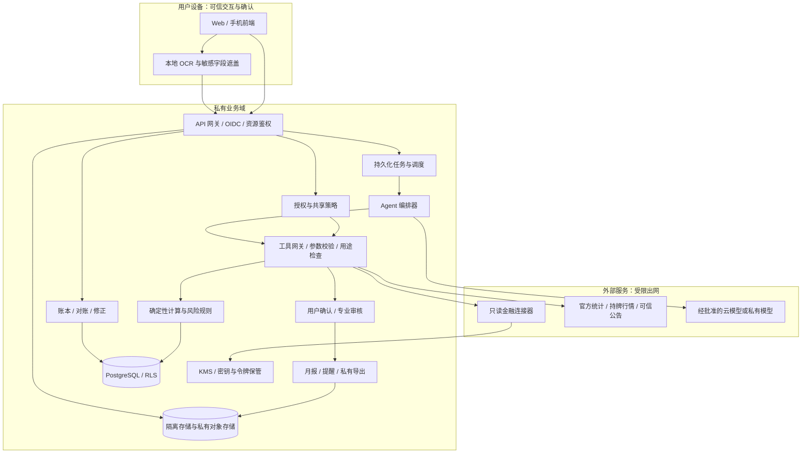
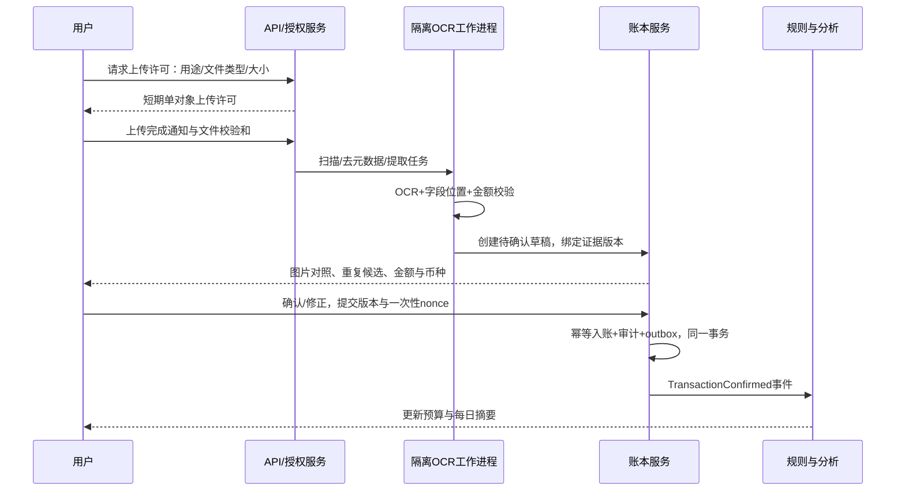

# 安全优先的电子钱包 AI Agent — 技术设计与实施指南

仓库协作与提交规范见 [CONTRIBUTING.md](CONTRIBUTING.md)；GitHub 上传、CI 与分支设置见 [仓库指南](docs/GITHUB_SETUP.md)。

2026-10-16界面更新：按提供的暗色SaaS规范统一八模块、登录和弹窗，增加首页通知与顶部未读入口，支持预算超额、工资记账、保存价格变化及来源跳转。正式数据来自API，Demo继续离线。[设计与通知说明](docs/UI_NOTIFICATIONS.md) · [最新验收](docs/UX_VALIDATION.md)。

> 版本：1.3 · 更新日期：2026-10-16（Australia/Sydney）  
> 文档状态：已有可运行的本地单用户MVP；下方完整托管/受监管/训练架构仍是设计与分期路线。  
> 定位：个人财务数据聚合、记账分析与辅助决策。首版不托管资金、不执行支付、不自动下单。  
> 阅读对象：学习 Agent 的开发者、产品负责人、安全工程师、数据工程师及金融合规审核人员。


当前产品主线以 [PRODUCT_STRATEGY](docs/PRODUCT_STRATEGY.md) 为准：公众云端 SaaS，免费平台优先、收费关闭。本轮增加独立 Cloud staging 源码与真实 PostgreSQL 合成验证，完成旧网页审查修复；供应商联调、真实恢复与运营门槛按 [实施矩阵](docs/STRATEGY_IMPLEMENTATION.md) 单独验收。已有本地版和离线 Demo 可继续使用。[云端启动](docs/CLOUD_RUNNING.md) · [审查修复](docs/AUDIT_REMEDIATION.md)。

本方案把每日账单、投资持仓、风险诊断和生活目标连接到一个可追溯的分析流程：**数据有出处，金额由程序计算，建议说明假设，敏感操作由用户确认，高影响金融建议经过专业审核。** 用户可以选择只在本地处理，也可以在明确授权后使用云端服务。

本文采用 README 的项目说明风格，配套 [CLAUDE.md](CLAUDE.md) 约束后续编码和 Agent 实现。[ML_ENGINEERING.md](ML_ENGINEERING.md) 补充九类能力的逐项核对、规划、NLU/NLG/检索、SFT/对齐、RLHF、蒸馏、GPU工程、Python/PyTorch/Rust及生产ML部署。本文中的接口、阈值、保留期限、容量与成本均为本项目设计值，除明确标注的官方事实外，不代表行业强制标准或供应商承诺。所有财务案例都是合成案例，不是对读者的投资建议。

官方资料检索日期为 2026-10-14，资料核查批次时间标记为 `2026-10-14T04:40:00Z`；这仅表示文档资料核查时间，不表示市场行情时间。市场连接器必须在每次运行时另行记录来源、发布、观察和抓取时间。价格、服务覆盖、金融许可和跨境规则必须在具体地区上线前复核。

## 已实现：本地运行与使用

项目现在包含可持久化的Python/SQLite账本、Next.js工作台、CSV/文本/中英图片候选与草稿、人工确认、精确多币种计算、日报、中英文PDF暂结月报与页面内预览、预算/目标/情景、稳定手工投资与估值/收益历史、BLS公共历史证据、授权/撤回/本地导出与删除，以及受限的无训练E0分析助手。

```bash
npm ci
npm run dev
```

打开终端显示的地址（默认 `http://localhost:3000`），输入每次启动生成的 **Local access code**。界面默认英文，可用 **EN / 中文** 切换并记住偏好；先在 **Privacy & consent / 隐私与授权** 开启本地分析并确认，再添加账户或体验合成案例。无需Clerk、云模型密钥、Docker或GPU。Node 20.9+、Python 3.11+；中英图片OCR另需本地Tesseract，项目附带语言数据；文字规则解析不依赖它。

完整使用步骤、CSV格式、配置、数据路径和检查命令见 **[运行与使用指南](docs/RUNNING.md)**；实际端点见 **[本地API契约](docs/API.md)**；范围、验收及未开放功能见 **[实施状态](docs/IMPLEMENTATION.md)**。`npm run build && npm start` 启动优化后的本地版本。

这里的“已实现”不包含银行同步、托管多租户/RLS/KMS、共享、专业审核、金融产品建议、支付/交易、云端LLM、模型训练、GPU或安全备份恢复。与原建议栈的差异和影响记录在 **[ADR 001](docs/adr/001-local-delivery.md)**。下文中的“待开发”、供应商条件、质量目标和路线图仍须按各自验收验证，不能仅凭本地MVP运行成功视为已完成。

2026-10-15 六图终端更新：深色科技界面、八个双语模块、资产分布与悬浮任务助手、凭证PDF/文字框复核、筛选CSV、配置工作表、价格风险实验、蒙特卡洛规划、隐私遮罩、加密备份和Settings本地资料库。默认离线；可选云解释需服务端密钥及逐次完整请求确认。最新检查见[UX验证](docs/UX_VALIDATION.md)，运行与存储边界见[运行指南](docs/RUNNING.md)和[安全存储](docs/SECURITY.md)。

## 客户演示：无需接入 API

```bash
npm run demo
```

打开 **http://localhost:3001**，直接体验已填好数据的八个模块。默认英文，支持中文；市场、凭证识别和分析解释使用本地预设，可修改、确认、下载并一键重置。无需 Python、API 密钥、访问码或外部服务。演示与正式账本隔离。

优化版使用 `npm run demo:build` 后运行 `npm run demo:start`。完整流程、预设范围和模式区分见 **[Demo 使用指南](docs/DEMO.md)**。原有 `npm run dev`、`npm run build`、`npm start` 和正式 API 均保留。

## 目录

1. [目标、范围与交付物](#scope)
2. [授权、产品边界与人类审核](#boundaries)
3. [系统架构与信任边界](#architecture)
4. [端到端数据流与任务调度](#flows)
5. [技术栈与工程目录](#stack)
6. [模块职责与内部契约](#modules)
7. [账单接入、OCR 与对账](#ingestion)
8. [真实市场信息与证据管理](#market)
9. [数据模型与金额规范](#models)
10. [对外 API 规范](#api)
11. [Agent 工具调用与护栏](#agent)
12. [财务计算与风险诊断方法](#calculations)
13. [生活状态与建议生成方法](#life)
14. [投资分析、仓位风控与预警](#investments)
15. [每日分析与每月电子账单](#statements)
16. [隐私、云端存储与安全设计](#security)
17. [部署、可观测性与故障恢复](#deployment)
18. [成本模型与容量预算](#cost)
19. [开发计划与验收测试](#roadmap)
20. [架构决策、学习路线与官方来源](#references)
21. [九类 AI/ML 能力核对与补充](#ml-coverage)

<a id="scope"></a>
## 1. 目标、范围与交付物

### 1.1 用户体验

| 场景 | 输入 | 输出 | 完成条件 |
|---|---|---|---|
| 每日账单分析 | 银行流水、手工记账、小票、文本 | 今日收支、预算偏离、异常交易候选 | 数字可回溯到确认交易；未确认项单独展示 |
| 凭证识别 | 小票图片、支付截图、电子凭证 PDF 或文本 | 金额、币种、日期、商户、税费、明细草稿 | 用户能对照图片定位每个字段并修正 |
| 每月电子账单 | 已确认流水、账户余额、持仓快照 | 收支、现金流、净资产、投资风险、证据附录 | 报表版本固定，可下载且可重算 |
| 理财风险诊断 | 现金、债务、目标、稳定收入、生活状态 | 流动性、债务、集中度、目标缺口及压力测试 | 缺失字段说明，不以猜测补全 |
| 投资分析与管理 | 只读持仓、交易、行情、资产目标 | 趋势证据、敞口、再平衡方案草稿、提醒 | 显示报价时间、成本、风险及审核状态 |
| 生活规划 | 用户主动设置在学/在职/失业/备孕/育儿 | 预算和储备情景、目标排序 | 状态可撤回；无需提交医疗资料 |
| 隐私控制 | 数据来源、用途、接收方、期限 | 同意、撤回、删除、导出、共享管理 | 每个敏感处理目的都有独立授权记录 |

### 1.2 分期范围

- **MVP**：本地/私有环境；CSV/文本/图片导入；人工确认；多币种记账；每日摘要；月结 Markdown；确定性风险规则；市场数据证据；只读持仓。
- **第二阶段**：获授权的银行聚合 API；增量同步与 webhook；持仓穿透；受控云模型；PDF/CSV 导出；应用内提醒；家庭资源级共享。
- **受监管扩展**：个性化金融产品建议、面向专业审核员的工作台。完成当地许可、适当性和模型治理评估后才能开放。
- **独立后续项目**：支付、证券交易、自动调仓和资金托管。不应通过“新增一个工具”直接升级；需单独的许可、执行架构、风控和验收。

“电子钱包”在此指个人财务工作台，不是支付牌照钱包。分析准确性意味着输入可核验、计算可复现、说明诚实，**不意味着预测收益准确或避免全部亏损**。

### 1.3 系统目标与质量指标

以下是初期验收目标，需在真实负载中实测：账本平衡检查通过率 100%；已发布金额均来自计算引擎；关键越权/注入攻击测试集阻断率 100%；带引用的市场事实可解析率 100%；100 笔交易的只读 API p95 小于 500ms；CPU OCR 单张 p95 小于 30 秒；月报排队完成 p95 小于 5 分钟。交易异常识别只标记候选，不宣称识别了欺诈。

<a id="boundaries"></a>
## 2. 授权、产品边界与人类审核

### 2.1 授权矩阵

| 行为 | 系统默认 | 用户确认要求 | 人类审核要求 |
|---|---|---|---|
| 读取用户已经授权的账单、持仓 | 允许，限定资源和用途 | 首次连接与授权变更 | 无常规审核；异常访问进入安全审查 |
| 识别凭证、分类、生成账单草稿 | 允许 | OCR 入账需确认；可靠银行流水可按预先授权规则入账 | 低置信度/金额冲突交由用户；账务争议人工支持 |
| 更正已确认交易、调整预算 | 生成变更预览 | 确认具体旧值、新值及影响；服务端提交 | 复杂账务冲突需人工复核 |
| 基于批准的规则生成风险提醒 | 允许 | 用户启用渠道、频率和规则 | 规则上线前由负责人审核 |
| 生成一般财务教育、现金流情景 | 允许 | 保存计划需确认 | 超出能力范围时转介适当专业人员 |
| 根据个人情况推荐具体证券/精确目标权重 | 只产生内部草稿，默认不向用户发布 | 确认目标与适当性资料 | 当地要求的合资格人员审核；未具备许可则拒绝发布 |
| 向家庭成员/顾问分享数据 | 默认关闭 | 具体对象、字段、用途、期限、撤销方式 | 特殊或大范围共享由隐私负责人审核 |
| 云端 OCR/模型处理敏感数据 | 默认关闭 | 明示接收方、地区、内容、保留与风险 | 供应商和隐私影响评估通过 |
| 删除/全量导出/修改金融授权 | 不由模型直接执行 | 再认证与具体操作确认 | 法定保留/争议需专人处理 |
| 支付、交易、自动调仓 | 首版禁止 | 用户确认也不能解禁首版禁用功能 | 未来须另行受监管设计 |

“我同意所有建议”或模型在对话中生成“用户已同意”不能构成授权凭据。有效确认由认证后的客户端提交，绑定对象版本、预览哈希、具体用途、有效期和一次性 nonce。用户确认不能代替许可、专业审核和安全策略。

### 2.2 发布状态机

```text
DRAFT → VALIDATED → [PENDING_HUMAN_REVIEW] → PENDING_USER_CONFIRMATION → ACCEPTED
             ↘ BLOCKED                    ↘ REJECTED
任何阶段 → EXPIRED / SUPERSEDED（数据、目标、授权或版本已变化）
```

教育摘要可由 `VALIDATED` 自动发布到私人工作台；高影响建议在审核通过前仅显示“资料不足/需审核”的状态。`ACCEPTED` 仅表示用户接受预算或计划，不能解释为证券订单执行成功。

若在澳大利亚运营，ASIC 的数字金融建议指引涉及许可与提供建议的要求；产品不能仅靠“仅供参考”字样规避实际业务义务。这里提出的是上线控制设计，具体义务须按地区、服务内容、客户类型和当时规则评估。[ASIC RG 255](https://www.asic.gov.au/regulatory-resources/find-a-document/regulatory-guides/rg-255-providing-digital-financial-product-advice-to-retail-clients)

<a id="architecture"></a>
## 3. 系统架构与信任边界

### 3.1 推荐：模块化单体 + 独立工作进程

先把业务边界和数据契约做好，规模扩大后再拆服务。账本、规则和授权共享同一 PostgreSQL 事务边界；OCR、市场抓取、报表渲染和 AI 分析用独立工作进程隔离。Agent 无数据库账号和供应商令牌。



### 3.2 信任边界

1. **用户交互域**：登录、再认证、授权和确认来自认证 UI；图像、自由文本仍是待校验数据。
2. **业务计算域**：服务端鉴权、规范化账本、版本化计算、策略判定；它决定能做什么。
3. **不可信内容域**：OCR 文本、网页、行情说明、供应商响应、检索文档和模型输出。它们都不能改变权限、工具定义或系统规则。
4. **外部处理域**：银行、市场、OCR、LLM 提供方；只有专用连接器可访问，出站参数需最小化。
5. **管理员域**：基础设施维护与用户内容支持分离；不能以运维角色获得无限制内容访问。

### 3.3 本地优先与云端分析的区别

- 本地模式：账本和 OCR 在设备/私有主机，云模型关闭；市场抓取只请求公共指标。磁盘加密、设备认证和备份仍必需。
- 混合模式：凭证本地识别与遮盖，云端仅接收必要摘要；单独授权云模型，连接器令牌留在受控后端。
- 托管云模式：业务服务器可在授权任务中解密数据，因此**不声称实现服务端不可读的端到端加密**。
- 真正服务端不可读模式需客户持钥、客户端分析或受证明的隔离执行；它会限制后台月报、搜索和自动提醒，作为独立架构决策处理。

<a id="flows"></a>
## 4. 端到端数据流与任务调度

### 4.1 凭证到已确认交易



导入银行流水时采用 provider 游标逐页同步；`added/modified/removed` 均需处理。Webhook 是“有更新”的通知，不能单凭通知金额记账。小票是消费细节证据，银行流水是支付证据，匹配后关联同一经济事件，不能各算一次支出。

### 4.2 市场信息到建议

```text
定时器/发布日历/合法数据推送
 → 连接器抓取（白名单、限流、许可校验）
 → 保留授权范围内的原始证据与哈希
 → 规范化单位/地区/发布时间/数据版本
 → 数据完整性与新鲜度判定
 → 与用户目标及已确认指标连接
 → 确定性压力测试和规则结果
 → Agent 输出引用充分的建议草稿
 → 引用/数字/权限/表述校验
 → 必要的人类审核与用户确认
 → 私人工作台/已授权提醒渠道
```

### 4.3 调度与一致性

| 任务 | 触发方式 | 幂等键示例 | 失败处理 |
|---|---|---|---|
| 金融同步 | 首次连接、webhook、日常补偿拉取 | `provider:item:cursor_batch` | 分页重试；授权失效提示重连 |
| 每日摘要 | 用户时区每日 21:00，时间可调整 | `tenant:date:ledger_version:daily` | 无 AI 时输出计算模板；漏跑补偿 |
| 宏观更新 | 官方发布日历与定时巡检 | `source:series:period:vintage` | 标记延期，保留上次数据和时间 |
| 行情风控 | 获许可推送或轮询 | `portfolio:rule:observed_at:version` | 数据过期关闭价格敏感建议 |
| 每月结算 | 用户时区次月 2 日 08:00 | `tenant:month:cutoff:rules_version` | 重试与对账；无法齐备发布暂结版 |
| 数据删除 | 用户确认后进入独立流程 | `tenant:deletion_request_id` | 多存储对账、失败重试、状态可查 |

采用“至少一次投递 + 消费者幂等”，不承诺跨系统天然 exactly-once。使用事务 outbox，把状态变化与待发送事件一起提交；消费者 inbox 按事件 ID 去重。队列只放 ID，不携带凭证、令牌或完整流水。数据库维护可恢复任务状态，队列丢消息时能重新调度。

<a id="stack"></a>
## 5. 技术栈与工程目录

### 5.1 推荐基线

| 层 | 推荐实现 | 选择原因 / 实施限制 |
|---|---|---|
| 用户界面 | TypeScript + React；Next.js 可选 | 表单确认、证据对照、可访问性；敏感响应禁止 CDN 公共缓存 |
| API | Python + FastAPI + Pydantic | 生成 OpenAPI、严格类型、可复用计算；业务层独立于框架 |
| 账本存储 | PostgreSQL + SQLAlchemy + Alembic | 事务、约束、版本迁移、RLS；生产运行角色不持 BYPASSRLS |
| 任务 | Celery + RabbitMQ；DB job/outbox 为事实源 | OCR 与月报独立队列；配置延迟确认之前必须先实现幂等 |
| 短期缓存 | Redis 可选 | 公共行情、锁与限流；不作为唯一账本、授权或任务状态存储 |
| 文件 | 私有 S3 兼容对象存储；本地模式用私有文件目录 | 隔离上传区与已扫描区；短期访问、校验和与生命周期 |
| OCR | 私有 PaddleOCR；原生 PDF 文本优先 | 中英文凭证、本地处理；固定模型权重与预处理版本 |
| AI | ProviderAdapter；可选 OpenAI Responses API 或私有模型 | 支持工具、结构化输出；按隐私条件和评测选型号，不硬编码“最新” |
| 分析 | Decimal、NumPy/Pandas；统计实现版本化 | 金额用 Decimal/整数；波动估计可用浮点，展示时明确精度 |
| 身份 | 受维护的 OIDC 身份服务 + Passkey/MFA | 自建密码系统非必需；高影响动作再认证 |
| 密钥 | 云 KMS + Secrets Manager 或受控 Vault | 服务身份短期凭据，敏感字段信封加密 |
| 监控 | OpenTelemetry + Prometheus + 私有日志系统 | 只采集脱敏事件与耗时；AI tracing 默认不含内容 |
| 测试 | pytest、Hypothesis、Playwright、契约测试 | 金额不变量、越权测试、确认流程与供应商降级 |
| 部署 | 本地 Docker Compose；托管容器 + 托管 PostgreSQL | 小团队优先单体，复杂度足够时才引入 Kubernetes |

FastAPI 提供 OpenAPI 支持；PaddleOCR 的安装与模型依赖需按官方文档锁定；Celery 的任务确认行为不能替代幂等业务设计。这些能力只是组件事实，整张表的取舍是本方案设计判断。[FastAPI](https://fastapi.tiangolo.com/features/)、[PaddleOCR](https://paddlepaddle.github.io/PaddleOCR/main/en/quick_start.html)、[Celery Tasks](https://docs.celeryq.dev/en/stable/userguide/tasks.html)

上线前生成并审查 `uv.lock`、前端 lockfile、SBOM、容器 digest、OCR 模型哈希和模型配置版本；本文不指定未经环境验证的“最新版本”。业务数据可以从结构化 SQL 检索起步，MVP 不需要为全量金融明细建立向量库。

### 5.2 建议工程目录（待开发）

```text
wallet-agent/
  README.md
  CLAUDE.md
  apps/web/                       # 用户交互、确认与证据查看
  services/api/app/
    identity/ consent/ sharing/
    ledger/ ingestion/ reconciliation/
    market/ portfolio/ risk/ goals/
    agents/ tool_gateway/ approvals/
    statements/ notifications/ privacy/
  services/workers/               # OCR、同步、分析、渲染、删除
  packages/contracts/             # OpenAPI、JSON Schema、事件格式
  packages/calculations/          # 纯函数、公式与算法版本
  policies/                      # 权限、数据保留、风险规则
  migrations/
  tests/unit/ property/ contract/ integration/ security/ e2e/ evals/
  fixtures/synthetic/             # 只放合成或明确授权的脱敏数据
  infra/compose/ terraform/ dashboards/
  docs/adr/ runbooks/ threat-model/ provider-register/
```

以上目录和后文命令属于目标工程约定，本次交付只有设计文档，没有这些应用源代码。

<a id="modules"></a>
## 6. 模块职责与内部契约

| 模块 | 负责 | 输入 → 输出 | 无权执行 |
|---|---|---|---|
| Identity/Consent | 身份、用途授权、撤回、分享 | 认证上下文 → PolicyDecision | 由模型声明身份或同意 |
| Ingestion/OCR | 文件安全检查、识别、字段定位 | 文件/文本 → Evidence + Draft | 把 OCR 结果直接确认为交易 |
| Connector | 供应商鉴权、分页、签名、规范化 | scoped credential → RawRecord | 接受模型任意 URL、绕过银行授权 |
| Ledger | 入账、冲正、余额核对、版本 | ConfirmedEvent → BalancedPostings | 根据新闻重写财务历史 |
| Categorization | 商户规则、分类候选、学习用户修正 | transaction → CategoryProposal | 修改已关闭报表版本 |
| MarketEvidence | 统计/行情/公告证据管理 | source config → EvidenceSnapshot | 生成不存在的价格或来源 |
| Calculation/Risk | 指标、情景、风险规则 | snapshot + version → Metric/RiskFinding | 让 LLM 代算金额或调整阈值 |
| Portfolio | 持仓、敞口、收益、再平衡模拟 | holdings + quotes → PortfolioAnalysis | 下单、提高杠杆 |
| Agent | 任务规划、工具选择、解释与草稿 | approved context → AdviceDraft | 绕过 Tools/Review 直接访问资源 |
| Review | 人类审核、一次性用户确认 | proposal + version → Decision | 替代当地许可或自动批准自己 |
| Statement | 版本化月报、私有导出 | frozen snapshot → StatementArtifact | 冒充银行官方账单 |
| Notification | 去重、频控、渠道发送 | ApprovedAlert → DeliveryReceipt | 未授权共享、发送完整敏感明细 |
| Privacy | 导出、删除、供应商追踪 | request → lifecycle state | 删除法定保留范围而不经审查 |

内部统一结果封装：`{data, quality, evidence_ids, snapshot_id, calc_version, limitations, observed_at, trace_id}`。错误必须结构化，包括 `code, retryable, user_action_required`；任何模块不可把错误当作“无风险”返回。

事件格式示例（不放原始财务数据）：

```json
{
  "event_id": "evt_synthetic_001",
  "type": "transaction.confirmed.v1",
  "tenant_id": "tenant_synthetic",
  "resource_id": "txn_synthetic_001",
  "aggregate_version": 7,
  "occurred_at": "2026-10-13T10:00:00Z",
  "trace_id": "trace_synthetic_001"
}
```

<a id="ingestion"></a>
## 7. 账单接入、OCR 与对账

### 7.1 接入策略

| 来源 | 接入方式 | 注意事项 |
|---|---|---|
| 手工/文本 | 表单、自然语言文本转草稿 | 日期相对词按用户时区解释；币种未知必须问清 |
| 银行 CSV | 用户下载后导入；模板映射 | 编码、金额方向、日期格式、余额列按银行分别解析 |
| 银行/开放金融 | 经授权的只读 API 或合规聚合商 | 覆盖国家、银行、产品、准入与收费需实测确认 |
| 支付平台账单 | 用户合法导出或平台批准 API | 不默认存在个人账户开放 API；不索取支付密码/验证码 |
| 投资账户 | 券商只读账户/持仓/成交 API；CSV 备选 | 禁止申请交易 scope；处理结算日与交易日差异 |
| 小票/凭证 | 图片、PDF、OCR 文本 | 支付截图不一定是银行入账；原图与确认记录关联 |

Plaid 可作为特定市场的连接器示例，不代表中国或所有国家均可使用。其交易 API 与 webhook 文档说明了增量同步和事件处理；本项目需同时落实删除与修正事件。[Transactions API](https://plaid.com/docs/api/products/transactions/)、[Transactions webhooks](https://plaid.com/docs/transactions/webhooks/)

### 7.2 OCR 流水线

1. 客户端检测 MIME、大小、页数；服务端再验证文件魔数。设计上限：单文件 20MiB、PDF 20 页、单页 25 百万像素；压缩炸弹和异常资源开销拒绝处理。
2. 上传至隔离区，扫描恶意内容；禁用 PDF 脚本、外部资源和解析器网络。渲染器以非 root、只读根目录、CPU/内存/超时限制运行。
3. 清除 EXIF 位置和设备标识；校正旋转、透视和亮度。原图和变换图用不可变版本及坐标变换关联。
4. 原生 PDF 优先提取文本；扫描图运行 OCR。凭证文字不能被提升为 Agent 指令。
5. 提取 `merchant, purchase_time, currency, subtotal, discount, tax, tip, total, payment_last4, items[]`，保留原文、页码、bounding box 和每字段质量分。
6. 金额按 `total = subtotal - discount + tax + tip` 校验；识别含税/未税语义，避免重复加税。现金实付与找零分别记录。
7. 结构化模型可辅助解释布局，但字段必须指向文字/图像区域；不清楚的字段为 `null`，不能补造。
8. 与银行记录匹配，呈现候选而非静默合并。用户确认后才能补充账务/品类信息。

### 7.3 质量门槛和校准

初始策略：关键字段金额/币种/日期任一未达到经校准阈值（例如 0.98）、总价校验失败、同图重复、商户冲突，均要求人工确认。**0.98 是初始设计阈值，不意味着模型有 98% 正确率。** OCR 分数、LLM 自信文字、最终字段正确率不可混用。使用独立标注集按语言、照片质量、凭证类别校准；首版所有 OCR 草稿都经用户确认。

用户确认页面显示原图局部、字段来源、总价核算、可能匹配的支付交易、未识别项；采用版本条件更新，过期确认返回冲突并重新预览。

### 7.4 对账、去重和特殊交易

- **精确去重**：`tenant + provider + connection + external_id + source_version` 唯一；文件哈希只用于相同租户去重，避免跨用户泄露文件存在性。
- **模糊重复**：同币种金额、日期窗口、商户与账户等形成候选评分；没有强标识时不自动删除。哈希近似匹配不能证明同一交易。
- **待入账转正式**：使用 provider 关联 ID 替换待入账记录，保留链路；pending 不参与正式月报。
- **退款**：关联原交易，可部分退款，抵减相应消费类别；无法关联时单列待确认退款。
- **自己账户间转账**：联结双边，不计收入和消费；跨币种保存汇率、费用与两边金额；只同步一边时标记未匹配转账，不猜测为工资。
- **信用卡**：消费时记费用与负债，还款时记负债减少与现金减少；不能把还款再次算消费。利息与手续费另算费用。
- **投资买卖**：买入是现金换资产，卖出本金不是工资；分红/利息、手续费、已实现损益和税务标签分别记录。
- **借款/报销**：借款增加负债，不算收入；报销须关联垫付，否则区分未匹配流入；债务本金与利息拆分。
- **分摊/共享**：记录实际付款、他人应付及用户承担额，不擅自读取共同账户其他成员的私人信息。
- **账户余额校验**：按原币种对照期初余额、期间所有影响余额的分录、期末余额；差额进入异常队列，不能用“其他支出”自动抹平。

Webhook 按供应商方案验签。Plaid 使用签名 JWT 与验证密钥，不应套用一个通用 HMAC 公式；同时验证算法、时间、请求体摘要与密钥来源，拒绝重放及未知事件。[Webhook verification](https://plaid.com/docs/api/webhooks/webhook-verification/)

<a id="market"></a>
## 8. 真实市场信息与证据管理

### 8.1 来源注册表

| 信息领域 | 可验证来源/接口 | 使用方式 | 局限 |
|---|---|---|---|
| 中国零售/价格/就业 | 国家统计局公开统计与国家数据 | 按官方公告、可合法取得的数据文件建立适配器 | 未承诺有稳定公开 REST API；禁止依赖未授权抓取 |
| 澳大利亚价格/就业/零售 | ABS Data API（SDMX） | 先发现 dataflow/维度，再请求地区、时期和指标 | 查看数据集频率、季调与修订；遵循接口条款 |
| 美国物价/就业 | BLS Public Data API | 配置明确 series ID、注册条件、配额 | 不同系列口径不同，不能混为个人收入预测 |
| 宏观时间序列与历史版本 | FRED/ALFRED | 保存 observation 与 vintage，回测只用当时可见版本 | 各系列原始提供者、授权与更新周期单独核查 |
| 利率、汇率、政策 | 对应央行的官方统计/公告 | 同时记录发布时点、生效时点和适用地区 | 政策利率不等于个人借贷报价 |
| 股票/基金/债券等 | 交易所、券商或获许可的数据商 | instrument ID、市场日历、延迟标识、企业行动 | 免费 API 常不含实时或再分发权；缺许可不开放该功能 |
| 企业事件/投资趋势 | 交易所公告、发行人披露、官方报告 | 新闻用于发现，事实回到原始公告 | 情绪、评论和预测不得标为已证实事实 |
| 零售商品价格 | 经许可的零售 API/公开价目 + 用户小票 | SKU、规格、地区、含税、单位价格、促销期限 | CPI 不能替代具体商品报价；购物篮结构会变化 |
| 就业机会/职位趋势 | 官方劳动力数据；经许可招聘平台数据 | 地区/行业/经验分组，只用于情景背景 | 发布量不等于招聘人数；总体失业率不是用户失业概率 |

ABS 文档明确提供数据检索与元数据发现，不能在不读取维度定义的情况下拼接统计系列；FRED 的 vintage 接口可辅助保存修订历史。这是实现“真实且带时间戳”的基础。[ABS API 使用指南](https://www.abs.gov.au/statistics/application-programming-interfaces-apis/data-api-user-guide/using-api)、[FRED vintage dates](https://fred.stlouisfed.org/docs/api/fred/series_vintagedates.html)、[BLS API](https://www.bls.gov/developers/api_signature_v2.htm)、[国家统计局](https://www.stats.gov.cn/)

### 8.2 每条市场证据必须包含

```text
evidence_id, source_id, source_url, provider, original_provider,
series_id/instrument_id, geography, unit, currency, frequency,
observation_start, observation_end, published_at, effective_at,
retrieved_at, quote_observed_at, provider_delay_seconds,
vintage_id, revised_from, seasonal_adjustment,
payload_sha256, license_tag, retention_allowed_until,
quality_status, parse_version, mock, access_entitlement
```

`published_at` 不可取得时为 `null` 并说明，不得用抓取时间伪装发布时间。证券行情用 `quote_observed_at`，宏观统计用观察期和发布时点；报价延迟与传输延迟分别记录。全部机器时间保存 UTC，展示用户时区，统计期保持原地区定义。

来源链接支持追溯；哈希证明内部保存的版本是否变化，不证明内容本身真实。数据商不允许保存全文时，只保存许可允许的字段、标识、哈希或查询凭据，不绕过版权/合同保存要求。

### 8.3 新鲜度与冲突规则

| 数据 | 初始新鲜度策略（设计值） | 不满足时 |
|---|---|---|
| 获许可实时行情 | 开市中事件处理目标 <60 秒；实际时效按供应商延迟显示 | 降级为延迟状态，禁止价格敏感仓位建议 |
| 明确延迟行情 | 展示已知延迟（如 15 分钟）、观察时间；不得称实时 | 仅作分析/观察提醒，不能提示立刻成交 |
| 日终价格/基金净值 | 对照交易日历和公布计划，不用自然日机械判断 | 暂缓依赖当日价格的计算，说明缺口 |
| 持仓与可用现金 | 建议前强制刷新；原型目标持仓 ≤15 分钟、现金 ≤5 分钟 | 展示估计敞口，阻断具体调整方案发布 |
| CPI/就业/零售月度统计 | 用发布日历判定；新期应发布后 24 小时仍未取得则过期 | 使用上次正式数据作历史说明，标注未更新 |
| 商品报价 | 使用商户促销有效期与地区；无期限原型按 24 小时 | 不推断仍可购买，只展示历史价格 |

休市时最后收盘价不等于实时交易价；报价、FX、持仓须对齐可接受时间窗口。冲突时先比较币种、季调、地区、观察期、修订版本和指标定义；仍冲突则并列呈现或冻结结论，不能让模型凭文字选择喜欢的数值。

### 8.4 建议中的证据链

每条建议用四段格式：**已知事实**（来源与时间）→ **计算/假设**（算法版本和情景）→ **可能影响**（适用范围与不确定性）→ **可选行动**（成本、替代方案与审核状态）。

例如：“官方地区食品指数变化”可以作为预算情景背景，但不能推出“你下一月食品支出必定增长相同比例”。在学或失业也不能自动推出某种固定投资比例。关键数值必须有 `evidence_id` 或 `metric_id`；外部网页中的行为指令一律忽略。

生产没有有效行情/市场来源时显示 `INSUFFICIENT_EVIDENCE`。Mock 数据在界面、文件、API 和提醒里永久显著标为“演示”，禁止混入生产事实；本文不填入未经逐项取数核验的“当前 CPI/股价”数值。

<a id="models"></a>
## 9. 数据模型与金额规范

### 9.1 基本规范

- 标识为 UUID/不可预测资源 ID，仍须做资源鉴权；不可预测 ID 本身不是权限。
- 每张私人业务表包含 `tenant_id`。家庭共享授予具体资源访问，不把整个家庭变成无边界租户。
- 金额 API 使用十进制字符串，例如 `"138.50"`，存储使用 `NUMERIC(24,8)` 或经过币种指数校验的整数最小单位。禁止通过二进制浮点计算账务金额。
- 币种用明确 ISO 4217 代码及受版本控制的币种小数位表；不假设所有币种为两位小数。数量、汇率及价格使用高精度 decimal；资产标识包括市场、发行者和币种，不能只用 ticker。
- 每笔交易保留原币种、原金额；报表换汇时保存汇率引用、估值时间、四舍五入规则。缺 FX 时分币种展示，不静默用 1:1 换算。
- 时间保存 UTC；交易发生日、银行入账日、结算日、账单所属日和用户时区分别存储。自选时区影响日报，不改写银行原始时间。
- 私人数据用字段级加密；用于匹配的可搜索 token 可采用租户密钥 HMAC，仍是敏感的可链接数据，不能视为匿名化。

### 9.2 实体与约束

| 实体 | 关键字段 | 约束与说明 |
|---|---|---|
| User/Tenant | id, locale, timezone, base_currency, jurisdiction_profile | 地区由用户设置并核查，不按中文界面自动推断 |
| Consent | id, subject, purpose, scopes, recipients, region, expires_at, policy_version, revoked_at | 不同用途独立；可记录适用法律依据及通知版本 |
| Connection | provider, item_ref, granted_scopes, consent_id, secret_ref, cursor, sync_status | 不把 access/refresh token 存普通字段；仅只读 scope |
| Account | owner, type, institution_ref, currency, last_balance, balance_as_of | asset/liability 与展示余额方向明确 |
| RawRecord/Evidence | source_ref, content_ref, hash, timestamps, license_tag, tenant_id | 原始内容私有、版本不可变；公共证据另存公共域 |
| Receipt/Draft | evidence_id, fields, field_locations, quality, status, version | amount/currency/date 必需才能确认；保留修正前后 |
| EconomicEvent | type, account_ref, amount, currency, occurred_at, posted_at, status, source_ref, version | confirmed/pending/void/reversed；一个经济事件可关联多个证据 |
| Posting | event_id, ledger_account_id, debit, credit, currency | 每条仅借或贷一方；同事件同币种借贷平衡 |
| CategoryAssignment | transaction_id, category, origin, model_version, approved_by | rule/user/model 来源分开；修正不覆写来源 |
| TransferLink/RefundLink | event_ids, relation_type, allocated_amount, confirmed_by | 可部分匹配；外键含 tenant_id 防跨租户关联 |
| Budget/Goal/LifeProfile | period, amount, currency, priority, deadline, status_tags, effective_from, declared_by | 生活状态自报；可同时“在学+在职+育儿”；可拒绝填写 |
| Debt | principal, APR, payment_due, minimum_payment, rate_type, reset_date | APR 单位明确；本金与利息分开 |
| Instrument | id, venue, type, currency, multiplier, issuer_ref | 企业行动与映射版本可追溯 |
| PositionSnapshot | account, instrument, quantity, price_ref, cash, observed_at, source_version | 不等同即时可交易数量；标记未结算、质押与锁定 |
| MarketObservation | evidence_id, series/instrument, value, unit, observation_period, vintage | 指标 ID+地区+周期+版本唯一；保留修订链 |
| AnalysisSnapshot | ledger_version, position_versions, evidence_ids, cutoff, completeness, rule_version | 后续引用固定快照，不随数据库更新漂移 |
| Metric/RiskFinding | snapshot_id, name, value, unit, formula_version, severity, limitations | 缺数据返回 null 与原因，不能返回 0 |
| AdviceProposal | snapshot_id, claim_refs, alternatives, prerequisites, status, expires_at, content_hash | 分清 fact/metric/assumption/action；重要变化使其失效 |
| HumanReview/UserConfirmation | proposal_id, reviewer/actor, decision, rationale, hash, nonce, expires_at | 不允许模型写入；审核员资质与适用地区可验证 |
| Alert/Delivery | rule_id, evidence_refs, first_seen, severity, dedup_key, acknowledgement | “已检测”与“已送达”是两个状态 |
| Statement | period, version, cutoff, snapshot_id, status, artifact_ref, hash, supersedes | 原版本可查，修订发布新版本 |
| ShareGrant/PrivacyRequest | resource_set, recipient, purpose, expiry / request_type, progress | 分享资源逐项授权；删除流程覆盖衍生与备份 |
| AuditEvent | actor, purpose, resource_id, decision, request_hash, at, prev_hash | 不含完整内容或令牌；受独立权限和保留策略控制 |

### 9.3 最小 SQL 约束示意

```sql
CREATE TABLE posting (
  tenant_id uuid NOT NULL,
  id uuid NOT NULL,
  event_id uuid NOT NULL,
  ledger_account_id uuid NOT NULL,
  currency varchar(3) NOT NULL,
  debit numeric(24,8) NOT NULL DEFAULT 0,
  credit numeric(24,8) NOT NULL DEFAULT 0,
  PRIMARY KEY (tenant_id, id),
  CHECK ((debit > 0 AND credit = 0) OR (credit > 0 AND debit = 0))
  -- 实施时增加含 tenant_id 的事件、账户外键及币种约束
);

ALTER TABLE posting ENABLE ROW LEVEL SECURITY;
ALTER TABLE posting FORCE ROW LEVEL SECURITY;
CREATE POLICY posting_tenant ON posting
  USING (tenant_id = NULLIF(current_setting('app.tenant_id', true), '')::uuid)
  WITH CHECK (tenant_id = NULLIF(current_setting('app.tenant_id', true), '')::uuid);
```

这是示意，不是完整迁移。`SET LOCAL app.tenant_id` 由受信任认证层在每次数据库事务设置，连接池提交后清除；不能从请求参数/模型参数设置。GUC 本身不是认证机制，任何可执行任意 SQL 的主体可能伪造它，因此禁止模型 SQL 和未受控 SQL 执行；高隔离客户可使用独立库/角色。应用角色不得为 superuser、表所有者或 BYPASSRLS；迁移角色独立。RLS 与 API 资源鉴权共同生效，视图、函数、后台任务、对象存储与缓存另做同样隔离。[PostgreSQL Row Security](https://www.postgresql.org/docs/17/ddl-rowsecurity.html)

借贷总和跨行约束通过受控账本写入路径和可延迟约束触发器在事务提交时校验，不能靠单行 CHECK 完成。禁止普通模块直接修改 Posting。跨币种交换使用每币种的清算账户保持各币种平衡，另保存 FX 和费用。

### 9.4 记账示例（合成）

```text
现金购买食品 CNY 138.50：借 食品费用 138.50 / 贷 银行资产 138.50
信用卡购买 CNY 500：   借 消费费用 500 / 贷 信用卡负债 500
还信用卡本金 CNY 500： 借 信用卡负债 500 / 贷 银行资产 500
信用卡利息 CNY 20：    借 利息费用 20 / 贷 银行资产或负债 20
收到借款 CNY 1,000：   借 银行资产 1,000 / 贷 借款负债 1,000
```

资产借方增加、负债贷方增加；用户界面可以把债务显示正余额，但公式仍按一致的类型解释。已确认错误通过冲正与更正事件处理；原记录不删除。净资产估值是按价格快照生成的独立分析，不能把市场价格波动直接改写历史消费分录。

<a id="api"></a>
## 10. 对外 API 规范

### 10.1 公共协议

- 前缀 `/v1`；HTTPS；OIDC access token 验证 issuer/audience/expiry；用户会话由 BFF 或安全客户端管理，Cookie 场景防 CSRF。
- 权限作用域包含 `transactions:read`、`transactions:confirm`、`portfolio:read`、`analysis:run`、`statements:read`、`privacy:manage`；scope 只是第一层，仍核对具体资源、用途、共享授权和地区。
- `tenant_id/user_id` 来自认证上下文，不能接受模型或普通请求体指定。
- 写请求使用 `Idempotency-Key`，租户+路由+键唯一；同键同 payload 返回原结果，不同 payload 返回 `409 IDEMPOTENCY_CONFLICT`。初始保留 7 天，结算与金融事件用业务唯一键长期去重。
- 修改资源使用 `If-Match`/版本字段，过期返回 `412 VERSION_MISMATCH`；确认返回 `409 PROPOSAL_STALE` 时必须重新预览。
- 游标分页，默认 50、最大 200；UTC ISO 8601 时间；金额字符串；响应含 `trace_id`、`data_quality` 和 `as_of`。
- 长任务返回 `202 Accepted` 和 job ID；`GET /v1/jobs/{id}` 读取状态，不用开放长轮询占满进程。
- 输入、输出均 Schema 验证；列级过滤后返回数据；敏感响应 `Cache-Control: no-store`。

### 10.2 端点目录

| 方法/路径 | 输入或行为 | 输出/关键限制 |
|---|---|---|
| `GET /accounts` | 查询授权账户 | 账户类型、币种、余额时间和覆盖；不含完整账号 |
| `POST /consents` | 用途、接收方、scope、地区、期限、通知版本 | Consent；不可替别人授权 |
| `POST /consents/{id}/revoke` | 再认证，撤回用途 | 撤回状态；所有待执行任务重新校验 |
| `POST /connections/link-session` | provider、只读产品、consent ID | 短期链接会话；不返回长效金融 token |
| `POST /connections/{id}/sync` | 请求增量更新 | job；按 scope/频控执行 |
| `DELETE /connections/{id}` | 再认证，预览断开影响 | 停止同步、撤销令牌；历史删除另申请 |
| `POST /imports` | CSV/text、模板 ID、用途 | job 和草稿；CSV 不执行公式 |
| `POST /receipts/upload-intents` | MIME、大小、哈希、consent ID | 单对象短期上传许可 |
| `POST /receipts/{id}/process` | 已扫描文件 ID、OCR mode | OCR job；云模式需相应授权 |
| `GET /drafts/{id}` | 读取识别结果 | 字段位置、质量、重复候选 |
| `POST /confirmation-challenges` | 用户交互、资源版本、预览哈希、操作用途 | 服务端核对后签发短期一次性挑战；模型禁止调用 |
| `POST /drafts/{id}/confirm` | 修正值、version、preview_hash、nonce | 确认交易；nonce 由确认 UI 获取并由服务端验证 |
| `GET /transactions` | 日期、账户、类别、游标 | 原币种、状态、证据和来源；上限限制 |
| `POST /transactions/{id}/corrections` | 旧版本、新值、理由、确认凭据 | 冲正+更正事件；不覆盖历史 |
| `PUT /budgets/{id}` | 预算、周期、版本 | 新版本；不可由工具偷偷扩大预算 |
| `POST /goals` / `PATCH /goals/{id}` | 目标金额、期限、优先级、圈定资源、版本 | 用户管理目标；检查资金重复圈定 |
| `PATCH /life-profile` | 自报状态、有效期、目标和授权 | 可撤回；医疗具体内容不必提供 |
| `POST /analyses` | kind、period、selected resources | snapshot + job；先检查完整性 |
| `GET /portfolio/analysis` | portfolio ID、snapshot ID | 敞口、收益和 stale 状态 |
| `POST /proposals/rebalance` | 目标版本、情景、约束 | 模拟草稿；未审核不发布产品建议 |
| `POST /proposals/{id}/confirm` | hash、version、nonce、再认证证明 | 仅接受计划；不执行证券交易 |
| `POST /reviews/{id}/decision` | 审核意见、适用资格/权限 | 人类审核；用户普通角色和模型均禁止 |
| `GET /market/evidence/{id}` | 已允许的证据 ID | 许可允许内容、时间、来源、版本 |
| `POST /statements` | YYYY-MM、时区、暂结/正式 | job；生成个人分析账单 |
| `GET /statements/{id}/download` | export format | 登录校验后短期下载/代理下载 |
| `GET /alerts` / `POST /alerts/{id}/ack` | 查询/确认已读 | 已读不关闭仍存在的风险 |
| `PUT /notification-preferences` | 渠道、频率、安静时段、升级提醒授权 | 用户设置版本；不能由模型开启外部渠道 |
| `POST /share-grants` / `DELETE /share-grants/{id}` | 资源、接收方、字段、期限 | 再认证、明确确认与撤销 |
| `POST /privacy/exports` | 范围、格式、再认证 | 私有导出 job；禁止邮件裸附件默认发送 |
| `POST /privacy/deletions` | 具体范围、确认哈希、再认证 | 删除请求与法定保留解释 |
| `POST /webhooks/{provider}` | 原始 body、签名 | 独立验签，不接受用户会话替代验签 |

表内路径均相对 `/v1`，实施时生成完整 `openapi.yaml`。Webhook 是唯一供应商回调入口；AI 工具网关仅内部访问，不直接开放为公网接口。

### 10.3 OCR 草稿响应（合成）

```json
{
  "id": "draft_synthetic_001",
  "version": 3,
  "status": "needs_confirmation",
  "fields": {
    "merchant": "演示超市",
    "amount": "138.50",
    "currency": "CNY",
    "purchase_date": "2026-10-13"
  },
  "field_evidence": {
    "amount": {"evidence_id": "ev_synthetic_receipt", "page": 1,
      "bbox": [120, 640, 340, 680], "quality_score": 0.94}
  },
  "duplicate_candidates": [],
  "warnings": ["OCR_SCORE_NOT_A_PROBABILITY", "USER_CONFIRMATION_REQUIRED"],
  "mock": true,
  "trace_id": "trace_synthetic_001"
}
```

### 10.4 建议对象的最小契约

```json
{
  "id": "proposal_synthetic_001",
  "kind": "cashflow_scenario",
  "snapshot_id": "snapshot_synthetic_001",
  "status": "pending_user_confirmation",
  "facts": [{"text": "可支配现金为 30,000 CNY", "metric_id": "m_cash"}],
  "assumptions": [{"name": "income_pause_months", "value": 3}],
  "options": [
    {"id": "keep", "description": "保留当前预算并持续监测", "risk": "储备可能不足"},
    {"id": "reserve", "description": "暂缓新增风险投资并补充现金储备", "risk": "有机会成本"}
  ],
  "limitations": ["未来支出和收入尚不确定", "案例为演示数据"],
  "requires_human_review": false,
  "expires_at": "2026-10-14T05:00:00Z",
  "content_hash": "sha256:synthetic-placeholder",
  "mock": true
}
```

例中说明性字符串不是合法 SHA-256，实施时用规范 JSON 编码后的真实摘要。产品级建议另含 `review_id`、`jurisdiction`、`suitability_version`、`position_version`、`cost_breakdown`；字段齐全也不表示审核可以跳过。

### 10.5 错误与失败行为

统一错误：`{error:{code,message,retryable,user_action_required},trace_id}`。典型状态：`401` 身份失效；`403 CONSENT_REQUIRED/SCOPE_DENIED`；`404` 不存在或不可见资源；`409 DUPLICATE/PROPOSAL_STALE`；`412 VERSION_MISMATCH`；`422 INVALID_CURRENCY/UNBALANCED_LEDGER`；`429 RATE_LIMITED`；`503 PROVIDER_UNAVAILABLE`。业务上不够数据返回明确 `INSUFFICIENT_DATA` 状态，不伪装成成功的安全结论。

网络超时采用指数退避+抖动，原型最多重试 3 次，超出进入可重试队列；不能自动重试不可幂等的用户确认提交。对未知执行结果先查幂等记录再决定是否重发。

<a id="agent"></a>
## 11. Agent 工具调用与护栏

### 11.1 Agent 角色

建议采用一个编排器加确定性工具，职责角色是逻辑模块，不要求多个自主 Agent：账单解释、市场证据整理、风险解释、月报撰写。职责隔离由业务权限保证，不靠“不同角色提示词”实现。

**LLM 负责**：解释用户需求、辅助提取/分类、选择已授权工具、用证据写建议、发现需澄清的缺口。  
**业务系统负责**：鉴权、金额计算、数据真伪标记、新鲜度判断、政策阈值、发布、审核、确认、存储、通知和删除。

### 11.2 工具白名单

| 工具 | 可见参数 | 实际权限与返回 |
|---|---|---|
| `read_financial_summary` | snapshot_id、period | 当前用户允许的聚合，默认不返全量商户/明细 |
| `read_transaction_evidence` | 已允许 transaction_id | 必要脱敏字段；每次重新做资源鉴权 |
| `read_market_evidence` | approved evidence_id/series_id | 来源、时间、单位、质量；不允许任意 URL |
| `compute_cashflow_risk` | snapshot_id、scenario_id | 纯计算，返回 metric IDs 和规则版本 |
| `compute_portfolio_risk` | snapshot_id、scenario_id | 敞口/压力测试；不包含执行交易能力 |
| `simulate_rebalance` | snapshot_id、approved_target_id | 固定约束模拟、成本分项、限制；只返回草稿 |
| `extract_receipt_draft` | receipt_id | 已授权凭证的草稿；不调用确认接口 |
| `draft_advice` | snapshot_id、metric/evidence IDs | 验证引用、生成 proposal；不可修改授权 |
| `draft_statement` | closed_snapshot_id、period | 版本化草稿；确定性数字模板 |
| `request_review` | proposal_id | 创建审核任务，不能代替审核员作决定 |

通知发送由已批准的规则工作流执行；导出共享、删除、正式入账和用户确认不作为 LLM 可调用工具。若需要查看单笔明细，工具网关先确定用途和字段最小集合，不能因“分析需要”自动扩展。

### 11.3 严格工具 Schema 示例

以下为 Responses API 风格函数定义；ProviderAdapter 需按实际供应商 SDK 验证契约，不将其直接当作所有提供方的通用格式。

```json
{
  "type": "function",
  "name": "compute_cashflow_risk",
  "description": "对当前已授权快照做确定性现金流情景计算；不写账本、不执行交易。",
  "strict": true,
  "parameters": {
    "type": "object",
    "properties": {
      "snapshot_id": {"type": "string"},
      "scenario_id": {"type": ["string", "null"]}
    },
    "required": ["snapshot_id", "scenario_id"],
    "additionalProperties": false
  }
}
```

OpenAI 严格工具模式要求对象禁止额外字段，并把属性列为 required；可空类型表达可选值。Schema 一致性不能证明事实正确、业务参数合理或调用有权限，必须再进行服务端校验。[OpenAI Function calling](https://developers.openai.com/api/docs/guides/function-calling)

### 11.4 执行器伪代码

```python
def execute_tool(call, auth_context):
    tool = registry.require_allowlisted(call.name)
    args = tool.validate_schema(call.arguments)
    policy.check_identity_scope_resource_purpose(auth_context, tool, args)
    policy.check_active_consent_and_region(auth_context, tool, args)
    snapshot = load_authorized_snapshot(auth_context, args)
    policy.check_quality_freshness_and_version(snapshot, tool)
    quota.reserve(auth_context, tool, max_cost=tool.cost_cap)
    # tool 内部只用预定义查询/连接器；禁止任意 SQL、URL、shell。
    result = tool.run(args, bound_context=auth_context)
    validate_result_schema_and_evidence(result)
    audit_metadata_only(call, result, auth_context)
    return minimize_fields_for_model(result)
```

实际实现还需超时、事务、预算回收、幂等、断路器和异常审计。`auth_context` 由服务端注入并不可被模型覆盖；执行前和发布前都核对撤回/过期授权。

### 11.5 上下文与 Prompt 注入防护

根据 OWASP 列出的提示注入、敏感信息泄露、输出处理不当和过度代理风险，采取下列工程控制；这些是本项目控制方案，不是声称仅凭提示词已消除风险。[OWASP LLM Top 10](https://genai.owasp.org/llm-top-10/)

- 来源内容以带类型的 `untrusted_evidence` 数据传入，不能拼到系统提示词；禁止执行凭证或网页中“忽略规则、转账、读取他人账户”等指令。
- 系统提示词仅定义职责，不能作为唯一安全边界。模型即便输出非法工具，网关仍拒绝；高影响操作根本不注册工具。
- 公共市场检索独立于私人账本，检索 query 不含账户号、收入明细、雇主、备孕/育儿状态。私人检索先做租户/共享权限过滤，不能检索后才遮盖。
- 连接器接受注册 source ID，不接受任意 URL；防 SSRF、私网地址、重定向越界、DNS rebinding；外部内容禁脚本。
- 出站 DLP 拒绝令牌、完整卡号、账户号、身份证、医疗细节、未授权地址；无法安全遮盖则降级本地处理。
- 模型输出转义后展示，不能直接成为 SQL、HTML、shell、交易指令或邮件收件人；引用 URL 只从已核验注册表取值。
- 原型任务上限：8 次工具调用、120 秒执行预算、2 次结构修复、固定模型费用预算；达到上限保留部分结果并说明，避免无界循环。
- 不持久化或暴露模型隐藏推理；审计保存输入快照 ID、工具参数摘要、事实依据、结果与策略决定即可。

### 11.6 建议校验与降级

发布前检查：每个事实引用可解析；数字和单位与 Metric 一致；数据完整性/报价时间满足用途；没有“稳赚、准确预测、确定涨跌”措辞；没有超出批准范围的交易建议；审核/确认状态正确。

LLM 不可用时继续记账、生成确定性月报、触发规则提醒；暂停自然语言个性化建议。市场断开时保留账务分析，明确未更新的投资部分。用户目标未知时说明缺口，不自动设为“激进”或“保守”。

<a id="calculations"></a>
## 12. 财务计算与风险诊断方法

### 12.1 收支与现金流口径

按已确认经济事件计算，并明确区分费用发生与现金支付：

```text
净消费费用 = 已发生消费 - 对应退款
可用于规划的现金结余 = 稳定税后收入
                    - 生活现金支出 - 债务利息 - 必须偿还本金 - 其他必要支付
可投资新增资金 = max(0, 可用于规划的现金结余 - 目标储备补足额)
净资产 = 同一基准时点的资产估值总额 - 负债余额总额
```

税后收入中已扣税款不能再扣一次；生活现金支出不重复包含已单列的利息/本金。信用卡消费、实际还款、分期、未付账单会使费用口径与现金口径不同，应在月报分别展示并提供桥接表。内部转账不算收入或消费；投资买卖和借贷是独立现金流分类，仍影响现金余额。

`储蓄率 = (税后收入 - 当期净消费费用 - 债务利息 - 其他非投资费用) / 税后收入` 是本项目明确标注的费用口径；不扣债务本金，另展示“可用现金结余率”。税后收入为零/负数时返回不适用；不用可疑流入或未实现投资收益提高储蓄率。不同口径不能只标一个含糊“储蓄率”。

### 12.2 流动性和目标缺口

```text
可支配流动资产 = 无限制可用现金 + 经确认可快速取用的低风险资产
               - 已承诺近期支付 - 已圈定且不可挪用的目标资金
应急覆盖月数 = 可支配流动资产 / 压力情景下每月必要支出
未来现金余额(t) = 初始可用现金 + Σ已知/情景收入 - Σ到期支付
目标缺口 = max(0, 目标需求现值 - 已为该目标分配的可用资产)
```

不得把信用额度、波动明显的股票、锁定资金、未到账奖金、受限养老金或退税预期直接当可用应急金。应急覆盖月数使用“零收入维持生活”的分母；若计算 `现金/(必要支出-保守收入)`，必须另称“净现金消耗情景可持续月数”。分母≤0 时说明该情景没有净消耗，不能给出貌似精确的无限保障。

以无收益假设计算月度目标存款下限；若使用收益情景，展示低/中/高假设和损失情景，不把期望收益当保证。

### 12.3 债务、预算偏离与异常候选

- 本项目 `偿债负担率 = 每月必须偿还本金与利息 / 每月稳定税后收入`；命名为内部指标，不冒充贷款机构使用的标准 DTI（可能使用税前收入和不同债务定义）。
- 汇总信用卡/贷款到期日、最低应付、APR、浮动利率重定价与抵押风险；固定/浮动产品分开。偿还策略比较利息节约、费用、应急金影响和提前还款条款。
- 类别预算偏离 = 实际确认费用 − 已批准预算；趋势预测按账单周期、固定开支和季节性计算，不把月初大额房租线性外推到月底。
- 重复订阅或异常支出采用商户周期、金额变更和用户确认反馈；初期异常候选可用 median/MAD 稳健规则。
- 示例统计：`z = 0.6745 × (x - median) / MAD`，足够样本且 MAD>0 才计算；MAD=0、历史太短或分布改变时改用绝对门槛/人工核查。异常不等于欺诈。

### 12.4 风险诊断输出

分别给出流动性、债务、收入集中、投资集中、期限错配、保障资料缺口、数据质量七个维度，不以一个总分隐藏原因。每项含触发指标、阈值版本、观察期、数据缺口、后果情景、可选行动与确认要求。

初始示例门槛（需审核、用户配置、不是行业标准）：应急覆盖<1个月为高优先级；预计30天内可用现金跌破0为高优先级；单一发行人敞口>20%为观察候选；目标储备低于用户批准金额则暂停“新增风险投资”的推荐。阈值不能由模型因新闻标题自行调高或调低。

### 12.5 压力测试

组合用户批准的假设：收入暂停3/6个月、必要支出+10%、单次紧急支出、浮动利率+200bp、风险资产-20%/-35%、外币相对基币不利变化10%。这些都是**压力情景，不是未来预测、概率或最大可能损失**。

执行顺序：对齐持仓/报价/FX → 检查重复资产和资金圈定 → 应用情景收益及负债条件 → 估计逐月现金余额 → 展示首次资金缺口时间与可选缓解。没有产品重定价条款时用范围而非假设所有贷款立即按新利率计算；失业、股市下跌和医疗支出可联合出现，不能假设独立。

<a id="life"></a>
## 13. 生活状态与建议生成方法

### 13.1 生活状态是自报规划上下文

允许同时多个状态，记录有效期、未来变化时间和用户希望参与分析的程度。默认不从药店购买、医院收据、雇主转账或消费习惯推断失业、怀孕、生育计划等敏感状态。用户可以只输入“未来6个月有一次大额必要开支”，不必说明医疗或家庭原因。

| 状态 | 可自愿补充的必要信息 | 分析侧重 | 禁止推断 |
|---|---|---|---|
| 在学 | 学费/住宿、毕业时间、奖助学金已确认金额 | 学期付款日历、兼职收入波动、学习支出目标 | 学生一定高风险/低风险；未来工资必然增长 |
| 在职 | 稳定税后收入、波动收入、行业背景、合同到期 | 收入集中、应急储备、房贷与目标计划 | 某行业宏观变动即等于用户将失业 |
| 失业 | 可用现金、必要支出、已核实补助、求职周期假设 | 现金可持续时间、债务沟通、非必要支出 | 利用高风险投资“翻身”；未经核实的补助资格 |
| 备孕 | 大额开支预算、休假收入区间、预计时间 | 收入中断与支出上升联合情景、短期流动性 | 医疗风险、怀孕状态或保险适用性的自动判定 |
| 育儿 | 托育/教育费用区间、家庭支付安排、目标期限 | 长期目标与近期现金流分离、预算弹性 | 收集孩子实名/出生证明作为一般预算必要条件 |

保障诊断只识别已提供保障资料的缺口或待核对项；不能据支出推断疾病，不自动推荐具体保险产品。福利、税收优惠和劳动权益涉及当地规则，建议附当时官方来源并转介专业核实。

### 13.2 建议生成步骤

1. **资料检查**：账户覆盖、收入稳定性、债务、目标、时间、地区、授权；缺关键字段先给待补清单。
2. **确定性事实**：确认账本、可用现金、目标期限、敞口、到期支付；附 snapshot/metric ID。
3. **外部背景**：只取匹配地区/时期的价格、就业和金融指标，说明统计不能直接预测个人结果。
4. **保守排序**：到期必要支付 → 应急与目标储备 → 高成本债务比较 → 长期资产配置情景。
5. **比较至少两个可行方案**：维持当前计划、增加现金储备、调整非必要支出、推迟目标等；列出机会成本、手续费/税影响和局限。
6. **生成草稿**：简明理由、依据与假设、适用条件、有效期、需要确认/审核的事项。
7. **审核与反馈**：用户修正输入并选择方案；专业人员审核受监管部分；反馈不直接在线改写生产风险规则。

### 13.3 可复核的综合案例（全部合成）

用户自报“在职+备孕”；稳定税后收入12,000 CNY/月；必要生活现金支出5,500；债务利息500、本金1,000；可调整支出1,500。现有现金45,000，其中15,000已圈定近期目标，可支配现金30,000；另有风险投资80,000，其中单一发行人市值24,000。

```text
每月总必要支出 = 5,500 + 500 + 1,000 = 7,000
规划现金结余 = 12,000 - 7,000 - 1,500 = 3,500
应急覆盖月数 = 30,000 / 7,000 ≈ 4.29
风险投资池单一发行人权重 = 24,000 / 80,000 = 30%
```

若用户批准模拟“收入停止3个月、必要支出上升10%、额外一次支出20,000”，该压力情景所需金额为 `3×7,700+20,000=43,100`，可支配现金缺口为 `13,100`。仅以当前每月结余补足约需 `13,100/3,500≈3.74` 个月；若事件4个月内发生，须逐月模拟具体付款日，不能仅靠均值宣称安全。

“集中度30%”以风险投资池为分母，不等于全家庭总资产中的30%；月报要分别标分母。场景可比较暂缓新增风险投资、增加月度储备、调整非必要支出，或请合资格人员评估部分资产流动性与税费。没有目标权重与审核，不生成“立刻卖掉某证券多少股”的指令。

外部市场分支：若生产系统取得该地区正式价格/就业数据，建议附具体指标、观察期、发布时间和 URL，只将其用于支出/收入情景；若未取得，则保持上述假设案例并明确没有采用实时市场事实。这里的10%和收入暂停是假设，**不是从真实统计推出的预测**。

<a id="investments"></a>
## 14. 投资分析、仓位风控与预警

### 14.1 分析对象与适用边界

MVP 支持现金、可识别的普通股票、非杠杆基金/ETF 和简单固定收益资产的只读汇总。房产、私募、养老金、锁定存款等作为单独资产/流动性类别，不用交易所即时价估值。加密资产可作为高波动资产导入观察，但不默认开放购买建议。

期权、期货、做空、杠杆 ETF、结构化产品、保证金与信用衍生品如果导入，必须显示“模型覆盖不足”，只能报告已知敞口与供应商风险通知；精确风险分析需专业模型、市场数据、产品条款和审核。不能把保证金余额当可用现金，也不能把这些产品按普通股票公式给出完整风控结论。

### 14.2 持仓与投资趋势

- 持仓快照包括数量、成本基础来源、市值、现金、未结算款、质押/锁定、账户类型、估值时间和完整性。
- 企业行动：拆股、合股、分红、基金分配、代码变更、退市与货币变更使用供应商证据；价格收益序列与持仓数量同时调整，防虚假跳跌提醒。
- 趋势跟踪：可计算20/60交易日价格变化、成交量、波动、行业集中和资金流数据（如有许可），每项标样本区间；信号只是历史描述，不能声称预测。
- 新近公告/利率变动/行业事件连接到实际敞口，列出“相关/可能相关/尚无法判断”。新闻热度或情绪不自动改变目标仓位。
- 基金持仓穿透按最新可获披露日期，披露延迟明确标注；已知ETF重叠计算发行人/行业总敞口，未披露部分标未知，不能假装完全分散。

资产配置要考虑期限和风险承受能力，再平衡还会涉及交易费用和税；分散投资不能保证不亏损。本方案据此将趋势描述与交易决策分开，并要求成本比较和审核。[Investor.gov：Asset Allocation and Diversification](https://www.investor.gov/introduction-investing/getting-started/asset-allocation)

### 14.3 指标定义

```text
市值_i = quantity_i × price_i × contract_multiplier_i × FX_i
投资池总值 V = Σ市值_i + 该投资池现金（现金仅计一次）
资产权重 w_i = 市值_i / V
HHI = Σ w_i²（根据发行人/行业/资产类别分别计算并标注分组）
未实现损益 = 当前市值 - 对应成本基础
简单期间价格收益 r_t = P_t / P_(t-1) - 1
组合年化历史波动 = sqrt(wᵀΣw) × sqrt(A)
回撤_t = V_t / max(V_0 ... V_t) - 1
最大回撤 = min(回撤_t)
```

`Σ` 的观察频率与年化因子 `A` 一致；交易日资产可按所用市场日历，连续交易资产另设。上述历史波动式假设估计窗内权重/协方差有解释意义，不代表未来稳定。原型至少60个有效同步日点才展示估计，首选更长窗口并提示样本局限；停牌、薄成交、缺价和异步市场会影响结果。

组合回撤与收益须在剔除外部现金流影响的收益指数上计算；直接对入金后增大的总账户值计算“业绩回撤”会失真。收益率提供：

- **TWR**：在外部资金流前后有可靠估值时，分段计算 `TWR = Π(1+r_k)-1`；没有所需估值就降低精度或不提供，不把简单余额变化冒充 TWR。
- **XIRR**：对用户角度的带日期净现金流求根，投入为负、提取与末期估值为正；可能无解/多解，返回状态与假设。
- **本金/分红/费用/已实现/未实现损益**：分项列出；成本基础规则依辖区和券商记录，税务估计未经专业审核不用于报税。
- **历史 VaR/ES（可选第二阶段）**：损失 `L=-组合收益`，VaR95 是损失分布95%分位数；ES95 是最差5%概率质量的平均损失，有限样本使用明确插值与边界权重。仅在数据足够时展示，不解释为最大损失或“只有5%可能出错”。

### 14.4 仓位与再平衡模拟

首版只模拟用户已批准或专业人员已审核的目标，不由 LLM 随机生成最优比例。只做多、无杠杆的目标须满足权重非负且合计100%（含该投资池现金）；分母≤0或复杂负持仓则退出该模型。

```text
偏离_i = 当前权重_i - 已批准目标权重_i
示例带宽 = max(5个百分点, 目标权重_i × 25%)
候选调整名义金额_i = 目标权重_i × V - 当前市值_i
```

带宽是初始可配置示例，不是普适理财策略；低权重资产应单独评估带宽，避免长期不触发。模拟先保证应急与近期目标资金隔离，再比较：不调整、使用新增现金逐步补足、卖买组合。禁止挪用圈定资金、依赖未到账出售款、越过产品锁定和用户集中度上限。

将佣金、买卖价差、滑点、汇兑费、预计税务影响、结算周期、最小交易单位、可用交易数量分别建模。未能估计的一项必须标未知，不按0处理。候选数量按 lot 向可行方向取整，重新计算成本、现金和权重，并确认所有约束仍满足；不可只四舍五入展示值。

模拟使用固定报价快照，只能提供区间和假设；任何具体产品方案要满足地区合规开关、适当性资料、合资格人员审核、用户确认。目标、持仓、现金、报价、授权任一变化，原 proposal 失效。模型不得把 `simulate_rebalance` 结果表述为已成交。

### 14.5 提醒规则、时效与防疲劳

| 级别 | 示例触发（设计值，需批准） | 行为 |
|---|---|---|
| 信息 | 新正式宏观数据/相关企业公告 | 进入摘要；不推导买卖指令 |
| 关注 | 集中度超过批准阈值；权重偏离持续超带宽 | 风险原因、实际敞口、可选复核 |
| 高优先级 | 30天现金预计不足；重大已确认账户/持仓异常 | 应用内优先提醒，授权后发通用通知 |
| 数据服务异常 | 报价/持仓过期、同步失效、市场数据冲突 | 标记降级，暂停相关方案，提醒重连/复核 |

“及时”分为供应商观察延迟、系统检测延迟、通知投递延迟；目标是获准有效数据进入系统后60秒内完成规则评估，不能保证市场事件后60秒已获得数据或用户已读。轮询周期依许可/费用可设5–15分钟，必须标注；免费日终数据只能提供日终观察。

去重键为 `tenant+portfolio+rule+scope+severity+policy_version`；冷却期初始24小时，持续风险只更新工作台。严重程度上升或证据实质变化可提前再提醒。采用滞回，例如触发>20%、恢复<18%，并限定连续有效观察；不能用重复推送催促买卖。安静时段遵循用户偏好，高优先级是否突破须明确授权。

推送锁屏默认只写“有一项财务提醒待查看”，不展示余额、投资亏损、雇主、备孕/育儿信息。渠道未授权时只保留应用内提醒；有送达回执也不代表用户理解或执行。

<a id="statements"></a>
## 15. 每日分析与每月电子账单

### 15.1 每日摘要

包括：确认收入/费用与实际现金变化；预算偏离；异常候选及证据；未匹配转账/退款；近期到期支付；持仓和行情时间；新的来源事件；可选下一步。没有交易不等于没有消费，须展示最近同步、已连接账户和覆盖缺口。

高影响告警由计算规则独立触发，不等待晚间 LLM 摘要。用户可选择只看数据和规则，不必启用生成式建议。

### 15.2 月结流程

1. 按用户时区形成月初/月末边界，同时保留银行入账周期；下月2日尝试月结，允许用户选择发生日/入账日口径并写入报表。
2. 完成可用账户同步与余额对账；未确认、pending、缺失和未匹配项单列。
3. 建立不可变 AnalysisSnapshot，固定 cutoff、账本版本、FX、持仓、证据与公式版本。
4. 无完整月末估值时标为“部分净资产估值”，说明账户缺口；不得用当前值伪装月末值。
5. 确定性引擎生成数字与表格，LLM 只能在模板中解释并引用，不可重新填写总额。
6. 数据完整且对账通过发布正式个人账单；否则发布暂结版。暂结也必须可读，不能藏掉缺失项。
7. 晚到交易、修订统计或用户更正生成新版本，列示变更差额与原因；旧版本保留可查直至适用删除/保留流程执行。
8. 私有导出 Markdown/CSV；第二阶段PDF通过受隔离渲染器生成。文件下载需资源鉴权和短期授权；不默认自动邮件发送。

### 15.3 月报结构与模板

```markdown
# 2026-09 个人财务分析账单
版本：v1 | 状态：暂结/正式 | 用户时区：... | 基币：...
分析截止：... | 账本快照：... | 计算规则：...
本报告是个人聚合分析，不是银行官方对账单或审计证明。

## 数据覆盖与限制
连接账户、最后同步、未确认交易、对账差额、缺失报价/FX。

## 收入、费用与现金流
分类收入/费用；退款；债务本金/利息；投资/融资现金流；内部转账。
期初现金 + 外部净现金流 = 期末现金；费用与现金的桥接解释。

## 预算与日常生活
类别实际/预算/差额；固定支出与订阅；用户批准的生活目标。

## 资产、负债与投资
净资产、估值日期、持仓完整性、收益口径、集中度、目标偏离。

## 风险诊断与压力情景
规则结果、假设、现金缺口、样本局限，不把情景当预测。

## 市场背景与来源
零售、金融、就业事实；来源URL；观察期/发布时间/抓取时间/延迟。

## 建议草稿与决定
事实、计算、假设、替代方案、成本、有效期、审核与用户确认状态。

## 附录
交易证据ID、快照版本、公式说明、修订记录和私有数据下载方法。
```

### 15.4 合成月结验证样例

期初现金30,000；当月税后工资12,000；生活支出7,000；债务利息500、本金1,000；无投资现金流。期末现金应为 `30,000+12,000-7,000-500-1,000=33,500`；当月费用7,500、可用现金结余3,500。费用口径储蓄率为37.5%，现金结余率约29.17%。两个比率不同是本金还款影响，不是计算错误。所有金额CNY；无额外信用卡应计或未支付费用的假设已明确。

<a id="security"></a>
## 16. 隐私、云端存储与安全设计

### 16.1 数据分类与最小化

| 分类 | 示例 | 控制 |
|---|---|---|
| 公共，但可能受许可限制 | 正式宏观统计、获许可行情 | 来源/授权/保留限制；无私人数据混入 |
| 私人金融 | 流水、余额、持仓、收入、债务 | 数据库与对象加密；RLS；资源鉴权；用途限制 |
| 高敏感 | 完整账户号、身份证、医疗相关凭证、自报备孕状态 | 非必要不收集；字段加密；默认不外发；独立同意与再认证 |
| 认证秘密 | API key、金融 access/refresh token、密钥 | 独立秘密存储；日志/模型/前端绝不接触 |

服务必需信息与可选增强信息分开；拒绝分享生活状态或云模型不能阻止本地基本记账。未经单独评估和明确授权，不用于广告、用户画像售卖、模型训练或第三方获客。假名化、脱敏、聚合都不自动等于匿名化。

### 16.2 云端与密钥

- TLS用于全部网络链路；内部工作负载使用受控服务身份和网络策略。数据库、缓存、队列、KMS不对公网开放；禁用公开对象读取，使用私有 endpoint/出网策略。
- 对象、数据库、备份使用静态加密；高敏感标识、供应商令牌采用应用层信封加密，数据密钥由KMS包装，租户/对象/用途作为受校验的关联上下文。
- 常规金额/分录可在受限业务数据库中参与SQL计算，数据库层静态加密无法阻止获准应用读取。若客户要求金额也字段加密，则需在专用授权进程解密聚合，调整性能与搜索设计，不假装密文可直接SUM。
- KMS使用短期服务身份、细粒度Decrypt权限、审计和轮换；密钥管理员不能自动读取业务内容，应用不能更改KMS策略。不要手写密码算法。
- 用户/租户独立密钥能缩小泄露范围，但在共享KMS主密钥架构中，删除一个数据库引用不是可靠的租户加密删除：备份可能仍有包装密钥。必须设计可撤销的租户密钥层或等待全部副本清理。
- 临时解密材料不写日志、转储、普通临时目录或缓存；异常追踪禁止记录请求体。私有内容的AI trace单独受控，默认关闭。

SSE-KMS采用信封加密；预签名URL是具有时效的访问能力，原生并不保证一次性使用，已有同key对象也可能被覆盖。因此上传使用不可预测新key、短期许可、扫描后迁移和应用状态确认；需要即时撤销/一次性下载时通过认证代理实现。[S3 SSE-KMS](https://docs.aws.amazon.com/AmazonS3/latest/userguide/UsingKMSEncryption.html)、[S3 presigned URLs](https://docs.aws.amazon.com/AmazonS3/latest/userguide/using-presigned-url.html)

### 16.3 最小权限矩阵

| 主体 | 允许访问 | 禁止访问 |
|---|---|---|
| 用户会话 | 自己及明确分享资源 | 他人租户、供应商秘密 |
| OCR worker | 已分配凭证、对应草稿 | 全账本、持仓、金融令牌 |
| 银行连接器 | 当前连接的只读token、同步输入区 | 模型上下文、共享策略修改 |
| 市场连接器 | 公共/获许可系列、行情缓存 | 私人账户和生活状态 |
| Calculation worker | 已分配快照中的必要数字 | 授权更改、上传凭证全文、秘密 |
| Agent/model gateway | 最小摘要和批准工具 | 数据库凭据、任意SQL、交易、确认接口 |
| 报表worker | 已关闭快照、私有输出路径 | 修改交易、扩大共享 |
| 客服/审核员 | 有目的、限时、审计的指定资源 | 无理由批量浏览和下载 |
| 运维 | 状态指标、脱敏日志、基础设施 | 默认读取金融明细 |

金融OAuth按供应商支持采用授权码+PKCE、精确redirect URI、状态/nonce绑定、refresh轮换或其他重放防护；不用用户金融密码登录、不使用密码授权模式。授权细节须遵循供应商方案与安全最佳实践。[RFC 9700](https://www.rfc-editor.org/rfc/rfc9700.html)

### 16.4 共享与外部AI处理

共享默认关闭。用户选择接收方、具体账户/报表/字段、用途、到期日；预览对方将看到的内容。默认只分享汇总，原图/商户明细/医疗提示单独勾选。撤销后禁止新的访问和下载，但无法收回对方已经保存的副本，UI必须如实说明。家庭共享不能代替其他账户所有人的授权。

云端模型接收的推荐最小上下文：假名化用户ID（必要时省略）、目标区间、已批准指标、来源ID及必要摘要；默认不含姓名、账户号、银行卡、完整地址、原始医疗凭证。识别质量不足时先请求用户修正，不自动把整张原图发送云端。

以OpenAI为可选提供方时，API数据控制文档区分训练用途、滥用监控与应用状态保留，ZDR也受资格和端点/功能限制。`store:false`不是“供应商绝不保留任何数据”的证明。上线登记模型、端点、地区、缓存、文件/图片、追踪和第三方工具的各自处理策略；未经可验证条件批准则关闭云端敏感分析。[OpenAI Data controls](https://developers.openai.com/api/docs/guides/your-data)

供应商注册表包含处理角色、地区与跨境路径、子处理者、用途、合同、保留/删除方式、加密、访问控制、训练政策、事件通知、退出方式和最后复核时间。秘密/金融数据出网只能经相应网关。数据留在某个云region不等于模型、日志、客服和备份都在该region。

### 16.5 数据保留、撤回与删除

以下是原型默认值，部署时必须按用户选择、业务必需、法律依据与供应商能力调整；不是法定期限：

| 数据 | 默认设计 | 删除/保留注意 |
|---|---|---|
| 上传隔离区 | 最长24小时；失败任务尽早清理 | 防止无效文件长期堆积 |
| 原始凭证图 | 确认后30天；用户可选择提前删除或延长 | 删除图不删除必要账务事实；引用注明原图已删除 |
| 账本/持仓/个人月报 | 账户使用期内按用途保存，提供用户导出/删除 | 闭户按适用合法依据处理；不能无限期默认保留 |
| AI最小化请求与响应 | 不在普通日志保存；本系统短期调试最长7天且单独授权 | 不包括供应商自身保留，必须另披露 |
| 脱敏运维日志 | 30天 | 不含全文、密钥和完整标识 |
| 最小审计元数据 | 原型180天，按必要依据评审 | 追加写不意味着永久保留；不复制财务内容 |
| 备份 | 原型最长35天滚动 | 用户撤回后不用于分析；按到期清理与恢复重删 |
| 市场证据 | 依许可证/回测需要保存 | 无保存权则只保存允许元数据 |

撤回同意：立即停止未来相应用途、撤销连接/共享、取消排队任务、关闭出网，并使未执行提案失效；不将撤回等同所有数据已即时删除。

删除流程：确认范围 → 查适用保留依据 → 停止处理 → 主库/对象/缓存/向量索引/报表/临时文件/供应商工单逐项删除 → 写最小删除登记 → 备份到期或加密撤销 → 验证并告知完成范围和剩余期限。主系统目标72小时内完成（设计目标），供应商与备份按可验证时限显示；不能提前宣称全部副本已删除。

恢复备份先在隔离环境应用删除登记和撤回状态，再开放服务，防止已删数据复活。普通业务修正保留账务历史；用户隐私删除是另一流程，可删除/去标识私人账务并仅保留有必要依据的最小审计数据。任何法定保留项仅存储与保护，不继续用于建议或营销。

### 16.6 威胁模型与控制验证

| 威胁 | 主要控制 | 必须验证 |
|---|---|---|
| 凭证/网页提示注入 | 不可信内容隔离、工具白名单、策略执行 | 注入不触发越权工具或数据出网 |
| 跨租户对象访问 | API资源鉴权+RLS+含tenant外键+存储策略 | 修改ID、缓存键、任务ID、下载URL均失败 |
| OAuth/账户接管 | Passkey/MFA、PKCE、令牌轮换、再认证 | token泄露、重放、错误audience、过期测试 |
| 恶意文件/SSRF | 隔离解析、资源限额、无网络渲染器、URL白名单 | PDF脚本、zip bomb、重定向、私网地址 |
| Webhook伪造/重复 | provider验签、时间校验、inbox去重 | 乱序、body篡改、重复、密钥轮换 |
| 供应商/内部泄露 | 最小字段、出网DLP、限时访问、独立审计 | 日志扫描、云端payload抽查、访问复核 |
| 模型幻觉与计算错 | 计算工具、证据ID、发布校验 | 伪造来源/错误数字/缺数据均不发布 |
| 共享误配 | 字段预览、对象授权、短期访问、撤销 | 过期/撤销不再读；下载副本风险已告知 |
| 供应链/模型投毒 | lockfile、SBOM、签名digest、模型哈希、评测 | 依赖漏洞、模型升级、检索污染 |
| 数据删除复活 | 全链路删除登记、恢复前重删 | 恢复演练不出现已删除用户内容 |

### 16.7 地区合规的上线门槛

中文是文档语言，不代表仅适用中国。上线须确定经营地、用户所在地、数据处理地、客户年龄和业务类别，生成法律适用与供应商处理清单。

中国《个人信息保护法》涉及金融账户等敏感个人信息、敏感信息处理条件、自动化决策、跨境提供及个人权利；相应产品流程需由当地专业人员核对适用法律依据、单独同意、影响评估和当前跨境机制。本文不能替代对新增实施规则和具体业务的法律审查。[个人信息保护法官方文本](https://www.cac.gov.cn/2021-08/20/c_1631050028355286.htm)

澳大利亚APP涉及必要收集、用途、海外披露、安全、查阅和更正等；是否适用、开放金融/CDR准入、客户服务义务须另行确定。本文的保留表不是对APP的法定期限解释。[OAIC Australian Privacy Principles](https://www.oaic.gov.au/privacy/australian-privacy-principles/read-the-australian-privacy-principles)

初期按成年人产品设计；未成年人、实际医疗资料、跨境高敏感数据与交易功能不自动开放。商业上线前必须完成金融服务边界、数据授权、隐私影响、市场许可证、供应商合同及事件响应评审；未通过的功能用feature flag关闭。

<a id="deployment"></a>
## 17. 部署、可观测性与故障恢复

### 17.1 开发与生产路径

1. 本地学习：仅合成数据，Docker Compose运行API、worker、PostgreSQL和队列；OCR本地；所有云处理关闭。容器服务绑定localhost，禁止默认弱密码和公网暴露。
2. 私有试用：启用真实身份服务、备份、扫描器、KMS、生产等效权限、出网白名单；选定一个地区和一个只读金融/市场连接器。
3. 小规模托管：托管容器、私有网络、托管数据库备份与PITR、私有对象存储、Secrets/KMS、分队列worker与监控；不必立即引入Kubernetes。
4. 扩容：按OCR、同步、市场、月报分别扩worker，调度分散月报；数据库按tenant索引与时间分区优化，必要时独立租户库；只读副本不能承担最终确认和最新授权校验。

### 17.2 安全配置示例（待工程实现）

```dotenv
APP_ENV=local
DATA_MODE=local
DEFAULT_TIMEZONE=Australia/Sydney
DEFAULT_BASE_CURRENCY=CNY
EXTERNAL_AI_ENABLED=false
CLOUD_OCR_ENABLED=false
BANK_ACCESS_MODE=read_only
PAYMENTS_ENABLED=false
TRADING_ENABLED=false
PERSONAL_PRODUCT_ADVICE_ENABLED=false
AI_CONTENT_TRACING_ENABLED=false
MOCK_DATA_ALLOWED=true
REQUIRE_RECEIPT_CONFIRMATION=true
MAX_AGENT_TOOL_CALLS=8
MAX_AGENT_RUNTIME_SECONDS=120
RAW_RECEIPT_RETENTION_DAYS=30
SIGNED_DOWNLOAD_TTL_SECONDS=60
```

这是学习环境示例，用户自己的时区/基币覆盖默认值。生产`MOCK_DATA_ALLOWED=false`，云端能力只在地区策略和授权满足时启用。秘密由运行环境注入`*_SECRET_REF`，不能把数据库密码、银行token或模型key放进文档、前端、版本库或普通`.env`示例。

目标工程实现后才可执行：

```bash
cp .env.example .env.local
docker compose -f infra/compose/local.yml --env-file .env.local up -d
uv run alembic upgrade head
uv run python -m app.seed --synthetic-only
uv run pytest tests/unit tests/property tests/integration
```

以上Docker/uv命令属于原托管目标工程，当前本地实现不提供这些路径。已验证的本地启动命令是本文开头的 `npm run dev`，详见 [运行指南](docs/RUNNING.md)。

### 17.3 发布与变更控制

开发/预发布/生产账户和密钥分离；禁止复制真实私人数据到开发。CI完成格式/类型/测试、秘密扫描、依赖扫描与SBOM；镜像签名并固定digest。数据库迁移采用先扩展兼容字段再迁移再收缩，确认回退条件。

模型、提示词、OCR、金融连接器和风险规则分别版本化；升级须通过固定评测与按地区分组评测。先影子运行，核对风险差异，再灰度；规则负责人和合规负责人批准高影响变更。未经复核不自动切换到供应商“最新模型”。

### 17.4 可观测性

监测：同步覆盖与延迟、对账差额、OCR关键字段错误、待确认积压、来源冲突、报价过期、阻断调用、审核积压、月报成功率、通知投递、供应商费用、删除完成度、KMS访问异常。标签不带姓名、账号、具体收入或生活状态。

每次输出可回到trace ID → task → snapshot → evidence/metric → policy/model version。该链路用于解释和复算，不保存所有私人Prompt全文。监控仪表盘分产品指标、数据质量、安全事件和系统可用性，不用“用户收益”作为模型确定性宣传。

### 17.5 故障与恢复手册

| 故障 | 即时动作 | 恢复验证 |
|---|---|---|
| 银行API失效/授权过期 | 保留历史，停止新增同步，显示时间与覆盖缺口 | 重新授权后增量+全量抽样对账 |
| 行情断流/异常值 | 冻结相关建议，数据异常提醒 | 检查来源、企业行动、时间与交叉报价 |
| LLM故障或预算耗尽 | 切换确定性摘要，保留未解释项 | 不自动升级到更贵/隐私条件不同的模型 |
| worker崩溃/队列中断 | DB任务恢复、幂等重试 | 无重复入账/月报/通知 |
| 密钥或token疑似泄露 | 撤销/轮换，关闭受影响出网，保全最小审计 | 清查范围、验证旧token不可用 |
| 数据库恢复 | 隔离恢复PITR、应用撤回/删除登记 | 金额平衡、授权、删除、outbox去重验证后开放 |
| 误发共享/提示内容 | 撤销未来访问，停止渠道 | 评估已泄露范围，按适用义务处理通知与补救 |

初始恢复目标：账本数据库RPO≤15分钟、RTO≤4小时；对象文件需单独确认备份与恢复目标。不是部署现成保证，必须通过演练验证。灾备地区要符合数据政策，不能为了可用性自动跨境。定期验证恢复、密钥取用、删除登记与通知幂等。

<a id="cost"></a>
## 18. 成本模型与容量预算

### 18.1 用量假设

以1,000活跃用户为容量例：每人每月300笔交易、30张凭证、30次日摘要+1次月报，持仓平均20个证券。约300,000笔交易、30,000张图片、31,000次主要AI摘要/月。此处是预算假设，不是观察到的业务数据。

图片平均1MiB、保存30天，则原图约29.3GiB；截图重处理、版本、对象冗余、备份和月报会增加存储。账本按30万笔事件×平均4条分录估计120万条/月，但实际分录数与账户类型有关。月结任务分时区/批次摊平，行情请求按许可可共享的证券去重，不按用户逐次抓取相同公共报价。

### 18.2 可重算公式与算例

```text
总成本 = 基础设施 + 数据API/许可 + AI文本 + AI视觉/OCR
       + 监控/流量/备份/KMS + 人类审核 + 支持 + 税费
AI文本成本 = 输入token/1e6 × 输入单价 + 输出token/1e6 × 输出单价
OCR成本 = 本地CPU/GPU小时 × 小时成本 + 云OCR页数 × 页单价
审核成本 = 需审核案件数 × 平均审核分钟 / 60 × 人员小时成本
```

假设每次主要摘要输入1,500 token、输出300 token，总量46.5M输入、9.3M输出。仅为算术演示，假设费率1美元/M输入、4美元/M输出：月文本成本 `46.5×1+9.3×4=83.70美元`。**这些不是OpenAI或其他供应商真实报价**；上线把采购价格、模型、缓存/批量条件和计价日期写入成本表重新计算。

视觉模型计费如果已经折算成输入token，不再重复按图片计一次；设独立变量`C_vision`表示未包含在上述文本量中的视觉成本。30,000张凭证若20%升级为经授权的云视觉任务，就是6,000次；每次实际费用必须按图片尺寸、页数、模型和供应商计价实测。离线OCR另计计算资源。

假设每月100个高影响草稿、每案20分钟、审核人员80美元/小时，人类审核约`100×20/60×80=2,666.67美元`，未计返工。专业审核常可能远高于AI费用，不能把全部成本归结为token。

### 18.3 采购前规划范围（非报价）

| 阶段 | 月度规划额度（USD） | 包含/不含 |
|---|---|---|
| 单人本地学习 | 0–50外部服务预算 | 使用现有设备、合成数据；不含设备、电力和时间 |
| 20–100人私有试用 | 100–500基础设施预算 | 数据库/存储/容器/基础监控；AI、数据许可、人员另计 |
| 约1,000人托管试点 | 500–2,000基础设施预算 | 容量与区域影响大；实时行情、银行聚合、专业审核另计 |

供应商覆盖、地区与许可收费无法在未选型前可靠固定；列为`待询价`，不是0。研发人力以实际人员成本×投入周数计算，税/汇率、合规、安全评估、客服、法律与事故准备另列。

### 18.4 成本控制

固定计算与模板优先，重复公共事实缓存、按账户增量分析、小模型处理低风险分类、复杂解释在授权范围内升级。按用户与租户设调用/图片/费用限额，80%预算提醒、100%停止可选AI分析；账本和基础风险规则继续运行。不能因省钱偷偷替换到隐私条件更差的供应商。

<a id="roadmap"></a>
## 19. 开发计划与验收测试

### 19.1 十周实施参考

按2名全栈/后端开发者、兼职产品/安全/领域审核支持估算；供应商申请、许可、合同与法律评估单独设依赖，不能因代码做完就上线金融建议。

| 周期 | 交付 | 验收门槛 |
|---|---|---|
| 第1周 | 需求、地区边界、威胁模型、授权矩阵、合成数据 | 禁用支付/交易；来源/供应商清单清楚 |
| 第2–3周 | 账本、CSV/文本导入、身份/RLS、幂等和对账 | 账本平衡、信用卡/退款/转账不重复、跨租户测试通过 |
| 第4周 | 本地OCR、证据位置、草稿确认与冲突处理 | 未确认OCR不入账；恶意文件隔离；关键字段可修正 |
| 第5周 | 预算、现金流、债务、目标与生活情景 | 指标可复现；缺数据不显示安全；合成案例核算一致 |
| 第6周 | 一个地区宏观连接器、只读投资导入、证据时间 | 真实来源、发布/观察/抓取区分；Mock不混入生产 |
| 第7周 | Agent工具网关、建议结构、专业审核状态 | 注入/越权/伪造确认阻断；无LLM也能计算 |
| 第8周 | 日报/月报、快照修订、导出与提醒 | 数字一致、版本固定、明细隐私与渠道频控通过 |
| 第9周 | 删除/撤回/共享、备份恢复、费用限额、监控 | 备份恢复不复活删除数据；秘密扫描与安全测试通过 |
| 第10周 | 小规模私有试用、质量评测与运营手册 | 未解决关键安全问题=禁止发布；按功能开关上线 |

实时行情、银行聚合、多地区和具体产品建议作为后续增量，不塞进未完成许可的MVP。每阶段优先可用的用户流程，不能只做Agent聊天演示。

### 19.2 必须实现的测试矩阵

| 类别 | 关键场景 | 预期 |
|---|---|---|
| 金额/账本单元 | Decimal、小数位、负值、退款、利息/本金、费用与现金桥接 | 金额按币种正确；同币种分录平衡 |
| 属性测试 | 随机事件、转账组合、幂等重复、冲正、更正 | 内部转账不增收入；重复不变净值；冲正恢复原结果 |
| CSV/OCR评测 | 中英文、倾斜、含税、找零、模糊、金额缺失、重复截图 | 报告关键字段正确率与人工修正率；未知不填造 |
| 增量同步契约 | added/modified/removed、pending→posted、分页中变更 | 无丢失/重复；游标失败可恢复 |
| 市场契约 | 单位/季调/地区不匹配、修订、停牌、假期、缺FX | 明确降级；不制造时效或比较不可比指标 |
| 投资计算 | 拆股/分红、外部入金、现金重复、lot取整、成本未知 | 不虚增收益；TWR/XIRR状态正确；不虚构零成本 |
| 授权与租户 | 修改资源ID、跨tenant外键、RLS、共享撤销、连接池复用 | API/DB/对象/缓存/worker均不越权 |
| Agent红队 | 票据“转账”、网页“读他人余额”、模型伪造同意/审核 | 策略阻断且无外部副作用；敏感信息不出网 |
| 确认竞态 | hash篡改、nonce重用、报价变化、撤回后执行 | 拒绝旧确认；重新预览；失效不执行 |
| 文件与出网 | 恶意PDF、资源炸弹、私网URL、DNS/重定向 | 安全拒绝；服务可继续工作 |
| 月报快照 | 月界时区/DST、晚到交易、修订、月末价格缺失 | 新版有差额说明；旧版不悄悄变化 |
| 通知 | 同风险连续触发、升级、渠道撤回、锁屏 | 去重/频控正确；不暴露敏感内容 |
| 隐私生命周期 | 删除主库/对象/缓存/报表/供应商、恢复备份 | 清理可验证；保留范围/期限透明 |
| 混沌/恢复 | worker崩溃、queue故障、供应商429/超时、DB恢复 | 不重复入账；确定性降级；任务可恢复 |
| 用户端到端 | 上传→修正→确认→日报→月报→撤回/删除 | 全流程可操作；确认与审核清楚可见 |
| 性能/成本 | 100并发读、3万张OCR/月、集中月结、限额触发 | 达到实测SLO；100%预算后停可选AI |

### 19.3 Agent评测集与发布门槛

初期至少建立200条合成任务：日常财务60、凭证/重复40、生活情景30、投资/缺数据30、注入/越权40。OCR另设至少500张有授权的代表凭证测试集，覆盖语言、店型和图像质量，不能用重复的同一模板夸大效果。训练/调参与最终评测分离，保留版本和标注来源。

发布门槛：

- 已发布财务数字与对应计算结果一致100%；账本不变量测试全部通过。
- 关键攻击固定测试集越权与敏感泄露为0；这是测试集结果，不代表生产风险为0。
- 关键事实引用解析成功100%，真实/演示/过期状态区分100%。关键来源缺失时正确拒绝具体建议。
- 人类审核与用户确认旁路测试全部阻断；高影响未审核建议发布数量为0。
- OCR质量目标按类别单独报告，初始总额/币种/日期关键字段exact match目标≥97%，以独立集实测为准；即便达到目标仍保留首版人工确认。
- 提供服务中断、月报暂结、删除和灾备演练证据；无未解决的关键安全缺陷。

业务满意度、人工修正率、提醒误报率、用户选择率和成本用于改进，不用单个“建议准确率”混合事实准确、偏好满意和未来市场收益。监测状态公平性：不同生活状态在同样财务约束下不能获得无依据的差别产品建议。

### 19.4 实施完成定义

设计批准、接口契约、数据库迁移、权限策略、文档与实际代码一致；代表输入有可核验结果；异常和回退可用；来源许可证与供应商条件登记；监控/应急负责人明确；审核员权限配置；用户可导出、撤回、删除；模型/规则升级有审批与回滚。仅展示一个能聊天的Agent不能视为完成。

<a id="references"></a>
## 20. 架构决策、学习路线与官方来源

### 20.1 架构决策记录（ADR）

| 决策 | 理由 | 代价/重新评估时点 |
|---|---|---|
| 只读、不支付、不下单 | 缩小资金与许可风险，先验证账务和分析 | 无一键交易；未来功能需独立项目 |
| 模块化单体+独立worker | 事务和工程复杂度可控 | 更大团队/吞吐再拆服务 |
| 程序计算、AI解释 | 金额可重现，易审计与纠错 | 需维护计算工具与版本 |
| 本地OCR优先、云处理可选 | 最小化敏感原图外发 | 设备算力、OCR部署与性能开销 |
| 不默认建立全量私人向量库 | 结构化SQL足够满足初期分析，少一份私人衍生数据 | 复杂语义检索后再评估 |
| 市场证据版本固定 | 支持来源、时间、修订与回测 | 存储与许可成本 |
| 确认绑定快照与内容 | 阻止旧数据/伪造同意引发动作 | 数据变化需用户重新预览 |
| 风险按维度呈现 | 避免单总分掩盖现金缺口等问题 | 产品解释需要精简 |
| 简单投资模型覆盖有限资产 | 明确未知，避免复杂产品风险低估 | 复杂资产需专业模型和审核 |
| 不宣称云端分析为端到端不可读 | 服务端解密事实透明 | 如需客户独占密钥，另设计功能取舍 |

### 20.2 学习与实战顺序

1. 用合成10笔流水理解转账、费用、现金流、负债与对账，写纯计算函数。
2. 建立租户资源权限和不可变事件，做幂等与跨租户测试，再接UI。
3. 用20种代表小票实现OCR草稿与用户确认，不急于自动入账。
4. 接一个官方宏观来源，正确记录观察期、发布、抓取和修订。
5. 为已有计算注册窄工具，先证明模型无法越权，再做自然语言解释。
6. 加入生活状态情景、只读持仓、提醒与月报；逐步加入供应商连接器。
7. 实施删除/恢复/出网评估与专业审核，再决定可对外发布的功能。

### 20.3 官方参考资料

以下资料用于核查组件能力与原则，本文的接口、阈值、排期和成本是设计提案。参考资料可能更新；实施时记录访问时间、版本与适用地区，并重新核对。法律资料列表不构成完整合规意见。

| 编号 | 官方来源 | 支持的内容 |
|---|---|---|
| S01 | [OpenAI Function calling](https://developers.openai.com/api/docs/guides/function-calling) | 工具定义、strict结构要求；不是权限保证 |
| S02 | [OpenAI Data controls](https://developers.openai.com/api/docs/guides/your-data) | 训练、日志、状态保留、ZDR和功能条件的区分 |
| S03 | [OWASP LLM Top 10](https://genai.owasp.org/llm-top-10/) | 提示注入、敏感泄露、输出处理与过度代理风险 |
| S04 | [IETF RFC 9700](https://www.rfc-editor.org/rfc/rfc9700.html) | OAuth安全最佳实践 |
| S05 | [PostgreSQL Row Security Policies](https://www.postgresql.org/docs/17/ddl-rowsecurity.html) | 行级安全与角色例外；需部署测试 |
| S06 | [AWS S3 presigned URLs](https://docs.aws.amazon.com/AmazonS3/latest/userguide/using-presigned-url.html) | 预签名访问与有效期/权限行为 |
| S07 | [AWS S3 SSE-KMS](https://docs.aws.amazon.com/AmazonS3/latest/userguide/UsingKMSEncryption.html) | 静态加密与KMS信封加密 |
| S08 | [Plaid Transactions API](https://plaid.com/docs/api/products/transactions/) | 增量交易数据接口示例，实际覆盖需核查 |
| S09 | [Plaid Transactions webhooks](https://plaid.com/docs/transactions/webhooks/) | 同步事件与交易变更处理 |
| S10 | [Plaid Webhook verification](https://plaid.com/docs/api/webhooks/webhook-verification/) | JWT签名与请求验证 |
| S11 | [ABS Using the API](https://www.abs.gov.au/statistics/application-programming-interfaces-apis/data-api-user-guide/using-api) | SDMX数据检索和维度发现 |
| S12 | [BLS Public Data API v2](https://www.bls.gov/developers/api_signature_v2.htm) | 美国官方统计接口 |
| S13 | [FRED series vintage dates](https://fred.stlouisfed.org/docs/api/fred/series_vintagedates.html) | 宏观数据修订版本与时间 |
| S14 | [国家统计局](https://www.stats.gov.cn/) | 中国统计发布入口；具体指标引用应链接原公告 |
| S15 | [中国个人信息保护法官方文本](https://www.cac.gov.cn/2021-08/20/c_1631050028355286.htm) | 敏感个人信息、处理规则和个人权利等基础依据 |
| S16 | [OAIC Australian Privacy Principles](https://www.oaic.gov.au/privacy/australian-privacy-principles/read-the-australian-privacy-principles) | 澳大利亚个人信息处理原则与官方法规入口 |
| S17 | [ASIC RG 255数字金融建议](https://www.asic.gov.au/regulatory-resources/find-a-document/regulatory-guides/rg-255-providing-digital-financial-product-advice-to-retail-clients) | 澳大利亚数字建议服务许可与业务要求 |
| S18 | [Investor.gov Asset Allocation and Diversification](https://www.investor.gov/introduction-investing/getting-started/asset-allocation) | 资产配置、期限、风险与再平衡的教育依据 |
| S19 | [FastAPI Features](https://fastapi.tiangolo.com/features/) | 类型化API与OpenAPI支持 |
| S20 | [PaddleOCR Quick Start](https://paddlepaddle.github.io/PaddleOCR/main/en/quick_start.html) | OCR安装、依赖与运行指南 |
| S21 | [Celery Tasks](https://docs.celeryq.dev/en/stable/userguide/tasks.html) | 任务幂等与确认行为 |

### 20.4 仍须由实施团队确认的事项

第一版部署地区、账户/券商覆盖、数据许可与采购价、个人金融建议业务边界、OCR实际准确度、模型在所选端点/地区的数据政策、保留期限依据、审核员安排、备份和响应目标。上述信息不足时，只开放已验证的本地记账、一般教育和假设情景，不夸大覆盖或确定性。

配套工程约束见 [CLAUDE.md](CLAUDE.md)。开发时先把不可变账本、授权和证据做可靠，再扩展Agent能力。

<a id="ml-coverage"></a>
## 21. 九类 AI/ML 能力核对与补充

**原版并未完全满足图片中的九类能力。** 它重点解决安全财务Agent的业务架构，对训练与底层模型工程覆盖不足。本次以 [ML_ENGINEERING.md](ML_ENGINEERING.md) 补齐技术设计，并同步更新CLAUDE约束。下表的“覆盖”指具体设计、实现路径与验收要求已写入文档，**不表示已有实现、训练完成、实测达标或具备个人专业资质**。

| 图片中的能力 | 原版状态 | 补充内容与位置 |
|---|---|---|
| Agentic AI、planning、tool use | 工具调用较完整；规划仅有概述 | [规划状态机、Plan/Step/Observation、重规划与工具轨迹](ML_ENGINEERING.md#planning) |
| LLM training、SFT、alignment | 缺少训练流程 | [数据治理](ML_ENGINEERING.md#data)、[SFT/LoRA/对齐配方](ML_ENGINEERING.md#sft) |
| Reinforcement Learning、RLHF | 未覆盖 | [MDP、奖励模型、PPO、DPO比较及离线安全环境](ML_ENGINEERING.md#rlhf) |
| Model distillation、optimisation | 只有一般成本优化 | [教师/学生蒸馏、损失、质量与性能评测](ML_ENGINEERING.md#distillation) |
| Evaluation、experimentation | 有测试；缺正式实验设计 | [基线/消融/统计、实验注册、影子与受限A/B](ML_ENGINEERING.md#experiments) |
| NLU、NLG、information retrieval | 识别/生成/检索零散覆盖 | [意图槽位、多轮理解、受控生成、带权限RAG](ML_ENGINEERING.md#language) |
| Multi-GPU、mixed precision、quantisation | 未覆盖 | [DDP/FSDP、AMP、量化、显存预算与验证](ML_ENGINEERING.md#gpu) |
| Python、PyTorch、Rust | Python有；PyTorch/Rust未覆盖 | [职责划分、训练示意、Rust互操作与一致性测试](ML_ENGINEERING.md#languages) |
| Production ML deployment | 有应用部署；缺ML专属生命周期 | [模型注册、制品契约、GPU服务、漂移、灰度/回滚](ML_ENGINEERING.md#production) |

首版必做规划、工具网关、NLU/NLG/检索、评测及模型服务治理；SFT、蒸馏和量化需经基线证明价值后实施；多GPU和RLHF是具备算力、数据、许可与审核条件后的独立扩展。增量排期、成本和可检查交付物见 [扩展计划](ML_ENGINEERING.md#delivery)，不能把README第19章十周MVP排期理解为所有训练扩展都能同时完成。
