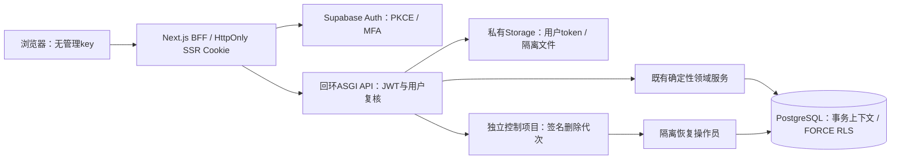

# Cloud staging 架构

实现决策见 [ADR004](adr/004-free-first-cloud-staging.md)，运行与权限设置见 [CLOUD_RUNNING](CLOUD_RUNNING.md)。

## 信任边界

- 身份来自固定项目签名的JWT与Auth用户查询；租户来自服务端唯一个人空间和成员记录。请求中自报身份/tenant被拒绝。
- 闭合开发阶段同时使用Auth关闭注册和后端邀请表。已有账户不能借直接调用Auth绕过邀请建立空间。
- 每事务重设角色、namespace、用户、租户，校验成员与设备撤销。连接池复用不继承上一请求上下文；同空间确认使用事务锁，其他空间独立。
- RLS与复合外键防止跨空间引用；事件和分录不可更新，延期约束在提交时验证平衡/币种。金额不通过模型或二进制浮点计算。
- BFF没有数据库或控制项目权限。API没有迁移/恢复凭据。当前免费参考仍是单容器，不能据此宣称完整RCE/操作系统隔离。
- 私有文件使用当前用户token访问固定项目和固定bucket，key由服务器构造。默认只接收隔离文件，不启动云端OCR；下载通过重新鉴权的代理完成。
- 删除签名记录在第二项目，恢复旧数据库之前重放。恢复命令要求隔离目标和独立特权凭据；旧会话/授权不恢复为有效访问。

## 可复用领域与新增适配

`services/api/business.py` 是共用业务分发；本地HTTP访问码和云端身份分别提供认证、再认证和存储。`services/cloud/store.py` 将固定应用SQL适配到PostgreSQL，来源字段和金额仍由既有领域方法校验。客户端/模型不能提交SQL。

财务确认、版本、幂等回执与Outbox在同一数据库事务内提交。个人规则只能在草稿形成时应用，不能在已审核Agent预览与写入之间改变类别。迁移仅导入用户选择的旧JSON，保留事件/快照并核对分录；会话、确认、授权、旧任务和幂等权限不迁移。

队列、模型网关、自动解析/清扫和Stripe的生产执行器尚未就绪，相关入口关闭。现有Outbox/任务/计量结构是后续可靠工作流的基础，不代表定时调度或真实外部调用已上线。
