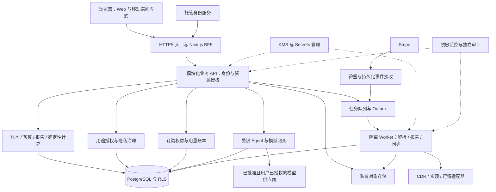

# FinAgent 产品策略文档

**面向公众的云端多租户 AI 个人财务管理 SaaS｜澳大利亚优先首发**

| 文档属性 | 内容 |
|---|---|
| 版本 | v1.0 · 产品与工程规划基线 |
| 规划基准日 | 2026-10-15（Australia/Sydney） |
| 适用读者 | 产品负责人、工程、安全与隐私负责人、商业运营及外部法律顾问 |
| 建议入库位置 | `docs/PRODUCT_STRATEGY.md` |
| 产品决策 | Web SaaS、公众注册、付费订阅、平台托管；澳大利亚优先，保留国际化 |
| 状态 | 待负责人确认资源、价格和供应商；路线图与指标均为建议，不代表已交付或对外承诺 |

> **阅读原则：** 当前产品有本地业务基础，尚不能据此认定具备公众 SaaS 的安全、合规或运营能力。本文把“当前能力”“目标设计”“发布门槛”分开陈述。个性化金融产品建议不属于已获准上线的能力；不持有资金、不执行交易，也不自动免除金融建议相关义务。


**实施更新（同日）：** 用户选择免费主流平台优先、价格未定且收费保持关闭。云端基础源码、旧审查修复与合成验证已实施；逐条状态见 [STRATEGY_IMPLEMENTATION](STRATEGY_IMPLEMENTATION.md)，平台与运行见 [CLOUD_RUNNING](CLOUD_RUNNING.md)。本文仍为规划基线，发布门槛由实际证据逐项关闭。

## 目录

1. [执行摘要](#s1)
2. [事实基础与当前能力](#s2)
3. [愿景、价值主张与产品原则](#s3)
4. [目标人群与 JTBD](#s4)
5. [市场定位、竞争与获客](#s5)
6. [MVP / V1 / V2 与明确不做](#s6)
7. [核心用户旅程](#s7)
8. [信息架构与体验规范](#s8)
9. [订阅模式、定价实验与成本指标](#s9)
10. [模块化云架构与部署](#s10)
11. [核心数据模型与账本迁移](#s11)
12. [安全、身份隔离与数据治理](#s12)
13. [AI Agent、模型网关与确定性计算](#s13)
14. [澳大利亚安全合规与投资建议边界](#s14)
15. [CDR 银行与行情数据接入](#s15)
16. [Stripe、Webhook 与权益计量](#s16)
17. [里程碑、P0 / P1 / P2 与验收](#s17)
18. [产品 KPI 与运营机制](#s18)
19. [风险清单与开放决策](#s19)
20. [资料引用与维护规则](#s20)

<a id="s1"></a>
## 1. 执行摘要

FinAgent 的定位是**帮助个人看清收支、维护可信账本、理解现金流和资产风险的订阅制 AI 财务管理平台**。用户通过浏览器注册使用，平台承担部署、模型接入、安全维护与账单管理。用户不需要本地部署、安装数据库或自行购买模型 API。

首发市场为澳大利亚，首批优先服务有稳定收入、多个金融账户、希望减少手工整理负担的成年人。中英文体验与跨币种数据能力是候选切入点，必须通过访谈和留存实验验证；它们不是已经证明的市场壁垒。

核心产品闭环为：

**导入或录入 → 识别与去重 → 用户核对 → 可信入账 → 确定性计算 → 有依据的 AI 解释 → 用户纠错 → 下次复用个人规则。**

商业模式采用 Freemium + Pro + Premium。收入主要来自订阅，套餐围绕自动化程度、处理量、分析深度和服务能力分层。**价格、额度、年付折扣、试用期限均未确定**，先采集真实成本和付费意愿。基础安全、数据导出、隐私撤回与账号删除不作为高价套餐专属权益。

工程上保留可复用的 Next.js 前端、财务领域规则和 API 契约，逐步把本地 Python 服务改造为生产级模块化后端，增加 PostgreSQL、成熟身份认证、RLS、私有对象存储、KMS、异步 Worker、模型网关及 Stripe。初期不采用 Kubernetes、复杂微服务或多个自主 Agent。

开发顺序明确为：

| 顺序 | 首要结果 | 不可跳过的理由 |
|---|---|---|
| P0 | 身份、租户隔离、可信账本、加密与恢复、隐私及合规边界 | 公众服务必须先具备可验证的数据保护与归属控制 |
| P1 | 受限 AI 工作流、模型网关、订阅权益与成本计量、反馈纠错 | 将已有业务能力转化为可靠且有单位经济性的服务 |
| P2 | CDR 自动同步、许可允许的市场数据、长期记忆与评测优化 | 依赖合同、授权、数据质量和运营能力，不应拖垮首发闭环 |

公开付费 MVP 需要 P0 与首发所需 P1 同时通过。P0 完成可以进入受控内测，不能自动推导为可以收费或提供投资建议。

<a id="s2"></a>
## 2. 事实基础与当前能力

### 2.1 证据分级与核对范围

本文使用三类证据：

- **A｜本次静态核对**：2026-10-15 对用户提供的本地项目进行只读文件检查，确认相应实现或配置存在。没有运行应用、调用真实模型、连接银行、读取私人账本或重新执行测试；“代码存在”不等于“生产验收通过”。
- **B｜既有审查或项目自述**：来自此前对话、项目安全文档、交接及既有网页审查；未独立复跑的通过率、效果、安全结论均不升级为 A。
- **P｜规划**：本文提出的目标、范围、架构、阈值与验收要求，尚待开发或决策。

核对目录：`/Users/sage/Document/Sage_portfolio/finance_platform/financial-agent/`。本次主要检查 `package.json`、`services/api/{server,store,agent,terminal,market,evidence}.py`、本地迁移文件、登录注册入口及 `docs/{API,SECURITY}.md`。未记录可复现的 Git 提交号，当前结论仅对应当日所读文件，后续工程应绑定提交版本。

### 2.2 当前能力与目标差距

| 能力 | 截至基准日可支持的判断 | 证据 | 云端差距 |
|---|---|---|---|
| 前端与服务形态 | Next.js / React 前端，Python 本地 HTTP API；现有前端以 JS/JSX 为主 | A：依赖清单、服务与页面文件 | TypeScript 为渐进改造目标；需生产应用服务器、部署与监控 |
| 身份与会话 | 本地访问码、内存会话、回环地址限制；注册和登录路由重定向首页 | A：`server.py`、认证页面 | 不具备公众注册、多用户身份及成熟账户恢复 |
| 持久化 | `sqlite3.connect`；默认 `.local-data/wallet.sqlite3`；静态检查未见 SQLCipher 接入 | A：`store.py`、`server.py` | PostgreSQL、租户外键与 RLS；云端加密、恢复与生命周期 |
| 账本与确认 | 账户、草稿、事件、分录、确认挑战、幂等和冲正相关结构及方法存在 | A：迁移与存储代码 | 云端并发、用户归属、迁移对账与端到端回归 |
| 预算、目标、投资记录、报表 | 此前审查陈述已具备本地正式 API 与 PDF 等业务能力；本次核对到接口/模块 | A + B | 真实场景准确性、跨用户隔离及可用性仍须重新验收 |
| OCR | 本机 Tesseract 调用路径存在 | A：`evidence.py`、`store.py` | 云端隔离执行、中文/澳洲票据数据集、准确率与单位成本 |
| 浮动助手与分析 | E0 为确定性模板、受限只读工具；本地命令确认链路存在 | A：`agent.py`、`server.py`；界面效果属 B | 完整 LLM 规划与工具执行引擎待建；不能称为已完成自主 Agent |
| 可选云解释 | 固定 OpenAI Responses API、服务端环境密钥、逐次载荷确认、`store:false` | A：`terminal.py` | 目前是独立只读解释；平台网关、供应商路由和运营控制待建 |
| 资料库与记忆 | 本地 384 维哈希词法检索存在；不是神经语义嵌入或训练 | A：`terminal.py` | 用户隔离的记忆、保留期、删除传播、外部嵌入授权待建 |
| 公共市场背景 | 固定 BLS 美国 CPI 系列连接器；保存历史观察及来源元数据 | A：`market.py` | 不能当作澳大利亚宏观数据、证券行情或通用金融数据平台 |
| 加密备份 | 项目安全文档称已实现浏览器加密导出与验证；不是运行库加密或完整恢复 | B：`SECURITY.md`，本次未独立验收 | 自动备份、恢复演练、KMS 权限和删除后恢复控制 |
| 训练与持续学习 | 此前陈述有本地评测基线；没有已验证的学习管线 | B；A：E0 标明未训练 | 授权样本、数据集审核、独立评测及受控发布待建 |
| 银行、支付与模型换源 | 所核对业务代码未见可证明已上线的银行连接、Stripe 订阅、多租户 PostgreSQL 或多模型路由 | A（有界检查）+ B | 全部按待开发能力规划，不以菜单或环境变量作为交付证据 |

### 2.3 不能继承的结论

此前文档中的测试数量、零依赖漏洞快照、浏览器演示效果，不等于本轮独立验证，也不等于渗透测试或合规认证。既有网页审查报告曾记录币种范围、财务术语、交易日风险序列、重复确认和无障碍等问题；部分相关代码在本次所读版本已有变化，**需逐项回归判断是否仍存在**，本文不将旧发现直接写成当前缺陷。

本策略取代早先“Local-first + Cloud-ready”的主交付方向。SQLite 与本地访问码仅保留为开发和迁移参考；SQLCipher 不再作为公众 SaaS 的主线前置投资。现有回环限制是本地保护措施，不能只取消限制或开放端口就上线。

<a id="s3"></a>
## 3. 愿景、价值主张与产品原则

### 3.1 愿景与价值主张

让没有财务专业背景的用户也能维护一份可信、可解释、可控制的个人财务记录，并持续理解自己的财务变化。

| 用户痛点 | 产品价值 | 需要证明的结果 |
|---|---|---|
| 多账户、截图和流水分散 | 一个工作台汇总，并保留原始来源和处理状态 | 用户能快速核对月度收支；未同步不显示为最新 |
| 记账费时，识别错误难发现 | 导入、OCR 与分类产生候选，核对后入账 | 节省整理时间，错误能定位、纠正和追踪 |
| 图表很多，却不理解变化原因 | AI 用账本计算结果解释变化，并链接依据 | 用户能说清变化来自哪些记录，而非只接受结论 |
| 不愿把全部财务资料交给未知模型 | 按目的授权、最少披露、可撤回与可删除 | 用户知道哪些数据发给了哪家供应商 |
| 资产分散，风险难描述 | 展示持仓事实、数据完整性和透明情景假设 | 不把模拟成功率、历史风险或健康指标包装成收益保证 |

### 3.2 产品原则

1. **账本优先**：AI 输出不能成为金额、币种、归属和余额的事实来源。
2. **解释可核对**：每个关键数字绑定期间、口径、来源和计算版本；数据不足时明确缺口。
3. **用户控制**：修改账本、对外披露、记忆保存与银行授权分别处理，不能互相替代。
4. **服务可信**：静态加密、多租户隔离、恢复与支持能力纳入产品交付，不只列为基础设施任务。
5. **范围克制**：先解决月度财务管理，避免在客户价值未验证前建设全功能投资平台。
6. **国际化可扩展**：币种、语言、时区、税务周期与监管地域分开建模，不将 AUD、中文或澳洲规则写死。

<a id="s4"></a>
## 4. 目标人群与 JTBD

### 4.1 首发人群

| 人群 | JTBD：当……我希望……以便…… | 首发优先度 |
|---|---|---|
| 澳大利亚有稳定收入、多个账户的个人 | 当月末整理账单时，希望快速合并并核对收支，以便知道钱花在哪里 | 首要 |
| 在澳中英文双语用户、跨境收支用户 | 当流水、凭证和币种混杂时，希望用熟悉的语言理解原币种数据，以便减少误读 | 候选切入群体；访谈验证 |
| 有储蓄目标、现金储备压力的人 | 当收入或必要支出变化时，希望比较自设预算情景，以便安排支出和储蓄 | MVP 次要 |
| 自主管理少量股票/ETF 的个人 | 当持仓分散时，希望看清估值来源、集中度和历史表现，以便理解已有资产 | V1；不提供具体交易建议 |
| 家庭财务协调者 | 当需要共同维护记录时，希望明确谁能看什么、改什么，以便协作且保有隐私 | V2；MVP 不开放家庭共享 |

首发不服务企业完整会计、持牌投顾后台、高频交易者、未成年人账户或机构资产管理。自由职业者可使用个人收支功能，但不宣称替代企业记账、税务申报和法定报表。

### 4.2 需求验证计划

建议先访谈 12–15 位目标用户，再进行 20–30 位受邀试用，均为研究计划而非已有用户数。收集最近一次真实整理流程、现有工具、耗时、错误后果、银行授权接受度和付费替代方案；不为研究索取网银密码或不必要的完整账单。

原型任务包括：导入一个月流水、发现一条重复记录、核对一份识别结果、解释支出变化、取消 AI 授权、导出并取消订阅。验证“理解和核对更容易”之后再扩大市场范围。研究材料使用合成样例；确需真实资料时另设研究授权和保留规则。

<a id="s5"></a>
## 5. 市场定位、竞争与获客

### 5.1 定位声明

面向希望减少财务整理负担、又需要知道分析依据的个人，FinAgent 提供“可信账本 + 可核对 AI 解释 + 用户控制的数据处理”工作台。首发价值是财务管理效率和理解能力，不承诺投资回报提升。

### 5.2 竞争参照与差异假设

以下仅概括官方公开页面可确认的能力，不是全面实测排名，不据此断言竞品缺少 AI、隐私或某项功能。

| 参照类别/产品 | 已公开价值 | FinAgent 的候选差异 | 验证方式 |
|---|---|---|---|
| PocketSmith | 银行流水、预算、现金流预测等个人财务管理能力 | 把凭证核对、不可覆盖的更正记录与对话解释连成一条证据链 | 对比完成月度核对任务的时间和错误率 |
| Frollo | 账户聚合、财务目标与通过 CDR 连接账户 | 中英文解释、导入纠错与跨来源证据追踪 | 目标用户任务测试；验证是否足以付费 |
| Sharesight | 持仓跟踪、收益、分红及税务相关报告 | 将生活收支和已有资产观察放在同一上下文中 | 不复制专业税务深度；验证整合需求 |
| 银行自带应用 | 本行数据与便捷使用体验 | 跨机构汇总与来源核对 | 验证用户是否确有跨行痛点 |
| 表格与通用聊天工具 | 灵活、用户熟悉 | 稳定计算口径、授权控制、可重复工作流和纠错 | 衡量月度维护耗时、数值一致性和复用率 |

产品参照来源：[PocketSmith 功能][R16]、[Frollo App][R17]、[Sharesight Australia][R18]。本表不采用未核实的竞品价格、市场份额或市场规模。

### 5.3 获客与商业验证

初期采用澳洲个人财务内容、双语社区、用户推荐和小规模目标用户招募；内容以预算教育和财务记录方法为主，避免借获客内容提供未经评估的金融产品推荐。销售页面展示合成 Demo、明确套餐和隐私处理方式。

先验证“导入—核对—理解—每月回来”的留存，再投入付费广告。银行自动同步不是首发获客的必备条件，不能在尚未签约和验收前宣传“已连接澳洲所有银行”。商业合作、返佣和金融产品导流暂不作为主要收入来源；未来如引入，应先评估利益冲突、披露与监管影响。

<a id="s6"></a>
## 6. MVP / V1 / V2 与明确不做

所有云端范围均为规划。版本描述代表目标，不是上线状态。P0/P1/P2 是工程优先级，MVP/V1/V2 是产品发布范围，两者并不一一对应。

| 模块 | 云端付费 MVP | V1：可靠自动化 | V2：经评估后扩展 |
|---|---|---|---|
| 账户 | 注册、登录、找回、独立个人空间、会话管理 | 更完善设备管理与风险验证 | 家庭成员与细粒度共享 |
| 交易与凭证 | 手工录入、CSV、已有 OCR 路径云端化、草稿审核、去重、冲正、导出 | OFX、更多银行模板与自动分类规则 | 更复杂来源的批量对账 |
| 预算与目标 | 用户自设预算、目标进度、现金储备及收支分析 | 到期与超预算提醒、经确认的周期规则 | 可解释的个性化管理工作流 |
| AI | 单一已审查供应商、结构化只读分析、受控记账草稿、依据、纠错 | 多模型选择、授权内路由、任务恢复 | 有边界的多步骤协作；不默认多 Agent |
| 报告 | 月报网页/PDF、期间与币种范围、来源和计算版本 | 定时报表、长周期比较 | 受控共享与高级自定义 |
| 投资记录 | 可选保留已有手工记录和基础持仓事实；无真实行情时明确标识 | 许可允许的估值、历史表现和事实性风险展示，经边界评审 | 高级情景研究；个性化产品建议另立项目、默认关闭 |
| 银行 | 无自动连接依赖；文件导入可完成价值闭环 | 在 P2 接入门槛通过后分批开通 CDR | 逐国评估国际连接，不承诺一套接口覆盖全球 |
| 收费 | Free + Pro，Premium 可保留为候选但未交付不收费 | 权益成熟后开放 Premium | 按验证结果调整，非预设必然扩张 |
| 记忆与优化 | 反馈、可撤销个人分类规则、评测基线 | 用户可见的偏好与记忆管理 | 经独立授权的数据优化；有证据才考虑训练 |

### 明确不做

- 不以本地部署、用户自带 API Key 或维护服务器作为公众用户使用前提。
- 不保管或转移用户资金，不提供钱包余额、充值、支付、换汇执行、银行卡发行或证券订单执行。
- 不把具体证券买卖、仓位调整、退休产品切换、贷款或保险推荐作为未评估即可上线的功能。
- 不承诺收益、不自动调仓、不将历史回测或 Monte Carlo 输出描述为真实未来概率保证。
- 不提供法定税务申报、审计鉴证、完整企业会计或未经授权的专业意见。
- 不保存网银密码，不以屏幕抓取绕过 CDR 参与和授权要求。
- 不销售用户账本，不默认将账本、对话或纠错用于跨用户训练，不把“删除记录”等同于训练权重遗忘。
- MVP 不建设实时交易终端、跨设备端到端加密同步、原生移动应用或全球银行覆盖。

<a id="s7"></a>
## 7. 核心用户旅程

| 旅程 | 主流程 | 异常与控制 | 完成定义 |
|---|---|---|---|
| 首次使用 | 看产品边界 → 注册验证 → 选择语言/时区/币种 → 建账户 → 导入或手工录入 | 可拒绝 AI/OCR 仍完成基础记账；Demo 与私人空间隔离 | 确认至少一批有效记录并能查看来源 |
| 文件导入与入账 | 上传 → 隔离解析 → 映射账户/币种/日期 → 去重 → 修改候选 → 最终预览 → 确认 | 低置信度/重复记录进入待审；失败不生成正式分录；重复点击不重复入账 | 候选数、确认数、拒绝数与账本一致 |
| 月度理解 | 选择期间与币种 → 确定性汇总 → 授权 AI 解释 → 展示依据与缺口 | 缺汇率不合并；过期行情不能称实时；模型失败仍展示原始计算 | 用户能从结论定位具体记录和公式 |
| 更正与偏好 | 定位错误 → 修改草稿或冲正已入账事件 → 确认替代记录 → 可选保存个人分类规则 | 个人规则与全局训练分开授权；显示影响范围；支持撤销 | 历史不被静默覆盖，未来分类规则可查看 |
| 订阅升级 | 查看权益/额度 → 托管 Checkout → 返回处理中 → 服务端确认 → 权益生效 | 支付失败、延迟、重复事件、取消和退款均有状态 | 付款、订阅、权益及用量可对账 |
| 连接银行（V1） | 选连接机构 → 展示参与主体/用途/期限 → 银行授权 → 同步 → 核对 | 授权到期/撤销停止新收集；pending 到 booked、断线与缺历史可解释 | 显示覆盖期、最后成功同步和待核对差异 |
| 撤回与退出 | 撤回某用途 → 停相关任务 → 导出 → 可选取消订阅 → 可选删账号 | 取消订阅、撤回授权、删除数据是三个独立动作；法定保留另作说明 | 有处理回执、预计完成时间和剩余保留范围 |

账本写入确认应绑定：操作者、租户、操作内容、资源版本、有效期和一次性确认标识。自然语言中的“同意”“确认”不直接替代最终写入确认。前端遮罩或关闭面板不算权限撤销。

<a id="s8"></a>
## 8. 信息架构与体验规范

| 一级入口 | 核心内容与首要动作 | MVP 要求 |
|---|---|---|
| 总览 Overview | 期间/币种、收支结余、现金变化、账户、待审核提醒 | 数字可点开依据；缺数与过期状态可见 |
| 交易 Transactions | 新增/导入、待审核、已入账、搜索筛选、更正 | 手机首屏可记账/审核；图表不挡住操作 |
| 预算与目标 | 预算、目标进度、现金储备、自设情景 | 实际记录与预测分开；长期模拟为次级入口 |
| 投资 Portfolio | 已有持仓、估值来源、集中度、历史与局限 | 无许可数据就显示手工值及日期；禁止伪造曲线 |
| 财务助手 Copilot | 提问、任务状态、分析、草稿确认、依据 | 独立入口与浮动快捷入口共享任务状态；不用 Advisor 暗示已持牌 |
| 报告 Reports | 月报、历史版本、PDF/CSV、覆盖范围 | 同一指标与页面/助手一致；变更后旧报告标明快照日期 |
| 隐私与安全 | 授权、AI 供应商、银行连接、记忆、导出、删除、设备 | 用户可直接找到，所有套餐可用 |
| 设置与订阅 | 语言/时区、账户、套餐、额度、发票、取消 | 数据源连接状态与付费状态分别显示 |

现有风险内容可先归入预算和投资详情，不为了视觉完整而增加独立 Risk Center。现有资料库作为高级可选入口，避免变成完成首次价值的前置步骤。

体验统一要求：

- 收支结余、现金净变化、支出、手续费、还款本金使用共享术语表；中英文、图表、助手和 PDF 一致。
- 页面范围包含期间、原币种或折算币种、时区；切换后清除或显式标记旧结果，阻止旧响应覆盖。
- 路由可恢复模块与非敏感筛选；不将金额、账户名称、金融问题正文写入 URL。
- 有清晰的加载、空数据、部分成功、未授权、超额度、来源失效和过期状态。
- 关键流程支持键盘、屏幕阅读和移动端；无障碍名称包含可见标签，完成对比度和缩放检查。
- 产品页不展示数据库、模型提示词等无助于决策的实现细节；“依据”面板按需提供技术版本。

<a id="s9"></a>
## 9. 订阅模式、定价实验与成本指标

### 9.1 权益设计草案

**以下是待验证的套餐方向，不是已上线权益。价格和所有具体额度均为待定；付费只扩大已交付能力，不获得金融许可或额外数据披露权。**

| 权益 | Free / Freemium | Pro | Premium |
|---|---|---|---|
| 核心记账、核对、基本预算 | 可使用，处理/存储额度待定 | 较高额度与效率功能 | 较高额度，视需求确定 |
| OCR / 文件处理 | 小额度试用 | 常规个人使用额度 | 高频处理额度，设公平使用上限 |
| AI 财务解释 | 基础额度与默认模型 | 更高任务额度，逐步开放已审查模型 | 更深历史分析及高级模型预算 |
| 报告 | 基础月报与数据导出 | 完整月报、长周期比较 | 更高分析/报告处理量 |
| CDR 自动同步 | 首发均不可用；后续是否试用待定 | 接入验收后可含有限连接 | 验收后可含更多连接；不承诺银行全覆盖 |
| 市场数据与提醒 | 仅已许可公开信息 | 许可范围内的历史/延迟数据与提醒 | 许可范围内更高额度；不默认实时行情 |
| 数据安全、导出、删除、撤回 | 全部可用 | 全部可用 | 全部可用 |
| 具体价格 | 待定 | 待定 | 待定；没有独立价值和毛利证据时暂不发布 |

不以“无限 AI”“无限银行同步”作为未经成本验证的卖点。模型、OCR、存储和金融数据分别计量；用户界面用可理解的任务/页数/连接数展示，后台记录实际成本。自带密钥留待后续需求验证，不作为首发路径。

### 9.2 单位经济性口径

所有成本以统一记账币种 AUD 汇总，同时保留供应商原币、价格版本与换算日期。不在本文填入未经报价的单价。

```text
每次模型成本 = 输入量×输入单价 + 输出量×输出单价
             + 供应商实际收费的缓存/工具/图像等费用
每用户月可变成本 = 模型 + OCR + 银行连接/同步 + 行情授权分摊
                  + 存储/流量/任务 + 可归属支付费与可变支持成本
每用户贡献 = 不含税订阅净收入（扣退款和折让） - 每用户月可变成本
贡献率 = 每用户贡献 / 对应订阅净收入
产品毛利 = 订阅净收入 - 一致口径的服务交付成本（含应分摊基础设施）
盈亏平衡付费人数 ≈ 月固定成本 / 平均每付费用户贡献
CAC 回收月数 = CAC / 每新增付费用户月贡献
```

贡献与会计毛利不是同一概念；固定第三方最低消费、未分摊空闲容量、安全与合规固定支出必须另列，不能通过排除成本制造高毛利。

必须监测：每激活用户成本、每付费用户成本、单任务成功成本、失败/重试成本、P50/P95 用户成本、免费用户补贴、供应商最低消费、现金跑道。早期不以短期流失率机械外推长期 LTV。

### 9.3 定价验证与成本控制

1. 先通过访谈判断用户为节省整理时间、自动化还是分析深度付费；候选价格仅在真实实验中产生。
2. 在封闭试用收集各功能成功率和成本分布，对低/中/高使用量建立成本表；供应商正式报价包含最低消费与展示权。
3. 产品、工程、运营共同确定各层额度、净收入和毛利门槛；再配置 Stripe Price，不在代码中写死营销价格。
4. 每个任务先估算并预留预算；限制输入、输出、工具步数、并发、重试和总费用；临近额度给提示，不静默超额收费。
5. 超额可等待下一周期或购买明确确认的额外额度；自动追加收费须另行设计并获得用户明确同意。
6. 先按月验证续费；年付折扣、退款、升级补差价、降级生效时间和欠费宽限期在发布前形成政策。

收费页面需清楚显示币种、计费周期、适用税费及必须支付的总价、续订方式、试用转付费条件和取消入口。消费者价格展示及合同条款应经过澳洲审查，不能通过格式或自动续订造成误导。参见 [ACCC 价格展示][R19]与[消费者合同][R20]。

<a id="s10"></a>
## 10. 模块化云架构与部署

### 10.1 目标架构

以下为逻辑模块划分，不代表需要多个独立服务或多个模型 Agent。



| 层级 | 建议方案 | 实施原则 |
|---|---|---|
| Web | 保留 Next.js / React；新模块渐进采用 TypeScript | 不为迁移类型系统重写所有界面 |
| 业务 API | 保留 Python 领域规则，改为成熟生产 Web 框架及应用服务器 | 具体框架在 ADR 决定；标准库本地 HTTP 服务不直接承担生产入口 |
| 数据库 | 托管 PostgreSQL、版本化迁移、连接池 | 私网访问、备份与加密；运行角色和迁移角色分离 |
| 身份 | 成熟托管 OIDC/OAuth 身份服务 | 评估澳洲可用性、MFA、恢复、会话撤销与合同；供应商未定 |
| 文件 | 私有 S3 兼容对象存储 | 隔离上传区、扫描、生命周期、短期授权访问 |
| 任务 | 一个可靠队列 + 独立 Worker；Redis 可选 | 先明确持久化、重试、死信和租户上下文，不强制绑定 Redis |
| AI | 统一 Provider Adapter + 受限工具执行器 | LangGraph 仅在状态图复杂度证明有必要后采用 |
| 支付 | Stripe Billing / Checkout / Customer Portal | 服务端权益、可靠 Webhook、日常对账 |
| 观测 | 结构化日志、指标、OpenTelemetry；错误监控服务可选 | 禁止把交易正文、文件或令牌上报错误监控 |
| 部署 | 托管容器或应用平台、CI/CD、独立 staging | 初期单一区域、多可用区方案按预算决定；无需 Kubernetes |

### 10.2 云端运行要求

主数据区优先评估澳大利亚区域，分别核实数据库、备份、对象、日志、支持人员、Auth 和模型的实际处理位置。**选择澳洲云区域不等于全链路数据不出境。** 合同、供应商子处理者和异常支持访问都进入数据流图。

开发、测试、生产分开账户/项目、数据库、密钥、存储桶和 Stripe 模式；测试使用合成数据。CI 执行静态检查、领域回归、隔离测试、迁移演练及构建；发布采用向前兼容迁移、受控开关和可回滚版本。生产密钥不进入构建产物或浏览器包。

任务采用持久化状态、租户与操作者、授权版本、输入版本、预算、重试次数和幂等键。业务事务通过 Outbox 发布任务，避免“账本已提交但任务丢失”。Worker 开始、外发前和提交结果前重验授权；并发删除或撤回后不得重新写回私人数据。

通知通过站内任务中心为主；邮件默认仅提示有新报告或连接问题，避免在主题、预览和推送中包含金额、商户或持仓。支持人员使用工单和限时授权工具，不提供任意搜索全库的日常后台。

<a id="s11"></a>
## 11. 核心数据模型与账本迁移

### 11.1 租户与身份模型

采用 `tenant/workspace` 作为财务空间，`user` 作为身份。MVP 每个用户默认一个个人租户，只有本人可以加入；家庭共享不开放。预留成员表不是默认授予共享权限。客户端提交的 `tenant_id` 只是定位信息，后端必须依据已验证身份和成员关系选择实际权限上下文。

| 领域 | 建议实体 | 关键约束 |
|---|---|---|
| 身份与空间 | `users`、`tenants`、`memberships` | 外部身份 subject 唯一；成员角色与状态；个人租户边界 |
| 财务账户 | `financial_accounts` | `tenant_id`、原币种、账户类型；银行标识最小化 |
| 账本 | `ledger_events`、`postings`、`drafts`、`reconciliations` | 事件不可静默覆盖；分录平衡；同币种与跨币种规则明确 |
| 预算与目标 | `budgets`、`goals`、`planning_assumptions` | 期间、币种、版本；假设与实际记录分开 |
| 凭证与文件 | `documents`、`evidence_items`、`extraction_runs` | 私有 object key、哈希、来源、解析版本、状态、保留期 |
| 投资与价格 | `instruments`、`positions`、`position_events`、`valuation_snapshots`、`market_observations` | 私有持仓与公共价格分开；行情许可及公司行动信息 |
| 银行接入 | `bank_connections`、`consent_grants`、`sync_runs`、`external_transactions` | 参与路径、授权期限、来源 ID、pending/booked 状态、密钥引用 |
| AI 与反馈 | `conversations`、`agent_runs`、`tool_calls`、`memories`、`feedback` | 租户、用途、模型/提示词/工具版本、来源、失效状态 |
| 知识与检索 | `knowledge_documents`、`chunks`、`index_entries` | 私人与公共语料分区；索引条目继承归属与删除策略 |
| 隐私治理 | `processing_consents`、`deletion_requests`、`retention_rules` | 授权对象/范围/版本/期限；法律保留与删除状态 |
| 商业化 | `plans`、`subscriptions`、`entitlements`、`usage_reservations`、`usage_events`、`provider_costs` | 套餐版本、周期、原始供应商用量、预留与结算唯一性 |
| 系统可靠性 | `webhook_events`、`outbox`、`jobs`、`audit_events`、`idempotency_receipts` | 持久化状态、租户作用域、幂等与最小审计内容 |

用户私有表的 `tenant_id` 必须非空，不能只在顶层账户表保存。跨表关系使用 `(tenant_id, resource_id)` 复合外键或等效约束，防止将 A 的交易挂到 B 的账户。唯一键含租户/连接作用域，例如 `(tenant_id, connection_id, external_id)`；全局公共证券表也必须与私人持仓严格分离。

金额使用适合币种精度的 `NUMERIC` 或最小单位整数；API 传十进制字符串。证券数量、价格和汇率独立设精度，不一律截为两位；禁止使用二进制浮点累计账本。服务器保存 UTC 时间与业务日期，使用用户 IANA 时区解释月度边界；澳洲财年与自然年分别配置。

### 11.2 账本和计算一致性

- 正式事件采用追加、冲正和替代记录；更正保留关联关系。不可变业务历史并不取消依法删除个人数据的治理流程。
- 普通记账、内部转账、退款、信用卡消费、还款本金、利息及手续费有明确分录模板；每笔事件按币种平衡，外汇交易通过明确汇率与对手科目处理。
- 收支结余不等于现金净变化；投资浮盈不计入现金收入，内部转账不重复作为收入/支出。
- 报告、助手与图表读取同一计算服务，绑定账本快照版本；已经导出的报告不随后续更正悄悄变化。
- 银行重复检测与 API 幂等是两种不同控制：前者发现业务重复，后者防止同一提交重复执行。
- 账本提交、分录、幂等回执与 Outbox 在同一事务内完成；乐观版本控制处理并发编辑。

### 11.3 SQLite → PostgreSQL 迁移方案

1. 盘点旧表、JSON 字段、孤立记录、币种和计算口径；记录迁移映射与输入文件哈希。不要复制真实数据到个人开发环境。
2. 用户明确选择导入旧账本并验证身份后，为其建立个人租户。**本地库没有可依赖的云端身份，不按邮箱猜测归属，也不把一份旧库分配给多个客户。**
3. 在受控环境导出、转换、校验并导入，保留稳定 ID 或映射表；旧确认 nonce、会话、过期任务和授权不迁移为有效云权限。云处理与银行授权重新取得。
4. 对账：每表数量、每币种余额、期间收支、分录平衡、冲正链、凭证链接、历史报表与哈希；金额差异必须为零或有逐条书面解释。
5. 验证重复导入幂等、失败回滚、空库、异常中断及版本不兼容。迁移期间采用短时写入冻结，MVP 不引入高风险双写。
6. 用户验收后切换；限时保留加密迁移备份并按政策清除。回滚不能覆盖已产生的新云端事件，需有增量处理和人工对账步骤。

<a id="s12"></a>
## 12. 安全、身份隔离与数据治理

### 12.1 身份与授权

采用成熟身份服务，后端验证令牌签名、issuer、audience、有效期和必要的撤销状态。浏览器使用 Secure、HttpOnly、适当 SameSite 的会话 Cookie，提供 CSRF 防护、登录限流、会话过期与设备撤销；不复用本地访问码机制。MFA 至少对管理员强制启用，普通用户提供并对高风险操作要求升级验证；账号恢复不能绕过安全级别。

读取、写入、下载、导出、任务查询、检索、WebSocket/SSE 和订阅操作均执行资源归属检查。身份、套餐、用途授权、内容确认是独立条件：付费不授予跨用户读取权，模型说“已授权”也不构成授权。

### 12.2 PostgreSQL / RLS

RLS 是后端授权的第二道保护。PostgreSQL 超级用户、`BYPASSRLS` 角色及通常的表所有者可绕过行级策略，因此应用不能使用这些角色；必要时对表使用 `FORCE ROW LEVEL SECURITY`，但它不限制超级用户和 `BYPASSRLS`。参见 [PostgreSQL Row Security Policies][R04]。

实施要求（FinAgent 目标设计）：

- 迁移 owner、业务运行、Worker、计费、审计和只读运维分别授权；常规 Web 和 Agent 均不持有管理角色。
- 私有表启用默认拒绝策略，同时覆盖 SELECT / INSERT / UPDATE / DELETE；`USING` 与 `WITH CHECK` 防止读取和写入越界。
- 每个事务在服务端确认成员关系后设置事务级租户上下文；连接池复用、异常退出和后台任务不得沿用上一用户上下文。缺上下文必须拒绝访问。
- 应用连接无法任意开放给模型；不提供原始 SQL 工具。敏感函数、`SECURITY DEFINER`、搜索路径及批量管理接口另行审查。
- A/B 双租户测试覆盖直接 API、数据库角色、恶意 ID、外键、批量请求、报表、下载链接、任务 ID、检索、缓存、并发连接与删除恢复。
- 公共市场缓存可以共享；私人摘要、检索、提示词缓存按租户与授权版本隔离，不能只以问题文本作为缓存键。

### 12.3 存储、密钥与文件处理

| 数据/组件 | 目标保护与验收 |
|---|---|
| 数据库、快照、备份 | 托管静态加密、TLS、最小角色、私网与恢复演练；不是端到端加密 |
| 银行令牌、平台模型密钥、Webhook secret | Secrets Manager 或受 KMS 保护的密钥存储；业务表仅引用；工作负载身份、访问审计与轮换 |
| 高敏标识 | 不必要不保存；必要字段脱敏，按威胁模型选应用层信封加密；不盲目加密全部可查询金额 |
| 票据/PDF/报告 | 私有对象、按归属鉴权、短有效期签名链接、禁止公共 ACL；存储前验证实际类型和大小 |
| OCR / PDF 解析 | 沙箱 Worker、CPU/内存/文件/像素/页数/时长限额；默认禁止出网；病毒/恶意文档处理 |
| 日志与遥测 | 不记录正文、账户号、令牌、完整提示词；错误报告脱敏；日志角色和保留期独立 |
| 运营访问 | 限时、按工单批准、可追踪的应急访问；客服默认只见最小元数据 |

KMS 管理权限和业务解密权限分开；数据密钥与密文分离，验证轮换、旧备份解密、密钥禁用和事故处置。密钥丢失和误删除是可用性风险，不能将删密钥作为未经验证的万能删除方案。

签名下载链接在有效期内相当于持有者凭证，应尽量短期；极敏感导出可通过每次重验身份的代理下载。账号删除后新链接不可签发；说明已下载副本和已发出的链接可能存在剩余有效期。

### 12.4 数据治理与保留策略草案

以下为**内部建议值**，不是法定期限、现有实现或已对客户承诺；应在 P0 由隐私/安全负责人和顾问确认后写入配置与政策。CDR 和法定留存适用更具体的规则，不被本表延长。

| 数据 | 建议默认策略 | 删除/核验要点 |
|---|---|---|
| 正式账本与预算 | 账号有效且用途存在期间保留；允许用户主动删除 | 删除覆盖私人关联表、快照与报告；合法保留范围最小化 |
| 上传临时文件 | 解析完成即清除；异常残留定时清扫，建议最长 24 小时 | 任务失败和进程崩溃也清扫；隔离区不进入普通备份 |
| 原始凭证 | 用户可选择核对后删除或保留作证据；建议默认不长期保存原件 | 清楚区分原件、提取文字和已入账事实 |
| AI 对话与任务明细 | 建议默认 90 天，可缩短/手动清除；不保存无必要原始模型载荷 | 合同允许时同步删除供应商应用状态；无法控制的保留披露 |
| 个人记忆与偏好 | 明确保存后保留，可查看、更改、撤销；关联来源失效时重评 | 不保留被删除来源的全文副本；索引一并清理 |
| 缓存、临时检索结果 | 建议不超过 24 小时；授权撤回/删除立即失效 | 按租户/资源/授权版本标记；供应商缓存另行审查 |
| 安全与操作审计 | 建议最小元数据 180 天，按调查与法律要求调整 | 不把账本正文复制进不可删日志；审计 ID 采用必要的伪名化 |
| 财务发票、税务/争议记录 | 期限由适用法律与顾问确认后确定 | 与用户账本分区；删除账号时解释必要留存及访问范围 |
| 生产备份 | 建议滚动窗口 35 天，恢复目标另行验收 | 加密隔离、到期销毁；恢复前重放删除清单，不能复活授权 |

对于适用 APP 的主体，不再需要且不受例外/法定保留约束的个人信息，应按 APP 11 要求采取合理步骤销毁或去标识化；FinAgent 的产品策略优先支持明确删除。参见 [OAIC APP 11][R06]。

### 12.5 删除、导出与恢复

删除流程：升级验证 → 明确展示影响与必要保留 → 撤销会话/授权/连接 → 停任务 → 删除主库、对象、检索与私人缓存 → 请求供应商可支持的删除 → 记录最小回执。建议活跃系统删除目标为 7 天内，备份按已披露滚动窗口失效；遇法定保留或 CDR 更严格要求须调整，不能机械套用。

删除标记与必要的最小恢复清单存放在独立受控系统；备份恢复先隔离，重放删除/撤销记录并验证，再开放访问。测试“用户已删除 → 恢复删除前备份 → 数据与授权没有重新可用”。不能承诺即刻擦除用户下载件、第三方独立副本或模型训练权重。

导出包含账户、交易、预算、目标、持仓、来源、个人规则和可导出的对话/记忆，提供机器可读格式及说明。导出不包含平台密钥、其他用户信息或依法不应披露的数据；生成与下载均验权，文件有有效期。

公众付费发布前建议验收 **RPO ≤ 1 小时、RTO ≤ 4 小时**；受邀内测可先采用 **24 小时/8 小时**，但必须披露并完成实际演练。以上为拟议内部目标，非现有 SLA。恢复测试覆盖数据库、对象版本、密钥可用性、任务与删除清单，而不只解压一个备份。

<a id="s13"></a>
## 13. AI Agent、模型网关与确定性计算

### 13.1 分工

| 逻辑模块 | 模型可承担 | 必须由服务端确定或禁止 |
|---|---|---|
| Transaction Assistant | 从文本/OCR 提取候选、建议类别、解释重复原因 | 金额校验、账户归属、去重策略、确认和入账由领域服务执行 |
| Financial Analysis | 理解期间和问题、组织解释、提示信息缺口 | 收入/支出/余额/增长率/预算完成度由计算服务提供 |
| Portfolio Analysis | 解释已有持仓事实和方法局限 | 价格、收益和风险由有数据依据的工具计算；产品建议受合规开关限制 |
| Market Intelligence | 检索批准来源、概括公开经济背景 | 来源地域、发布时间、许可、时效与版本由数据服务核验 |
| Financial Copilot | 形成结构化计划、澄清问题、协调受限任务 | 不授予授权、不过账、不持有密钥、不直接访问数据库或支付/交易接口 |

这些是同一后端中的职责划分。MVP 采用单一编排流程和有限状态机，避免多个 Agent 相互调用导致成本与权限难以追踪。

### 13.2 任务执行链

```text
已验证身份与租户
  → 识别请求范围、用途与金融建议风险
  → 服务端检查权益和预留预算
  → 最小化取数并检查来源/外发授权
  → 模型输出符合 Schema 的计划
  → 后端验证工具白名单、参数与资源权限
  → 确定性工具执行，记录来源和版本
  → 模型解释；数值、引用和边界校验
  → 展示只读结果或记账草稿
  → 写操作单独预览确认，再次验权和原子提交
  → 实际用量结算与最小审计
```

单任务限制工具次数、运行时长、输入输出、外部请求、重试和总成本。初始限制由基准测试确定，不能无限“反思”或重规划。模型 JSON 符合格式不等于业务内容可靠，仍须金额、类型、期限和权限校验。

### 13.3 确定性财务计算

关键财务计算必须可测试、可复现并独立于模型：

- 收支、现金桥、余额和预算从确认记录计算；草稿排除并显示数量。
- 变化率分母为零或负数时采用明确规则，必要时仅给绝对差额，不生成误导百分比。
- 多币种默认原币展示；折算记录汇率、方向、来源、时点与用途，余额估值汇率和历史交易汇率分开。
- 投资收益区分价格变动、分红、费用、外汇和外部现金流；TWR/MWR 仅在数据与算法验收充分时发布，明确期间和年化方法。
- 波动率、回撤和分位风险标明市场日历、样本数、复权方式和窗口；正常周末/休市不是缺失交易日，不能伪造价格补齐。
- 情景模拟记录参数、分布假设、随机种子、版本和观察数；可复现是计算方法保证，不是未来结果确定性。无历史输入时不伪装为个性化概率预测。
- 展示的关键数值与工具输出逐项核对；不一致时重生成或降级为模板，不能把未经验证的模型数字发送给用户。

### 13.4 模型网关

平台统一管理供应商适配器，标准化：模型能力、结构化输出、错误、超时、用量、价格版本、数据保留、地域与工具支持。首发选择经评测的默认模型，模型型号与供应商名单在选型后记录，不假设所有 OpenAI/Gemini 等服务具有相同数据政策。

路由依次检查：合规允许范围 → 用户授权的供应商/数据类型 → 套餐权益 → 任务能力 → 预算/延迟 → 供应商健康。用户明确选择模型时，替换须符合已披露政策；失败只能转到已获授权且政策兼容的供应商，否则提示暂不可用或返回确定性结果。不能为提升成功率把私人资料偷偷发给另一家。

密钥只在服务端按任务身份使用；禁止用户输入任意模型 URL 导致 SSRF。模型版本、提示词、工具 Schema 和计算版本可追踪，提供模型下线、预算熔断及紧急停用开关。

### 13.5 AI 隐私授权

采用分层授权：基础数据托管告知、OCR 处理、云端 AI 解释、银行收集/使用、长期记忆、可选研究/训练分别处理。首次 AI 外发前展示供应商、用途、数据类别、地域/保留说明；文档全文、额外供应商、扩展用途或敏感披露需要进一步确认。可提供查看本次发送内容的能力，不能用一个笼统“同意所有 AI”覆盖未来变化。

OpenAI API 官方文档说明默认不将 API 数据用于训练（除非明确选择共享），但仍有滥用监控及端点相关保留；`store:false` **不代表零保留**。ZDR、地域和特定功能须按实际合同及端点确认。该结论不能套用到消费者聊天产品或其他供应商。参见 [OpenAI Data controls][R10]。

默认去除账号标识和不必要文本，优先发送已核对的最小摘要；交易去掉姓名仍可能识别个人，不能轻率称“匿名”。撤回会停止后续外发并使在途结果失效，但无法撤回已传输内容。CDR 数据及其受保护的衍生数据默认禁止发往外部模型，直到参与路径、允许用途、供应商安排及跨境规则获得明确审查。

OAIC 对商业 AI 产品的指引要求关注个人信息收集、用途、披露与输出准确性。FinAgent 在上线前完成数据流和隐私影响评估，用户同意并不能自动代替所有法定义务。参见 [OAIC 商业 AI 隐私指引][R11]。

### 13.6 记忆、纠错与持续优化

| 层次 | 处理方式 | 发布条件 |
|---|---|---|
| 用户数据纠错 | 草稿更正；已入账通过冲正与替代 | 金额、版本与影响范围复核 |
| 个人规则与记忆 | 用户确认后仅在本人空间生效，保留来源/用途/版本/期限，可撤销 | 删除/撤回后检索和缓存失效 |
| 知识更新 | 批准公开资料、记录版本和时效 | 引用与版权/使用许可检查；不是训练权重 |
| 全局质量优化 | 单独授权的反馈 → 审核/脱敏 → 回归用例 → 提示词/规则优化 | 独立测试集、灰度、成本与风险对比 |
| 训练 | 有足够合法样本且比规则/检索更有效时才立项 | 供应商可用性、授权撤回影响、数据污染、评测与回滚方案 |

普通 API 调用不自动学会纠正。原始财务数据和银行数据默认不进入全局训练；不能承诺通过删数据库即可从已训练权重彻底删除。训练不是首发前置条件，早先对特定微调服务的可用性陈述不作为本策略依赖。

最小评测集覆盖：金额和币种、期间、转账/本金/退款、重复、资料注入、跨租户尝试、违规交易请求、一般解释误拒、授权中途撤回、供应商失败、数值与引用一致性。关键安全用例必须全部通过，真实任务质量以脱敏或合成独立样本评估，不只测试模型是否能复述提示词。

<a id="s14"></a>
## 14. 澳大利亚安全合规与投资建议边界

### 14.1 发布边界

本文提供产品治理要求，不作已获金融许可的认定。上线前由澳洲相关专业顾问依据最终功能、输出、宣传和商业关系形成书面范围意见；研发期间同步进行，不能推迟到代码完成后。

ASIC 区分事实信息、一般金融产品建议和个人建议；**一般建议也不等于无须许可**。自动化数字建议仍有许可与行为义务。限制建议范围或加入免责声明，均不能单独决定产品是否受监管。参见 [ASIC 金融产品建议][R01]、[RG 244][R03]和[数字建议 RG 255][R02]。

| 输出/功能 | 产品策略 | 发布控制 |
|---|---|---|
| 已确认交易汇总、来源与公式解释 | 首发候选范围 | 核对事实、口径与整体呈现；不得顺带推荐金融产品 |
| 用户自设预算和收入下降情景 | 首发候选范围 | 假设由用户确认；避免延伸为具体贷款/保险/投资产品建议 |
| 持仓占比、历史数据、集中度与回撤 | 条件开放 | 事实分析不自动获得合规豁免；根据语境、排序、提示和个体数据整体评审 |
| 金融产品类别优劣、排名与比较 | 默认限制在已批准教育内容 | 可能构成一般或个人金融产品建议，不能只去掉产品代码便上线 |
| “按你的收入和年龄买某 ETF、调到某仓位、换某退休产品” | 默认关闭；不属于已获准的 MVP/V1 能力 | 必要许可/授权、适当流程及其他适用义务落实后另立发布门槛 |
| 支付、转账、证券执行、保管资产 | 当前战略范围外 | 另做完整产品、法律、安全和运营评估 |
| 个性化贷款、保险、税务申报建议 | 首发不做 | 分别评估相关监管、专业资格及合作安排 |

任何未来个人金融产品建议项目都需明确责任主体、AFS 许可或授权适用范围、人员/算法治理、适用的客户利益与披露义务、记录、投诉、保险及外部争议处理等安排。是否需要某项文件或流程应按实际服务和当时规则确认，不在本策略假定一套模板可涵盖所有情况。

产品名称和营销以“财务管理助手 / Financial Copilot”为主，不以“持牌 AI 理财顾问”或“保证最优配置”宣传。转介给专业人士也须另行取得分享授权，不把私人账本自动发送给合作方。

### 14.2 隐私与消费者保护

- 评估 Privacy Act、APP、CDR 隐私保障和 NDB 对实际主体/活动的适用性；不能因规模小就假设全部豁免。参见 [OAIC 小企业适用说明][R21]。
- 数据分类中的“高敏财务数据”是内部风险等级，不等同于法律上 `sensitive information` 的自动分类。交易描述可能透露健康、宗教等额外信息，应按风险最小化收集与披露。
- 完成隐私政策、收集告知、供应商清单、用途和期限说明、访问/更正/投诉流程。跨境披露需评估 APP 8 及相关责任，用户勾选同意不自动解决所有问题。参见 [OAIC 跨境个人信息处理][R05]。
- 不能笼统声称“所有数据只在澳洲”“零保留”“端到端加密”或“已合规”，除非与实际架构、合同和验证一致。
- 取消、退款、续费、价格变化和免费转付费不得设置误导流程；产品条款不排除不可排除的消费者权利。参见 [ACCC 合同][R20]。

### 14.3 事故、投诉与运营准备

P0 建立负责人、值班联系、事件分级、隔离、证据保全、供应商联络、影响评估和通知流程。对于适用 NDB 的可疑合资格泄露，需合理且迅速评估，并采取合理步骤争取在 30 个日历日内完成；确认达到通知条件后及时通知相关个人和 OAIC，**不能把 30 天当作统一通知宽限期**。参见 [OAIC NDB 说明][R07]。

CDR 参与后还需核对相应事故报告、投诉、记录和合同义务，不用一般 NDB 流程替代全部 CDR 要求。参见 [OAIC CDR 隐私义务][R09]。内测前完成一次桌面事故演练；公众付费前完成恢复与通知决策演练。

国际化按国家逐项开通：语言翻译不等于金融监管可用。新国家需核对数据地域、银行接入、金融建议边界、市场数据权利、消费者条款和税费，默认不开放受监管功能。

<a id="s15"></a>
## 15. CDR 银行与行情数据接入

### 15.1 银行接入顺序与参与路径

先通过手工和 CSV 导入建立可靠对账闭环，再增加 OFX 与 CDR。澳洲 Open Banking 优先按 CDR 体系规划；“购买聚合 API”本身不证明 FinAgent 可以合法收集、使用或披露相关数据。

| 路径 | 基本区别 | FinAgent 决策要求 |
|---|---|---|
| Unrestricted accreditation | 自身获完整认证，按规则和 onboarding 接入 | 控制力强，需评估认证、安全、投诉、保险和持续运营投入 |
| Sponsored accreditation | 自身仍需认证，经 sponsor 等允许路径获取数据，不直接向数据持有者收集 | 不与代表模式混淆；核对可承担的活动及限制 |
| CDR representative | 在合资格 principal 的代表安排下参与，主体关系与登记等要求须满足 | 候选早期路径；逐项明确 principal / representative 责任，不称为零合规成本 |

路径以 [CDR 认证与参与指引][R08]为准，参与和上线流程参见 [成为 accredited data recipient][R22]。初期优先评估合适的合规合作路径，但不预先指定或宣称已签约供应商。决定前审查认证/登记状态、允许用途、覆盖银行、服务级别、价格、退出迁移、安全证明及数据再披露条件。

### 15.2 授权与同步状态机

```text
未连接 → 用途与期限说明 → 银行授权 → 首次同步 → 待核对 → 正常同步
                                     ↘ 部分历史 / 对账差异
正常同步 → 临近到期 → 重新授权
正常同步 → 失败/暂停 → 有界重试或用户处理
任意有效连接 → 撤销/到期 → 停止收集 → 依规则处理冗余数据
```

必须保存来源银行、连接、授权范围/目的/版本/期限、最后成功同步、覆盖历史、游标和失败原因。银行登录在银行或批准的授权流程中完成，FinAgent 不收取网银密码。

同步处理包括：pending → booked 的替换关系、银行更正、重复 external ID、分页/断点续传、跨连接重复、内部转账匹配、时区、账期和余额差异。不能把每次下载都直接追加成新交易；对于可确定重复项自动去重，对于分类或金额冲突生成待审队列。连接中断时保留“截至上次成功同步”的状态，不假装实时。

撤销不仅删除一个 token：停止调度与在途任务、更新授权仪表板、按参与角色与规则处理不再需要的数据，并记录最小证明。CDR 的收集、使用、披露、冗余与衍生数据规则应逐项建模；账户删除时不能简单把银行数据重命名为“个人记忆”继续使用。参见 [CDR 接收方义务][R23]和 [OAIC CDR 保障][R09]。

银行授权不自动等于允许把数据传给外部模型，也不等于取得证券交易或支付能力。首个 CDR 连接器上线前，需完成真实授权、到期、撤销、断线恢复、重放、数据删除和投诉处理验收。

### 15.3 数据源分层

| 数据类别 | 候选来源与用途 | 时效、许可与降级 |
|---|---|---|
| 澳洲宏观 | ABS 通胀/就业等统计；RBA 利率、汇率和统计表 | 按发布频率、观察期和修订版本显示；不能用于声称个人支出必然变化 |
| 美国宏观 | 已有固定 BLS CPI 连接器可保留作明确地域背景 | 不替代澳洲数据；不是证券行情或个人通胀预测 |
| 股票/ETF 报价与历史 | 经授权的交易所/供应商 | 明确实时、延迟、收盘；展示/再分发/非展示/衍生使用和 AI 使用权分别核实 |
| 外汇 | 经审查的参考汇率或商业来源 | 参考汇率不等于用户可成交价格；记录基准时间与报价方向 |
| 公司行动/分红/基金信息 | 具备相应覆盖与许可的来源 | 拆股、复权、分红币种和税费缺口会影响收益，应显式标注 |

公开宏观数据接口与元数据参考 [ABS Data API][R12]、[ABS 修订说明][R24]和 [RBA Statistics][R13]。证券行情不能因网页可访问就推断允许商业再分发；ASX 明确区分实时、延迟和历史等产品，所选供应商的具体延迟和权利应写入合同与配置。参见 [ASX Price Data][R14]与[供应商目录][R15]。

### 15.4 来源与时效契约

每项观察至少记录 `provider`、`source_url/source_id`、市场/地域、instrument/series、币种/单位、观察时间/区间、`published_at`、`retrieved_at`、供应商声明延迟、版本/修订关系、许可标签和质量状态；不知道的时间保留为空，不以抓取时间代替行情发生时间。

采用 `fresh / delayed / stale / missing / manual` 等明确状态。时效阈值按交易日历与数据频率配置：宏观按最新应发布期；收盘按最新已完成交易日；延迟行情按合同延迟和允许传输时间。不能用统一“24 小时”判断所有数据。

报告同时显示数据截至时间与生成时间。源故障时展示最后可靠值、日期及限制，禁止编造实时值；缺数严重则停止相关推断。公共缓存按许可共享，用户持仓上下文仍隔离。模型搜索只用批准来源，网页和资料均视为不可信输入，不能改变工具权限。

<a id="s16"></a>
## 16. Stripe、Webhook 与权益计量

### 16.1 收费责任与状态

Stripe 管理支付与订阅对象，FinAgent 管理套餐版本、可用权益与内部任务成本。Stripe 收费不等于获得任何金融建议许可。优先使用托管 Checkout/Portal 减少卡数据接触，但仍需评估自身支付安全责任，不宣称因此自动完成所有 PCI 义务。

用户登录后，后端依据有效套餐生成 Checkout；客户与租户映射由服务端维护，不能相信前端任意提交的 Stripe customer/subscription ID。Price ID 使用服务端允许清单；前端不能自行指定价格或权益。

将 provider 状态与产品权益分开映射，例如 trialing、active、past_due、unpaid、canceled；明确账期、试用、宽限期、取消时点、退款与争议策略。**返回成功页或收到一个 Checkout 完成事件，不足以无条件长期授予权益。** 具体依订阅/付款状态和已确认政策处理。参见 [Stripe 订阅 Webhook][R25]。

### 16.2 可靠 Webhook 流程

1. 使用原始请求体与签名头验签，校验端点 secret 和必要的重放防护；测试/生产 secret 分开。
2. 仅接收需要的事件；记录 provider、event ID、对象 ID、接收时间、API 版本与处理状态。完整支付载荷按最小化原则保留，不复制用户账本。
3. 以事件 ID 唯一约束持久化到 Inbox/事件表后，快速返回成功；数据库写入失败时不可返回虚假的已接收。
4. Worker 异步处理，事务更新订阅、权益、处理回执与 Outbox。对同一业务状态再做幂等，防止不同事件重复授予或取消权益。
5. 不假设事件有序；按对象串行化或等效并发控制，必要时重新读取 Stripe 当前状态和相关发票，避免旧事件覆盖新状态。
6. 可重试失败进入有界重试/死信，产生运营告警；定期查询 Stripe 对账，修复漏事件，不仅依赖 Webhook。
7. 外部创建/变更请求带幂等键；请求超时先查询结果，不盲目重复创建订阅。退款、拒付与取消采用明确业务政策处理。

Stripe 官方说明包含签名、重复投递和不保证事件顺序等约束；实现需按实际 API/事件版本验证。参见 [Stripe Webhooks][R26]。上线证据应包含重复、乱序、延迟支付、续费失败、取消、恢复与退款用例。

### 16.3 模型/任务额度状态机

```text
权益检查 → 原子预留 → 调用中 → 按实际用量结算 → 释放剩余额度
                         ↘ 已确定未调用：释放
                         ↘ 调用结果不明：待核账，不立即当作零成本
```

`usage_reservations` 绑定租户、订阅周期、任务、最大预算与过期时间；`usage_events` 为追加账本，保存实际量、供应商请求 ID、结算版本和唯一去重键。并发预留在数据库事务内完成；100 个同时请求不能绕过剩余额度。

用户任务消耗与平台供应商成本分别记录。供应商错误导致的重试可由平台承担，仍应记成本；不能重复扣用户额度。超时可能已经产生供应商费用，使用“待核账”状态、到期处理和对账任务，避免提前退款额度后继续无成本重试。周期切换、升级、降级与在途任务的额度归属有明确规则。

取消订阅通常在已付周期末降级，具体政策待确认；免费保留、超额只读和清理宽限期须事先披露。任何套餐失效都不能剥夺用户导出、撤回和按政策删除既有个人资料的基本通道。

<a id="s17"></a>
## 17. 里程碑、P0 / P1 / P2 与验收

### 17.1 交付顺序与相对排期

以下是**资源确认后的示意排期**，不是已承诺上线日。假设有明确产品负责人、可持续投入的前后端工程能力，以及兼职安全/测试和外部法律支持；单人开发应按能力延长。合同、CDR 认证/合作及行情授权时间不纳入固定完成承诺。

| 里程碑 | 建议窗口 | 必须交付 | 进入下一阶段条件 |
|---|---|---|---|
| M0 决策与基线 | 第 1–2 周 | 能力盘点、需求访谈、数据流、范围意见、Auth/云选型、ADR、测试样例 | 身份/租户方案和金融建议边界明确，P0 任务拆解可执行 |
| M1 云端安全账本 | 第 3–6 周 | PostgreSQL、迁移、认证、RLS、私有文件、KMS、恢复与隐私流程 | P0 阻断项关闭，旧业务和迁移对账通过 |
| M2 受邀内测 | 第 7–10 周 | 核对主旅程、受限模型网关、用量账本、纠错、观测、支持机制 | 真实任务可完成；安全/金额/数据范围问题清零；取得成本基线 |
| M3 公开付费 MVP | 第 11–14 周 | Free/Pro、Stripe、条款/定价、公开运行目标、取消/导出/删除 | P0 + P1 首发门槛通过；产品/工程/隐私负责人签署发布记录 |
| M4 V1 自动化 | 第 15 周起，依合同 | CDR 试点、数据源、可靠同步、提醒、多模型扩展 | 每连接器/供应商独立验收，不与营销日期捆绑 |
| M5 V2 验证 | V1 留存与贡献证据之后 | 家庭权限、长期记忆、高级工作流；训练先做收益论证 | 新数据处理和金融建议范围重新评审，必要许可未就绪继续关闭 |

依赖关系：**身份/租户 → 迁移与存储 → 受限工具与计量 → 支付权益 → 规模获客**。合规、隐私、供应商合同和用户研究自 M0 开始并贯穿全程。银行与高级行情是独立 P2 支线，不能阻塞手工/导入版验证。

### 17.2 P0：进入受邀真实数据内测的门槛

| ID | 任务与负责人角色 | 可执行验收证据 |
|---|---|---|
| P0-01 | 产品/法律：冻结首发服务边界 | 书面功能/输出分类、营销文案评审、投资建议开关默认关闭；未解决功能有关闭路径 |
| P0-02 | 后端/安全：身份与空间 | 注册、验证、登录、恢复、撤销和敏感操作升级验证通过；伪造身份/tenant 无法越权 |
| P0-03 | 后端/数据：PostgreSQL 与迁移 | 合成旧库完整迁移；逐币种余额和分录差异为零；重复迁移、失败回滚、冲正链与来源通过 |
| P0-04 | 后端/安全：端到端租户隔离 | 两租户 API、数据库、文件、任务、检索、缓存、导出及后台测试全部阻断；运行角色非 owner/非 BYPASSRLS |
| P0-05 | 安全/平台：加密与密钥 | 数据库/备份/对象加密配置可审查；密钥不入前端与日志；轮换和旧备份解密实测 |
| P0-06 | 平台：云环境与恢复 | HTTPS、环境隔离、监控告警、回滚；从备份实际恢复数据库+对象+授权控制，达到内测恢复目标 |
| P0-07 | 隐私/后端：授权和删除 | 拒绝 AI 仍能记账；撤回使任务停止；导出完整；删除主库/对象/索引/缓存并验证恢复不复活 |
| P0-08 | 后端/安全：解析隔离 | 恶意/超大/损坏文件、超时、异常退出均不越界；临时文件清扫；无不必要出网 |
| P0-09 | 领域/前端：财务口径与关键体验 | 转账、本金、退款、多币种、期间切换、重复确认、报告一致性回归通过；旧审查问题逐项复核 |
| P0-10 | 运营/隐私：事件响应 | 隐私告知、供应商台账、支持渠道、事故与投诉流程、一次桌面演练，责任人可联系 |

若尚未完成恢复、隔离或身份验收，只允许使用合成数据演示；不能把“内测”作为绕过真实数据保护的理由。

### 17.3 P1：公开收费与可靠 AI 的门槛

| ID | 任务 | 可执行验收证据 |
|---|---|---|
| P1-01 | 模型网关与隐私路由 | 密钥隔离；只有批准模型可用；换源重验授权；未授权 failover 被阻断；超时可降级 |
| P1-02 | 受限工具和确定性数值 | 工具白名单、Schema、期限/版本/归属；关键计算样例 100% 通过；提示注入不能读取他人信息或触发写入 |
| P1-03 | 预留与用量结算 | 并发请求、超时、重试、重复返回、周期切换均不超扣/重扣；成本可按任务对账 |
| P1-04 | Stripe 与订阅 | 验签、重复/乱序/漏事件恢复、支付未完成、续费失败、升级/取消/退款/拒付状态用例通过；不得依前端开权限 |
| P1-05 | 反馈与个人规则 | 识别/分类/解释错误可提交；正式账本更正可追踪；个人规则只影响本人且可撤销 |
| P1-06 | 主旅程与无障碍 | 新用户能完成导入—核对—分析—升级—取消—导出；键盘/移动/双语/空错误状态回归通过 |
| P1-07 | 运行与商业门槛 | 公开前恢复目标实测；容量测试、告警、成本熔断、取消/退款政策就绪；毛利阈值和额度已有负责人批准 |

P1 首发可只启用一家模型供应商，不为了满足“多模型”文案延迟可靠闭环。多模型平台能力与用户实际可选范围按交付逐步开放。

### 17.4 P2：自动化与持续优化的门槛

| ID | 任务 | 可执行验收证据 |
|---|---|---|
| P2-01 | CDR 银行连接 | 路径/登记/合同明确；授权、续期、撤销、pending/booked、重复、失败恢复、余额对账及删除均实测 |
| P2-02 | 行情与宏观 | 商业展示/使用权确认；时间、延迟、缺数、修订、公司行动和交易日历测试；过期数据不得显示为实时 |
| P2-03 | 长期记忆/共享 | 来源、用途、隔离、版本、撤回、删除完整；家庭共享需专项权限矩阵和双向撤销测试 |
| P2-04 | 优化/训练发布 | 合法样本台账、独立评测、相对基线收益、灰度和回滚；无收益或授权不清则不训练 |
| P2-05 | 新市场/受监管功能 | 当地范围评估、合同与必要许可/授权及运营安排完成；未完成保持关闭，不因版本到期自动开放 |

### 17.5 首轮工程任务包与完成定义

第一轮建议只交付 P0 的云端多用户账本基础：租户模型与迁移、Auth、后端资源检查、RLS、私有文件和 KMS、恢复、授权/导出/删除。保留既有前端与业务契约，不同时重做全部 UI 或增加自主交易能力。

每个任务的完成定义包含：需求与边界、版本化迁移/接口、针对风险的测试、观测和失败状态、部署/回滚说明、验收记录与负责人。安全例外必须记录影响、缓解和到期日；影响租户隔离、数据完整性或未授权外发的缺陷不能以普通体验债延期。

<a id="s18"></a>
## 18. 产品 KPI 与运营机制

### 18.1 北极星与关键指标

北极星建议为**每月完成可信财务复盘的活跃用户数**：用户在当月确认过有效记录、查看同一期间的收支/报告，并核对至少一项分析依据或完成纠错。以业务事件定义，不以生成多少 AI 文本作为价值指标。用户财务是否改善需长期研究，不能从点击量推断。

| 指标 | 口径 | 当前基线 / 初期动作 |
|---|---|---|
| 激活率 | 注册后 7 天内完成首批确认记录并查看其汇总的用户 / 合格新注册用户 | 未知；内测先测真实分母 |
| 首次价值时间 | 注册到首批已核对汇总的中位数与 P90 | 未知；区分手工、导入和 CDR |
| W4 / M3 留存 | 同批激活用户在第 4 周 / 第 3 月完成定义内的财务任务比例 | 未知；按 cohort 报告，排除测试账号 |
| 月度可信复盘 | 满足北极星定义的独立用户数及占月活比例 | 未知；不要求必须开启 AI |
| 整理效率 | 相同资料完成导入核对与复盘所需时间，相对用户原流程 | 用户研究配对比较，不能编造节省百分比 |
| 数据质量 | 确认前纠正率、确认后更正率、重复入账率、对账差异率 | 单独分析识别候选与正式账本错误 |
| AI 质量 | 关键数值一致率、引用可追踪率、合规拦截/误拒、任务成功率 | 关键回归集必须全部通过；开放任务人工抽检 |
| 订阅转化 | 指定窗口内转付费人数 / 同批合格激活 Free 用户 | 未知；试用转付费与直接购买分开 |
| MRR / ARPPU | 经标准化的月经常性净收入 / 每付费用户净收入 | 不含税、按政策扣退款/折让；年付摊月 |
| 流失 | 期初付费用户取消/到期流失率；收入流失另算 | 区分主动取消、失败续费和退款 |
| 单位经济性 | 每用户贡献、产品毛利、CAC、回收期、P95 成本 | 先建立真实报价和用量基线；目标由 M2 决定 |
| 可靠性 | 可用性、接口延迟、队列年龄、任务失败、RPO/RTO | 按功能定义 SLI，外部故障对用户的影响也记录 |
| 隐私与安全 | 未授权外发/跨租户事件、撤回生效、删除完成时间、恢复合规 | 安全事件期望为零；测试通过不代表零真实风险 |
| 支持质量 | 首次响应、解决时长、投诉、取消原因 | 内测记录问题类型，形成迭代依据 |

### 18.2 建议首发运行目标

以下均为**待容量与成本验证的内部目标，不是现有数据或合同 SLA**：

- 核心账本 API 月度可用性目标 99.9%；独立监测读取和写入，计划维护及统计口径在发布前固定。
- 在约定基准负载（首轮建议 50 个并发虚拟用户、代表性账本规模）下，非外部调用的常规读取 P95 ≤ 1 秒；重任务异步返回状态。
- 所有关键金额、币种、范围、授权与重复计费回归用例 100% 通过；未解决高严重性问题为零。
- 公众付费前验证 RPO/RTO 目标及删除恢复；Webhook/任务最长未处理时间设置告警，阈值根据内测分布确定。
- OCR、AI 质量与延迟分别建立语言/票据类型/任务类型分布；在取得数据前不公开准确率或“实时”承诺。

### 18.3 运营节奏

每周产品/工程复核激活、失败任务、用户纠错和成本异常；每月复核留存、贡献、供应商、权限审计和删除完成情况。重大模型、价格、授权或数据源变化触发专项评审，不等待月会。

埋点只保存最小事件元数据和伪名标识，不发送商户、金额、文件正文和用户问题给营销分析工具。生产质量评审遵守既定访问授权，不能以“改进体验”为由默认读取完整私人对话。

发布记录至少包含：版本、启用功能、适用市场、模型/提示词/计算版本、验收证据、已知限制、回滚负责人。异常时先保护数据和停止高风险功能，再恢复自动化；保留手工账本与导出通道。

<a id="s19"></a>
## 19. 风险清单与开放决策

### 19.1 风险登记

以下等级为规划阶段的定性判断，需在实施中更新概率、影响与剩余风险。

| 风险 | 影响/等级 | 缓解与触发信号 | 负责人角色 |
|---|---|---|---|
| 跨用户数据泄露 | 极高 | RLS + 后端 + 文件/任务隔离；发现一例越权立即阻断发布与相关功能 | 安全/后端 |
| 账本金额或范围失真 | 极高 | 确定性计算、对账、版本、更正；金额不平/币种错配触发停止报告 | 领域工程 |
| 未获授权的金融产品建议 | 极高 | 书面边界、输出审查与关闭开关；发现个性化买卖/产品推荐进入合规复核 | 产品/法律 |
| AI 供应商或跨境披露越界 | 极高 | 供应商台账、用途授权、最少披露、禁止未授权切换；政策变更立即复核 | 隐私/AI 工程 |
| CDR 路径/合同/覆盖不符 | 高 | 先文件导入；分阶段连接；授权与删除实测；合作未落实不宣传可用 | 产品/合作/法律 |
| 价格/行情许可不足或过期 | 高 | 合同审查、时效契约、来源与降级；许可变化停相应数据展示 | 数据/法律 |
| 重复收费/权益错配 | 高 | Inbox、业务幂等、当前状态核对、对账；异常授权和退款工单报警 | 计费/运营 |
| 模型与银行成本侵蚀收入 | 高 | 预算预留、P95 成本、最低消费评估、套餐限额；贡献持续为负停止扩量 | 商业/AI 工程 |
| 备份不可恢复/删除后复活 | 极高 | 数据+对象+密钥+删除清单恢复演练；失败即不满足上线门槛 | 平台/隐私 |
| 恶意文件与提示注入 | 高 | 沙箱、限额、批准来源、工具权限；解析/检索内容不具备执行权 | 安全/后端 |
| 留存不足、功能同质化 | 高 | 用户研究、月度闭环、成本前置；无复盘复用则缩范围、调整人群 | 产品 |
| 家庭共享滥用/账户恢复被利用 | 高 | MVP 不共享；后续逐资源授权、撤回、升级验证与访问记录 | 产品/安全 |
| 供应商中断或模型版本变化 | 中高 | 能力契约、固定评测版本、授权内备选和确定性降级 | AI/平台 |
| 国际扩张过快 | 高 | 国家级功能开关和范围审查；未确认市场不开放受监管能力 | 产品/法律 |

### 19.2 开放决策与建议默认值

| ID | 待决策问题 | 建议默认方向 | 决策时点/依据 |
|---|---|---|---|
| D01 | 首发人群与语言优先级 | 澳洲成年人个人财务；验证双语切入；Web 响应式 | M0 用户访谈；不凭主观偏好断定市场需求 |
| D02 | Auth、云和数据库供应商 | 成熟托管服务、澳洲主数据区、明确退出路径 | P0 开发前；价格、区域、恢复与合同对比 |
| D03 | Python 后端框架与 BFF 边界 | 保留领域逻辑，替换本地服务外壳 | M0 ADR；生产支持和维护成本 |
| D04 | 租户与家庭账本 | 一人一空间；预留成员模型但不开放共享 | Schema 冻结前；权限复杂度与真实需求 |
| D05 | 首发模型/备用供应商 | 一家经审查默认供应商；禁止未授权换源 | M2 前；质量、保留、地域、成本与合同 |
| D06 | Free / Pro / Premium 价格与额度 | 价格和数额待定；先 Free/Pro；Premium 有价值再开 | M2 成本分布与付费实验；M3 前批准 |
| D07 | 取消、欠费、退款和超额规则 | 清晰自助取消、无静默超额收费、个人数据可导出 | Checkout 上线前；消费者条款评审 |
| D08 | 凭证、对话、日志和备份期限 | 采用第 12 节建议作为讨论起点 | 真实数据内测前；法律与风险评估后配置 |
| D09 | 投资分析范围与金融许可路径 | 首发事实管理；产品建议开关关闭 | M0 范围意见；扩展前另行确认许可/授权 |
| D10 | CDR 参与方式与连接器 | 优先评估合作路径；未定前文件导入 | P2 启动前；主体、登记、合同、覆盖和报价 |
| D11 | 行情延迟与展示/AI 使用权 | 历史/收盘/明确延迟起步，不承诺实时 | V1 数据源开发前；合同与用户需求 |
| D12 | 运行目标与支持资源 | 采用建议 SLO/RPO/RTO，先压测和演练再承诺 | M2/M3；容量、恢复成本、值班能力 |
| D13 | 国际首个扩展市场 | 不预选；优先已有用户需求且可合规交付的市场 | V1 有留存/贡献证据后 |
| D14 | 是否进行模型训练 | 暂不训练；规则/提示词/检索与评测优先 | V2 立项前；授权样本和收益实证 |

### 19.3 已确定、待确认与重新评估

已确定：公众云端 SaaS、平台托管、订阅商业化、澳洲优先、国际化预留、安全和用户隔离先于扩展 AI。

待确认：供应商、价格/额度、资源排期、数据保留参数、CDR 路径、行情合同、最终投资功能边界。它们不妨碍先实施 P0，但不得把未决内容写成客户可购买的承诺。

重新评估触发：处理新的数据类别、增加供应商/市场、改变 AI 训练用途、引入家庭共享、产品导流、个性化金融产品建议或资金执行。每次变更同步更新策略、数据流、授权和验收。

<a id="s20"></a>
## 20. 资料引用与维护规则

### 20.1 对话与本地资料

- 需求与产品方向来自此前对话《设计电子钱包Agent方案》（conversation ID：`6acf04c4-3138-83ec-ba72-414d89122d33`）及本次明确需求。此前审查陈述是 B 类来源，不作为已独立验证的代码结论。
- 当前实现参考原项目 [API 契约](API.md)、[本地安全边界](SECURITY.md)、`package.json` 与第 2 节所列代码。将本文放入原项目 `docs/` 后，上述相对链接可解析；本次独立交付没有复制这些原项目文件。
- 既有网页审查参考：工作区 `outputs/finagent-web-audit-2026-10-15/REVIEW.md`。其浏览器发现是当时演示状态，不能当作本轮实测或当前版本全部未修复问题。
- 原项目位置：`/Users/sage/Document/Sage_portfolio/finance_platform/financial-agent/`。本次仅只读检查，没有访问私人数据库内容、环境密钥或改动原项目。

### 20.2 官方资料索引

以下资料于 2026-10-15 为本规划检索核对。网页与规则会更新，本文不是历史法律版本存档；在每个发布门槛前应复核适用文本、合同和供应商端点。资料支撑监管/平台事实，本文的架构、排期、阈值、套餐和产品取舍为 FinAgent 规划判断。

| 编号 | 官方资料 | 主要支撑内容 |
|---|---|---|
| R01 | [ASIC — Giving financial product advice][R01] | 金融产品建议、许可及行为义务的范围 |
| R02 | [ASIC — RG 255 Digital financial product advice][R02] | 自动化数字建议的许可与服务治理 |
| R03 | [ASIC — RG 244 Information, general and scaled advice][R03] | 事实信息、一般与个人建议的区别 |
| R04 | [PostgreSQL — Row Security Policies][R04] | RLS、表所有者、超级用户和 BYPASSRLS 边界 |
| R05 | [OAIC — Sending personal information overseas][R05] | APP 8 与跨境处理责任 |
| R06 | [OAIC — APP 11 Security of personal information][R06] | 合理安全措施、销毁与去标识化 |
| R07 | [OAIC — NDB Scheme][R07] | 可疑泄露评估与达到条件后的通知 |
| R08 | [CDR — Accreditation guidelines][R08] | 认证、sponsored 与 representative 路径 |
| R09 | [OAIC — About privacy obligations (CDR)][R09] | CDR 用途、披露、安全、冗余数据及事故义务 |
| R10 | [OpenAI — Data controls in the OpenAI platform][R10] | API 数据训练默认、保留、store 参数与端点差异 |
| R11 | [OAIC — Privacy and commercially available AI][R11] | 使用商业 AI 的个人信息治理 |
| R12 | [ABS — Data API user guide][R12] | 澳洲公开统计和元数据接口 |
| R13 | [RBA — Statistics][R13] | 利率、汇率与经济金融统计 |
| R14 | [ASX — Price data][R14] | 实时、延迟和历史行情产品 |
| R15 | [ASX — Vendor and ISV list][R15] | 行情供应商及数据类别参照 |
| R16 | [PocketSmith — Features][R16] | 竞品公开能力参照 |
| R17 | [Frollo — Frollo App][R17] | 澳洲个人财务与 CDR 连接参照 |
| R18 | [Sharesight — Australia][R18] | 投资跟踪、收益与税务报告参照 |
| R19 | [ACCC — Price displays][R19] | 面向消费者的价格展示 |
| R20 | [ACCC — Contracts][R20] | 合同及不可排除的消费者权利 |
| R21 | [OAIC — Small business][R21] | 隐私法适用性与例外评估 |
| R22 | [CDR — Become an accredited data recipient][R22] | 认证条件与 onboarding |
| R23 | [CDR — Legal obligations for data recipients][R23] | 接收方授权、政策与记录义务 |
| R24 | [ABS — Revisions][R24] | 统计修订与历史版本意识 |
| R25 | [Stripe — Subscription webhooks][R25] | 订阅生命周期和服务端处理 |
| R26 | [Stripe — Webhooks][R26] | 签名、重复投递、乱序及可靠处理 |

### 20.3 文档维护与后续交付

产品负责人维护定位、范围与套餐；工程负责人维护架构、状态和验收；隐私/安全负责人维护数据流、保留与风险；法律顾问提供适用范围评估。重大决策以 ADR、定价版本或发布记录关联，不在本文中把计划直接改成“已完成”。

下一步可从本文拆分 `CLOUD_ARCHITECTURE.md`、`DATA_GOVERNANCE.md`、`BILLING_DESIGN.md` 与 P0 实施任务，但它们不是本次已生成的交付物。每个开发版本更新第 2 节事实矩阵，并附独立验证证据。若没有证据，保留“待验证”，避免路线图反向变成销售承诺。

[R01]: https://www.asic.gov.au/regulatory-resources/financial-services/giving-financial-product-advice
[R02]: https://www.asic.gov.au/regulatory-resources/find-a-document/regulatory-guides/rg-255-providing-digital-financial-product-advice-to-retail-clients
[R03]: https://asic.gov.au/regulatory-resources/find-a-document/regulatory-guides/rg-244-giving-information-general-advice-and-scaled-advice/
[R04]: https://www.postgresql.org/docs/current/ddl-rowsecurity.html
[R05]: https://www.oaic.gov.au/privacy/privacy-guidance-for-organisations-and-government-agencies/handling-personal-information/sending-personal-information-overseas
[R06]: https://www.oaic.gov.au/privacy/australian-privacy-principles/australian-privacy-principles-guidelines/chapter-11-app-11-security-of-personal-information
[R07]: https://www.oaic.gov.au/privacy/notifiable-data-breaches/preventing-preparing-for-and-responding-to-data-breaches/data-breach-preparation-and-response/part-4-notifiable-data-breach-ndb-scheme
[R08]: https://www.cdr.gov.au/resources/guides/accreditation-guidelines
[R09]: https://www.oaic.gov.au/consumer-data-right/consumer-data-right-guidance-for-business/privacy-obligations/about-privacy-obligations
[R10]: https://developers.openai.com/api/docs/guides/your-data
[R11]: https://www.oaic.gov.au/privacy/privacy-guidance-for-organisations-and-government-agencies/guidance-on-privacy-and-the-use-of-commercially-available-ai-products
[R12]: https://www.abs.gov.au/statistics/application-programming-interfaces-apis/data-api-user-guide
[R13]: https://www.rba.gov.au/statistics/
[R14]: https://www.asx.com.au/connectivity-and-data/information-services/price-data.html
[R15]: https://www.asx.com.au/connectivity-and-data/information-services/vendor-and-isv-list
[R16]: https://www.pocketsmith.com/features/
[R17]: https://frollo.com.au/frollo-app/
[R18]: https://www.sharesight.com/au/
[R19]: https://www.accc.gov.au/consumers/pricing/price-displays
[R20]: https://www.accc.gov.au/consumers/buying-products-and-services/contracts
[R21]: https://www.oaic.gov.au/privacy/privacy-guidance-for-organisations-and-government-agencies/organisations/small-business
[R22]: https://www.cdr.gov.au/for-providers/become-accredited-data-recipient
[R23]: https://www.cdr.gov.au/for-providers/legal-obligations-data-recipients
[R24]: https://www.abs.gov.au/statistics/detailed-methodology-information/concepts-sources-methods/australian-system-national-accounts-concepts-sources-and-methods/edition-8/chapter-24-quality-national-accounts/revisions
[R25]: https://docs.stripe.com/billing/subscriptions/webhooks
[R26]: https://docs.stripe.com/webhooks
