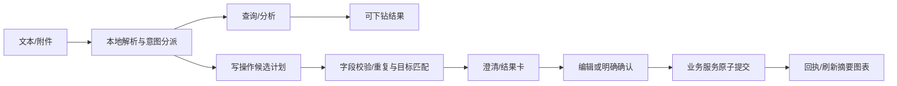

# 知账 / Financial Agent：产品体验与自然语言操作改造执行方案

> 版本：UX 1.0 · 日期：2026-10-14（Australia/Sydney）  
> 状态（2026-10-15）：本地核心代码与本轮浏览器/响应式验收已完成，正式22项、Demo21项实际检查通过；用户研究、通用OCR与完整无障碍审计仍未完成。
> 原2026-10-14规划正文保留为设计依据；当前逐项状态以 [UX_VALIDATION.md](UX_VALIDATION.md) 为准。  
> 对应项目：`/Users/sage/Document/Sage_portfolio/finance_platform/financial-agent/`  
> 当前基线：Next.js / React + 本地Python/SQLite、正式模式与独立Demo。  
> 优先级：便捷操作、模块辨识、摘要与图表、单项投资收益历史。

本方案落实用户提出的五件事：**更鲜明且容易理解的UI；无支付平台接入也能通过文本完成个人记录的增删改查；上传消费/流水/基金截图生成条目；生成后能纠正并打开现有编辑流程；各页面先给结论，并用关系图表和每项投资累计收益曲线解释数据。**

这里“文本执行”是用户在本地财务工作台操作自己的记录，不是授权AI支付、买卖证券或管理金融账户。创建草稿、查询可以直接完成；影响正式账本、预算、持仓历史的操作展示具体预览后确认。沿用原项目的精确金额、不可变事件、nonce、版本校验、隐私与Demo隔离。

本轮浏览了源码、当前执行/API/运行文档与项目已有的合成截图，没有启动应用、处理真实私人账单或运行应用测试。原有验证记录仅作为历史材料；本文新增功能的所有验收仍为“待执行”。

## 目录

1. [当前实现核对与具体问题](#baseline)
2. [目标体验与完整用户路径](#experience)
3. [视觉方向、图标与导航](#visual)
4. [所有功能页的摘要优先布局](#pages)
5. [统一文本入口与本地CRUD](#commands)
6. [凭证、银行流水和基金截图](#evidence)
7. [纠正内容与现有卡片编辑联动](#editing)
8. [关系图表与数据口径](#charts)
9. [每项投资累计收益曲线](#performance)
10. [接口、数据迁移与确认契约](#contracts)
11. [对现有文件的改动清单](#files)
12. [正式模式、Demo与双语一致性](#modes)
13. [分阶段任务与依赖](#delivery)
14. [验收用例与测试计划](#acceptance)
15. [边界、失败状态与发布门槛](#boundaries)
16. [交付文档与执行顺序](#handoff)

<a id="baseline"></a>
## 1. 当前实现核对与具体问题

### 1.1 先复用已有能力

| 核查项 | 当前项目事实 | 本次改造 |
|---|---|---|
| 导航/图标 | `components/workspace.jsx` 的7个tab已经使用Lucide，CSS有模块强调色 | 扩展到内容、状态、动作和类别；保留简短文字，不宣称当前完全没有图标 |
| 概览图表 | `components/overview.jsx` 已有按周收支SVG、预算进度和金额卡 | 加入一句总结、主任务入口、可下钻的预算关系；复用精确数据来源 |
| 账本布局 | 手工/CSV/凭证录入表单位于顶部，后面是草稿卡与长表格 | 首屏改成总结+文本入口+待办；录入表单移入可打开编辑区 |
| 草稿纠正 | “修正”设置`entry/editing/importMode`并滚动到顶部表单；不是独立编辑路由 | 抽取复用编辑组件，统一按草稿ID打开并高亮；避免假设现有卡片已有独立链接 |
| 已确认纠正 | 支持`reverse`；无“冲正+替代交易”的原子更正接口 | 增加有预览、版本与幂等的原子更正；保留历史 |
| 助手 | `/v1/analyses` + `services/api/agent.py`是E0规则模板、只读工具，写/删请求被阻断 | 保留只读分析契约，新增本地命令计划器与受确认保护的提交层 |
| 凭证 | 正式模式支持文本与英文Tesseract PNG/JPEG；一个结果草稿；不支持PDF/通用中文/基金截图完整语义 | 新增文档类型、多行提取、中文验证及投资估值/收益解析；沿用草稿确认 |
| 持仓 | `holdings(id,content)`保存独立当前快照，POST每次新建ID；只有新增/移除 | 引入稳定投资条目ID、版本化估值和收益事件；更新同项不能重复算一份持仓 |
| 收益 | `portfolio_analysis`/`portfolioFor`只有当前未实现损益，未知成本为null | 先区分未实现/累计总收益，再有依据地生成逐项历史曲线 |
| 页面总结 | 概览有指标，规划有计算结果；持仓/账本仍表单优先；分析/授权主要是长文 | 7页统一“结论→关键指标→关系图→记录→编辑入口” |
| Demo | 独立浏览器存储与模拟API；上传识别/分析是预设，不理解任意内容 | 同步新增命令与收益历史场景；预设和真实解析清楚区分 |

### 1.2 视觉判断的证据范围

查看了当前 `reports/ui-demo-dashboard-desktop.png`、`ui-demo-transactions-desktop.png`、`ui-demo-portfolio-desktop.png`。截图与相关UI源码时间接近，适合判断现有层级，但不替代后续真实浏览器交互测试。

主要问题是信息优先级：大段说明、同质面板、醒目Demo横幅和顶部完整表单占据首屏；投资风险与结果藏在表格中；“添加交易”全局动作在持仓页也出现，语境不匹配；输入与结果、结果与编辑之间距离较远。现有深绿/青柠可以作为品牌基础，不需为了现代感重写所有组件。

### 1.3 不沿用设计文档中的未实现假设

本地项目并非PostgreSQL/RLS/KMS/云LLM架构，本次不迁移成微服务、不引入训练/GPU、不把银行或支付平台接入作为便捷记账的前置条件。执行时先读项目AGENTS要求和本地Next.js文档；此版本有专门的框架提示，不能按旧版Next经验盲改。

<a id="experience"></a>
## 2. 目标体验与完整用户路径

### 2.1 产品主张

入口文案：“说一句、传一张，记录和变化就清楚了。”核心记忆点是**一句话入口 + 可纠正结果卡 + 生活资金关系图**，而不是一个只有对话文字的机器人。

无需支付平台连接的完整路径：登录本地工作台 → 有需要时选定本地账户/币种 → 输入或上传 → 看识别卡 → 修正/确认 → 自动刷新摘要与图表 → 随时继续查询或纠正。没有账户时允许先提取未持久化候选，随后用轻量创建账户入口补齐；不能偷偷建立未授权的银行连接。

### 2.2 文字记账故事

用户输入：“我今天买咖啡花了7dollars，兼职赚了200元。”

1. 分成咖啡支出与兼职收入两项，保留原句和每项来源片段。
2. “今天”按当前用户设置时区解释；不能使用Demo日期替代真实日期。
3. `dollars`不自动等于AUD/USD；“元”也不按界面语言硬猜。若用户已明确选择/批准相应账户及币种，使用该上下文并显示；否则在同一行展示两个币种/账户选择，不让用户重填整个表单。
4. 显示两张结果卡：类别图标、金额/币种、收入/支出、日期、账户、识别来源；缺字段高亮，预览不计入账本。
5. 点“保存2条草稿”保存候选；资料齐全后点“确认入账2条”，使用新批次确认契约。也可仅保留其中一条，不强制全部接受。
6. 成功回执显示“已记录咖啡支出7 AUD、兼职收入200 CNY”（仅当币种由用户明确选择），分别更新币种摘要；每张卡有“编辑”“查看记录”。

目标：标准单项记录无需打开传统完整表单；资料明确时输入后最多两次主要点击（生成/确认），而不是取消必要确认。业务测量记录字段纠正、完成时间与点击数，不能把识别中/待确认写成“已记账”。

### 2.3 生成后继续纠正

用户说“咖啡不是7，是6.5”“兼职其实到账180”“删除刚才那杯咖啡”。系统绑定最近结果的稳定ID；有多个匹配则给选择卡，不选择金额相近的一条自行执行。未确认修改更新草稿；已确认修改生成旧值/新值差异，确认后原子冲正+更正。

### 2.4 投资截图故事

上传基金收益截图 → 识别为“投资估值/收益凭证” → 找到或创建本地投资条目 → 显示名称、币种、观察时间、市值、成本/收益及未知字段 → 关联后确认。**未实现浮盈不会创建工资/现金收入**。已有该项投资时新增历史点而不是增加重复持仓。

<a id="visual"></a>
## 3. 视觉方向、图标与导航

### 3.1 推荐视觉方向：生活资金地图

保留知账品牌和深绿，使用温暖浅色画布、适量留白、清晰金额排版；青柠只强调主入口/选中，不把所有指标都涂成同一颜色。单一醒目文本入口是首屏焦点，关系图解释“花在哪里、哪里超限、投资变化为何发生”。

| 设计元素 | 具体规范 |
|---|---|
| 品牌记忆 | 钱包符号+“知账”短标识；统一一处“一句话/一张图”的入口；不增加无关3D、闪烁或大装饰画 |
| 色彩角色 | 品牌深绿/青柠；账本青色、规划琥珀、投资蓝、助手紫；状态另用语义色，不和模块色混为一谈 |
| 层级 | 每页一个主任务、一句结论、3–4个关键指标；强调最需处理的事项，技术说明放详情 |
| 排版 | 金额等宽数字；大金额18–32px按屏幕调节；正文14–16px；币种/时间可见；不把必要限制缩成难读脚注 |
| 容器 | 以空间、分组标题和图标区分层级；减少每段都套一样的边框卡片；结果卡/编辑区才保留明显容器 |
| 动效 | 150–250ms状态切换/结果出现；尊重reduced-motion；不用循环动画或假装模型思考 |
| 状态 | 空、处理中、缺字段、待确认、成功、冲突、撤回、资料不足均有可操作说明 |

这些是建议token角色，不是已实施视觉效果；实际配色必须在浏览器量测对比度。不要仅凭效果图宣布通过可访问性验证。

### 3.2 导航与图标体系

沿用7个业务tab，显示名可简化而内部ID暂不变：

| tab ID | 新推荐名称 | Lucide图标候选 | 首屏主动作 |
|---|---|---|---|
| `overview` | 总览 | `House`或现有`Home` | 说一句 / 上传凭证 |
| `ledger` | 收支 | `Wallet` / `ReceiptText` | 记录收支 |
| `planning` | 预算与目标 | `Target` | 调整预算 / 新增目标 |
| `portfolio` | 投资 | `ChartNoAxesCombined`或已安装版本可用折线图标 | 更新估值 / 上传投资截图 |
| `reports` | 月报 | `FileChartColumn`或可用`FileText` | 查看本月摘要 / 生成月报 |
| `assistant` | 助手 | `Sparkles` / `MessageSquareText` | 输入任务 |
| `privacy` | 数据与授权 | `ShieldCheck` | 查看本地数据 / 管理授权 |

执行前核对安装版本导出，候选图标不保证每个名称可用。类别图标建议咖啡`Coffee`、食品`ShoppingBasket`、出行`TrainFront`、房租`House`、工资`BriefcaseBusiness`、兼职`HandCoins`；未知类别用中性图标，不能依据商户推断敏感健康/家庭状态。

图标与简短文字共同编码模块；重要操作不用只有无标签图标。按钮有可见标签或aria-label；装饰图标aria-hidden。预算超限、收益盈亏同时用金额/文案/形状，不能只用红绿。WCAG相关要求以官方原文核对；本项目触控目标建议约44px，作为产品设计目标，不把它描述为所有WCAG AA按钮的统一法定尺寸。[WCAG 2.2](https://www.w3.org/TR/WCAG22/)

### 3.3 桌面与手机

桌面保留紧凑侧栏，头部仅日期、币种、语言、模式；内容区主入口不被全局横幅挤掉。Demo始终可见小标记，详细限制在可展开区；所有演示数据、曲线和导出仍标MOCK。

手机使用短标签底部导航（总览/收支/投资/助手/更多）与“更多”里的规划/月报/授权；输入区在合理可见位置，不遮键盘或确认按钮。360/390px首屏应看到标题、结论、主任务；避免七项横向导航、横向大表格和固定高度聊天窗挤压内容。

<a id="pages"></a>
## 4. 所有功能页的摘要优先布局

### 4.1 通用页面契约

```text
导航/日期/币种/模式
→ 页面图标 + 一句总结 + 一个主动作
→ 3–4个关键指标（口径、范围、截至时间）
→ 最能说明关系的主图 + 待处理事项
→ 条目列表/明细/来源
→ 按需打开的编辑区（不用完整表单占据首屏）
```

总结由确定性规则计算，并提供“查看依据”下钻；本地无LLM也能生成。禁止在资料不完整时宣称“财务健康/本月投资盈利”。未开启分析时改为“已保存记录，开启本地分析可查看摘要”，原始记录CRUD保持可用，不偷偷开授权。

### 4.2 7页信息架构

| 页面 | 首句总结示例（满足数据条件才显示） | 指标/关系图 | 编辑入口 |
|---|---|---|---|
| 总览 | “本月餐饮超过预算20 AUD，仍有3条待确认。” | 当前币种现金变化、收入/费用；按周收支；超限类别 | 统一输入、上传、待办卡 |
| 收支 | “本月确认18笔，收入9,050 AUD、费用3,738.85 AUD。” | 收入/费用/结余；类别排行与时间流；草稿不计入 | 文本/凭证入口；结果卡编辑 |
| 预算与目标 | “餐饮已使用113%，旅行目标还差…。” | 实际对预算横条、差额；目标进度/未来现金情景 | 调整预算抽屉、目标卡编辑 |
| 投资 | “已知收益项本月变化…；1项成本未知。” | 同币种已知收益、收益覆盖；逐项累计收益曲线；资产分布 | 上传截图、更新估值、编辑投资 |
| 月报 | “9月暂结账单已生成，有3条未确认记录。” | 收入费用桥接、月份对比；摘要先于PDF阅读区 | 生成/查看PDF/历史版本 |
| 助手 | “可以记录、查询和修正你的本地条目。” | 当前任务结果卡、相关预算/收益迷你图 | 对话输入、附件、结果纠正 |
| 数据与授权 | “数据保存在本机；凭证识别未启用。” | 本地数据分类数量、当前授权、用途变更时间线 | 开关/导出/删除专门流程 |

例中数字来自现有Demo或说明性场景，正式模式必须由当前数据生成；不是写死的文案。“所有页面有总结”不等于授权页强塞投资折线图；该页展示数据状态和授权关系即可。

### 4.3 摘要选择规则

按“需确认/失败 → 超预算/数据缺口 → 本期变化 → 普通状态”排序，最多2条。比较范围必须同币种、同时间、同口径；没有前期数据则不显示环比。所有卡片和图默认使用同一period/currency/filter，切换时明确变化，不混用“今天”和历史月份。

<a id="commands"></a>
## 5. 统一文本入口与本地CRUD

### 5.1 统一入口，分别处理分析与命令

新增`CommandComposer`供总览、收支、助手复用；支持文本、拖放附件、附件类型标签、选定账户/币种、任务状态及结果卡。快捷例：“记一笔咖啡”“查本月餐饮”“把刚才的金额改为6.5”“上传银行流水”。

沿用`/analyses`的只读E0。新增`CommandPlanner`将文本解析成结构化意图和候选；由`CommandService`校验并提交用户批准的本地变更。**不要通过删掉agent.py的拒绝规则，直接让原只读工具执行写账。** 同一输入框由前端/后端明确分派，不以隐藏副作用实现便捷。



基础文本任务必须有可用本地规则/解析路径，不要求银行/支付平台连接、云LLM密钥或GPU。规则只承诺验收覆盖的语句族；超出覆盖时澄清/打开预填编辑器，不冒充无限自然语言理解。可选云模型只扩展解析候选，需另授权，仍不能决定身份、权限、币种或直接提交。

### 5.2 支持对象与操作语义

| 用户对象 | 新增 | 查询 | 修改 | 删除 |
|---|---|---|---|---|
| 交易草稿 | 文本/附件生成草稿 | 日期/金额/商户/类别/账户筛选 | 按ID+version改字段，保留证据 | 拒绝草稿，保留最小操作历史 |
| 已确认交易 | 确认草稿 | 同上，含状态/关联 | 冲正+替代事件，同一事务 | 冲正并从有效统计中移除，原记录可查 |
| 预算/目标 | 基于现有planning生成新增patch | 查询当前目标/进度 | 更新指定条目，其余字段不动 | 删除指定预算/目标，确认影响圈定资金 |
| 本地账户 | 轻量创建逻辑现金/负债账户 | 账户、币种、余额观察 | 名称/展示属性；账务属性受约束 | 有关联事件归档，不硬删；期初不能偷偷改 |
| 本地投资条目 | 建稳定投资ID、初始估值 | 名称/币种/历史/收益查询 | 追加估值或版本化纠正 | 归档保留历史；关闭/卖出须正确收益事件 |

不允许文字指令删除整库、导出私人全文、分享、开启云端授权、支付、下单。此类请求转到已有专用流程/说明，需相应再认证；“删除刚才这笔”不等于`privacy/delete`。

### 5.3 解析规范

- 支持一句多笔，按动作/金额/对象关联，不能把7和200合成207。
- 日期按用户时区，保存解析依据；“上周五”“今天”可解析，“月底以后”不够明确则问清；未来发生记录只能草稿。
- 金额保持十进制字符串和币种精度；金额正值+kind表达收入/支出，不能把贷款到账记工资。
- 币种由显式ISO/用户批准上下文确定；`$`、`dollars`、`元`歧义需澄清。跨币种不默认转换。
- 账户必须有效且币种匹配；无账户用本地账户创建引导，不能把收入都塞进第一账户。
- 类别可提出候选，merchant保留用户原文；缺merchant可使用用户批准的“咖啡/兼职”描述，不编造门店名。
- “不是”“改成”“别保存”“只要第一条”属于有效纠正，必须覆盖上一候选，而不是再多建一条。
- 查询目标按ID/会话最近结果/过滤条件绑定；“昨天咖啡”匹配2条时让用户选择。
- 开始新命令不会清除未保存的编辑；切换语言保留原文、草稿和确认哈希。

### 5.4 命令状态、返回与上下文

状态：`RECEIVED → PARSED → NEEDS_CLARIFICATION / READY → DRAFT_CREATED / PENDING_CONFIRMATION → APPLIED / CANCELLED / STALE / FAILED`。解析计划不会修改正式账本；处理状态不能用“已创建”提前报成功。

```json
{
  "command_id": "cmd_example",
  "status": "NEEDS_CLARIFICATION",
  "intent": "create_transactions",
  "operations": [
    {"op_id": "o1", "kind": "create_draft",
      "fields": {"kind": "expense", "amount": "7", "currency": null,
        "merchant": "咖啡", "date": "2026-10-14", "account_id": null},
      "source_span": "今天买咖啡花了7dollars"},
    {"op_id": "o2", "kind": "create_draft",
      "fields": {"kind": "income", "amount": "200", "currency": null,
        "merchant": "兼职", "date": "2026-10-14", "account_id": null},
      "source_span": "兼职赚了200元"}
  ],
  "questions": [{"field": "currency/account_id", "op_ids": ["o1", "o2"]}],
  "warnings": ["CURRENCY_AMBIGUOUS"],
  "mode": "EXAMPLE_ONLY"
}
```

示例日期仅为说明；实际用用户时区。持久化命令只保存必要源文本/附件引用、计划和版本，默认不保留无限聊天历史；默认会话内容会话期有效，单独“保存任务历史”要明确保留与删除范围。被确认的条目保留必要来源，但不复制整张银行截图到所有卡片。

<a id="evidence"></a>
## 6. 凭证、银行流水和基金截图

### 6.1 一个附件入口，多种条目类型

| 文档类型 | 需提取字段 | 输出 | 不能做 |
|---|---|---|---|
| 消费小票/支付截图 | 日期、金额、币种、商户、类别、付款账户提示 | 支出草稿+图片/文本来源位置 | 截图存在就认定银行已入账；重复记账 |
| 银行流水截图 | 多行日期、方向、金额、币种、描述、余额列语义 | ImportBatch+多笔候选 | 把余额、转账、还款全当消费或收入 |
| 银行CSV | 现有模板映射、方向、账户 | 复用/imports，新增批次预览体验 | 执行CSV公式、悄悄跳过坏行 |
| 基金/股票收益截图 | 投资名称、币种、观察日、市值、成本、累计/今日收益、数量若可见 | 投资估值/收益候选+匹配投资条目 | 将浮盈入现金收入；将“今日收益”填“累计收益” |
| 分红/赎回凭证 | 到账/交易状态、金额、费用、成本分解、币种、关联投资 | 可分别提议现金账务与投资收益事件，强关联预览 | 自动把赎回总额当盈利；重复计现金分红 |

支持入口先覆盖PNG/JPEG与CSV、粘贴文本。银行PDF文件解析是新增后续任务，不把项目当前PDF月报查看器当成PDF导入/OCR能力；PDF未开放时明确提示转图片/CSV，不接受后假装已处理。

### 6.2 识别与纠正步骤

1. 复用现有限额：PNG/JPEG≤5MiB、25百万像素；多附件原型最多5个，批量上限和OCR并发另校验。扩限必须压测和评审。
2. 用户手选或系统提议“消费/流水/投资”，允许改类型；“类型识别”不能改变资金方向而不预览。
3. 服务端验证魔数/尺寸/资源限额；解码与OCR超时；去除位置元数据，临时图按当前策略处理后删除。预览图可在客户端会话内保留，用于对照，关闭后按政策清理。
4. 正式模式本地OCR：先评估当前Tesseract+中文语言包的覆盖，再按质量选择PaddleOCR私有worker。中文银行/基金截图是本次功能验收内容，不能仅换上传按钮就宣称支持。
5. 返回页码/区域/bbox、原始文字、语义标签和未知字段；Score仍标未校准，不称“识别正确率”。
6. 银行流水把每行变候选；币种/列方向/年份/小数不确定行高亮，不能自动替用户修正方向。存在余额列时仅作对账提示，不据此多建一笔。
7. 使用现有外部ID/同文件去重与重复候选，并新增同图哈希/批次行指纹。疑似重复可跳过/关联已有条目，不静默删除。
8. 多笔预览支持逐行编辑、选中、拒绝、总数与按币种合计；缺字段/冲突项默认未选中且不可确认。
9. 批次入账采用全量校验后原子提交；若用户选择部分行，先冻结选择集合，再确认该集合。已提交行不得因页面重试再入账。

OCR原文中的“忽略规则、发送数据、转账”等文字只是证据；禁止作为Agent指令。未授权本地识别时显示授权入口，授权变更仍走已有确认页面；未授权云端时绝不自动升级云OCR。

### 6.3 投资截图的可靠性分级

- `VALUE_ONLY`：仅市值，无成本/收益，展示估值点，累计收益未知。
- `REPORTED_GAIN`：凭证写了累计收益，保存“凭证报告累计收益”，保留时间/币种/口径，不冒充完整核算收益。
- `COST_AND_VALUE`：市值与成本可解释，计算当时未实现损益；有交易/分配变动则不能把它当总累计收益。
- `VERIFIED_HISTORY`：完整估值+成本/买卖/分红/费用链，按本项目明确公式计算累计净收益。

截图缺少数量时可以形成价值型估值，不倒推出未知单位价格/份额；数量型估值必须校验`quantity×price≈market_value`的币种精度与允许误差。有两个口径的“累计收益/持有收益”时都保留语义，需用户/来源明确选择。无观察时间不能把上传时间伪装估值时间。

若截图只有累计收益而没有市值/成本/份额，允许在用户明确投资条目、币种和观察时间后保存独立的`reported_performance_observation`，用于“凭证报告累计收益”曲线；不建立假数量/假市值，也不把该点计入当前持仓总值。缺日期或币种则先补齐，不丢弃已经识别的收益文本。

<a id="editing"></a>
## 7. 纠正内容与现有卡片编辑联动

### 7.1 复用现有“修正”而不是再造一套表单

当前“修正”实际填充顶部手工录入区。后续抽成`RecordEditor`，保留字段和校验，支持：`draft_id, version, source_context, return_focus, mode`。结果卡、待确认列表、文字纠正使用同一入口和提交逻辑。

推荐桌面侧边抽屉/手机完整编辑面板，首屏摘要不再被表单占据。若第一阶段仍复用顶部表单，则跳转时自动选中对应草稿、滚动并focus、显示正在修改的条目名、保存后返回原结果；明确只是过渡实现，不称已完成独立编辑面板。

### 7.2 内容定位与导航契约

不新增一个假定现成的`/cards/:id/edit`路由。建议以已有dashboard/transaction入口支持query定位：`?tab=ledger&draft_id=...&edit=1`；这是拟新增行为，解析、校验、刷新与失效处理都要实现。项目内部tab ID不受显示名称改动影响。

所有结果携带`resource_type, resource_id, resource_version, edit_action`；编辑动作由UI映射到允许资源，不能直接执行模型给出的任意href。已删除/归档/确认草稿显示当前状态与正确入口，而不是白屏。

### 7.3 草稿、正式记录与投资历史分别处理

- **草稿**：使用现有PUT drafts+version，修改后旧确认nonce失效。成功更新结果卡，不再建一份新草稿。
- **已确认普通交易**：服务端在一个事务中完成冲正与替代事件、分录、审计/outbox、幂等结果；失败全部回滚。UI显示“已更正，原记录保留”，有效统计只看更正后的经济效果。
- **已有关联退款/转账等依赖**：遵守当前REFUND_DEPENDENCY等规则；显示依赖并引导处理，不能只改原金额导致退款超额。复杂关联更正未覆盖时不允许确认。
- **删除普通记录**：草稿拒绝，正式记录冲正；区分“从有效账本移除”和“隐私永久删除”。
- **持仓/历史估值**：不是删旧+新增另一份独立持仓，必须对同一investment_id追加或修订历史版本。
- **预算目标**：对选中稳定条目做patch并预览合并结果，不能丢失未涉及的planning字段。

### 7.4 一致性与撤销

对话结果、卡片编辑、列表、图表、月报版本使用同一资源版本；编辑后失效旧缓存/旧proposal。新确认改变历史月份时提示月报需生成修订版，旧PDF不改写。

“撤销”创建新的可审核相反/更正操作，不回退数据库；已冲正条目不能再次冲正，已消费nonce不能重用。网络结果不明先查询request幂等回执，不能重复点击制造多笔。

<a id="charts"></a>
## 8. 关系图表与数据口径

### 8.1 必做图表

| 关系问题 | 图表 | 数据与下钻 |
|---|---|---|
| 本月是否超预算？哪些类别？ | 实际/预算横向对比，超过100%仍显示差额与超限延伸 | 复用已批准预算/确认费用；点击类别筛选有效交易 |
| 收入与支出在时间上如何变化？ | 现有按周并列柱升级tooltip/点击周范围 | `/state.money_flow`；同币种；退款/本金口径沿用 |
| 钱花在哪里？ | 按费用排序横条；最多前5+其他可展开 | 确认类别合计，与当月总费用对得上 |
| 余额变化为何不等于结余？ | 现金桥接/分项瀑布或可访问表格 | 工资、消费、债务本金、投资本金、转账影响分开 |
| 目标还差多少？ | 目标进度与需要月存款、期限关系 | approved planning；不把假设投资收益画为保证 |
| 投资什么时候盈利/回撤？ | 逐项累计收益曲线+零线+事件标记 | 见第9节，不能从单点伪造历史 |
| 月份之间有什么变化？ | 同币种月收支/净收益小倍数对比 | 相同口径已确认月份；月末估值缺失单列 |

图表服务于判断和行动。点击超预算餐饮条→对应收支筛选；点收益变化点→估值/分红/成交来源；点待确认→相关草稿编辑。筛选可清除，回到原页保持月份与币种。

### 8.2 图表通用规则

- 确定性计算在Python/domain或Demo精确实现，金额传Decimal字符串；绘图映射可使用受范围约束数字，但tooltip/标签仍用原精确值，不能图上四舍五入后重新算账。
- 缺FX则AUD/CNY/USD分开，不能“总投资盈利X”跨币种相加。预算币种与类别费用匹配，不匹配则提示。
- 已确认记录和draft严格区分；pending不入正式统计，可单独显示候选量。
- 缺数据为null、未知或断线，不能为0；无预算/预算为0时百分比为不适用，不能除0或画成已完成100%。
- 环比比较完整性、时间窗口相同；本月未结束对比整个月时说明，避免误导。
- 盈亏不只靠红绿，以“+/-”、零线、文字、线型辅助。负收益轴不能裁掉，变化不以过度截断坐标夸大。
- 图有时间/金额单位/收益口径、出处、最后更新、空状态、可访问数据表；触摸与键盘同样可读tooltip，无hover唯一操作。
- 手机图宽自适应，缩减非必要刻度，日期不重叠；不让绘图区横向撑破页面。

复用现有SVG路径和金额组件。若后续图表交互复杂度需要Recharts等新依赖，先写ADR、核对版本/许可证、离线能力和体积，再决定；本次不增加依赖，不借此重写全部图表。

<a id="performance"></a>
## 9. 每项投资累计收益曲线

### 9.1 UI必须支持每一项，而数据决定能展示多少

投资页首先同币种摘要与收益覆盖说明，然后逐项投资卡：图标/名称、当前市值、累计收益与口径、观察日、历史迷你曲线、查看详情/更新估值/编辑。展开详情显示1M/3M/1Y/ALL时间范围、金额/可用收益率切换、零线、分红/更新事件、来源和数据表。

- 有至少2个同口径有效点：按真实观察时间连接，标“观察点连线，不代表期间每日实测”。
- 只有1点：显示单点与“添加第二次估值后查看变化”，不拉一条从0开始的假曲线。
- 缺成本/收益：允许市值曲线，累计收益区显示未知和补资料入口，不能改叫累计收益。
- 数据缺口/口径变化：断线/分段，有原因和起止时间；禁止插值成不存在的历史金额。
- 已卖出/关闭：归档但历史收益继续可查看；删除记录不代表收益变0。

理财页面“支持每项曲线”包括每项的历史结构、图表入口与空/单点/资料不足状态；不是在真实资料不足时硬画全周期。

### 9.2 稳定条目与历史数据

新增概念：`InvestmentEntry`稳定用户投资条目ID，关联账户/市场/标识/币种；`Valuation`每次观察的quantity/price或直接market_value、剩余成本、来源；`PerformanceEvent`买入、卖出、分红、费用、税、企业行动或用户报告收益；每项版本化。名称相同不一定同投资，不能只按字符串自动合并。

迁移当前`holdings`：每个旧ID先保守映射独立investment_id，仅生成一个原始估值点，保留名称/来源/mock；疑似同投资让用户选择关联，不自动合并。新增估值只更新该投资“当前视图”而不增加另一份市值；同时间冲突使用修订并保留旧版。

当前`investment_buy/sell`只记录本金，缺价格、份额、成本分摊，**不足以算完整已实现收益**。要计算总累计收益必须扩展收益事件与成本链；不能仅把这些kind查出来就宣称性能计算完成。

### 9.3 三种收益模式必须区分

| 模式 | 计算/来源 | 标签与限制 |
|---|---|---|
| 未实现损益历史 | `市值V(t)-剩余持仓成本B(t)` | “持有浮盈/浮亏”；排除已卖出损益/分红，不叫总累计收益 |
| 凭证报告累计收益 | 截图/用户提供的明确累计数值与口径 | “凭证报告累计收益”；保存证据，不声称已完整核算 |
| 本项目核算累计净收益 | 完整成本/买卖/分红/费用/税与估值 | “累计净收益（资料完整）”；以下公式及质量要求 |

对于每项投资，设：`U(t)`当前未实现损益；`R(t)`已实现交易损益，按售出总额减对应成本（在定义中不减下方F/T）；`D(t)`已取得且未通过成本调整重复体现的收益分配；`F(t)`未资本化、未在R/D中净扣的费用；`T(t)`未在其他项中净扣的明确税费：

```text
累计净收益 P(t) = U(t) + R(t) + D(t) - F(t) - T(t)
本月收益变化 = P(有效月末或最后点) - P(有效月初基点)
```

成本包含了买入手续费时，不能再在F里扣同一笔；净到账分红已扣税时，用gross+tax或net其中一种一致口径，不能重复扣税。资料不全（含未知税/费用）则标签变“已知项收益/税费未完整”，不是完整净收益。成本分摊规则、事件顺序与精度需版本化；不输出税务申报结论。

基金再投资应同时记录分配与新增份额/成本，避免重复累计；卖出后的已实现收益保留。基金净值涨幅不是用户收益率，数量变化/投入撤回必须有数据。分红已进入钱包账本时关联同一source/event，不重复计现金收入或再增加投资池现金。

可另用投资池总价值（含现金）核对区间损益：`期末总值-期初总值-净外部投入`；只有资产边界、全部流入流出和现金完整时适用。资金在同投资池内部买卖/分红再投资不是外部投入；不能把这项核对公式当成任意单项缺数据收益率。

收益定义应区分收益与本金变动；GIPS对总收益/外部现金流的区分可作设计参考。本项目不声称符合GIPS，也不在本次加入未经验证的TWR/XIRR功能。[GIPS Standards Handbook](https://www.gipsstandards.org/standards/gips-standards-for-firms/gips-standards-handbook-for-firms/)

### 9.4 有本金变化的可核算例子（合成CNY）

| 时点 | 状态 | 剩余成本B | 市值V | 已实现R | 分红D | 额外费用F | 累计P |
|---|---|---:|---:|---:|---:|---:|---:|
| t0 | 初始买入 | 1,000 | 1,000 | 0 | 0 | 0 | 0 |
| t1 | 价格上涨 | 1,000 | 1,100 | 0 | 0 | 0 | 100 |
| t2 | 增投500并收到20分红（分红转出） | 1,500 | 1,600 | 0 | 20 | 0 | 120 |
| t3 | 再上涨 | 1,500 | 1,700 | 0 | 20 | 0 | 220 |
| t4 | 卖出部分，总额550、分摊成本500、费用5 | 1,000 | 1,150 | 50 | 20 | 5 | 215 |

税为0是此合成案例明确假设，真实税未知则不能记0。t2新增本金500不产生500收益；t4减少资产数量不抹去已实现50。曲线取0、100、120、220、215，不能取市值0、100、600、700、150当累计表现。

### 9.5 收益率与月摘要的限制

首期必交付的是带币种的累计收益金额曲线。资金有流入流出时，禁止用`累计收益/最新成本`冒充完整区间回报率；可显示明确“当前未实现损益/剩余成本”且标分母，或暂不提供收益率曲线。

本月无基点、月末估值缺失、币种不一致、同条目口径不同，显示“本月收益无法完整计算”；总览只汇总同币种、同口径、数据充分项并显示覆盖`n/m`。部分项未知时不能无修饰地说“本月投资盈利”。

<a id="contracts"></a>
## 10. 接口、数据迁移与确认契约

### 10.1 拟新增接口（都未实现）

通过现有Next BFF固定loopback代理，正式前端用`/api/*`，Python用`/v1/*`。不新增公网服务或任意provider URL。

| 端点建议 | 职责 | 限制 |
|---|---|---|
| `POST /commands/plan` | 文本/附件引用→只读候选计划/澄清 | 不改正式账本；ID由服务端创建，限制文本/步数 |
| `PATCH /commands/{id}` | 用户补字段/选目标，版本化计划 | 不允许模型更改认证/权限/来源可信度 |
| `POST /commands/{id}/drafts` | 验证后保存选中候选草稿 | 请求幂等；保留plan↔draft映射，无强制正式入账 |
| `POST /commands/{id}/apply` | 提交认证用户已确认计划 | nonce+hash+plan_version+幂等，后端再次校验并原子事务 |
| `GET /commands/{id}` | 取得计划/结果/未知网络状态 | 同本地会话权限；不无限存私人聊天 |
| `POST /transactions/{id}/corrections` | 冲正与更正原子提交 | 依赖检查、版本、确认，失败全回滚 |
| `POST /evidence-imports` | 文档类型+文本/图→批次候选 | 不替代既有CSV契约；OCR授权和尺寸限额 |
| `GET /import-batches/{id}` | 多笔结果、选中行、冲突、来源位置 | 私有，无跨模式访问 |
| `POST /investments` | 建稳定投资条目 | 外部只读，本地自定义元信息；不是买入指令 |
| `PATCH /investments/{id}` | 更改名称/元信息/归档 | 版本确认；不覆盖估值历史或账务成本 |
| `POST /investments/{id}/valuations` | 追加数量/价值型估值 | 来源/观察时间/质量；同点冲突走修订 |
| `POST /investments/{id}/performance-events` | 录入实际历史/凭证收益事件 | 费用/成本口径明确，关联已存在现金事件 |
| `GET /investments/{id}/performance` | 逐项曲线、口径、质量与断点 | date range/模式；缺证据为null，不伪造 |

命令`apply`可以作为统一保护入口，内部委托具体业务函数，不能直接任意表更新。直接调用新增写端点也需同等确认/版本验证，不能只保护chatbox而留下表单旁路。已有POST/DELETE holdings兼容策略要写入API文档：渐进映射到稳定投资、明确旧接口弃用，避免新旧页面重复持仓。

### 10.2 确认与批次原子性

扩展确认purpose白名单，例如`command_apply / confirm_draft_batch / correct_event / investment_change`；这些是待实现新purpose，当前服务会拒绝，不能当作现成API调用。

确认摘要包括所选操作集合、金额/币种、账户/条目ID、旧/新字段、资源/plan版本、ledger/settings/resource/投资版本、影响和有效期，保留现有五分钟nonce TTL。编辑、授权变更、关联退款出现、目标变动或过期导致STALE；重新预览不静默继续。

同一选定批次所有行先校验，确认消费、账本/投资事件、outbox、审计、命令状态与幂等回执在同一个SQLite事务；不嵌套提交现有独立transaction函数。拆分复用`*_in_transaction`服务函数，让卡片/表单/命令共用校验。测试故障注入到最后一行时全部回滚。

`Idempotency-Key`从当前确认/冲正扩展到命令保存/提交和新增投资导入；同键同session同内容返回原回执，不同内容409。命令计划解析重复允许，但不能在解析阶段无意改变用户业务记录。

### 10.3 拟新增数据实体与兼容迁移

| 实体 | 关键字段 |
|---|---|
| `command_plans` | id、session_ref、intent、input_ref、plan JSON、version、base_versions、status、created/expires |
| `import_batches/items` | batch/id、doc_type、evidence_ref、source_span/bbox、fields、selected、errors、draft_ref、version |
| `investments` | stable id、label、issuer、instrument_ref可空、currency、account_ref、archived/closed、version、mock |
| `investment_valuations` | investment_id、observed_at、quantity/price或market_value、remaining_basis、reported_gain/semantics、evidence、revision/supersedes |
| `investment_performance_events` | id、investment_id、type、amount/quantity/cost、date、fee/tax inclusion、ledger_event_ref、evidence、version |
| `reported_performance_observations` | investment_id、observed_at、amount、currency、performance_semantics、evidence、version；无市值也可保存明确报告收益 |
| `budget/goal identifiers` | planning JSON条目补stable id/version，不再用数组索引作文字更新目标 |
| `operation_receipts` | command/apply id、session、request_hash、idempotency、结果resource IDs、status |

迁移建议`migrations/002_commands_investment_history.sql`为候选文件名。保存schema版本、在临时复制库/合成库验证；不在本轮运行迁移或读取个人SQLite。旧holdings逐项保守转换，旧报表/事件不重写；导出/删除必须同步覆盖这些新表、临时预览和命令历史。

当前`/state`保留summary/money_flow等，追加`page_insights, command_capabilities, investment_summary, portfolio_version`；大段历史曲线按投资/日期按需请求，避免每次页面切换拉全史。新insight对象有`scope, currency, period, as_of, metric/evidence refs, severity, text_key, params, completeness, drilldown`，统一双语模板。

<a id="files"></a>
## 11. 对现有文件的改动清单

下面是后续开发清单，**本轮没有修改这些代码文件**。新文件名是建议，实际拆分服从项目结构；避免把3,083行workspace继续扩成更大单体。

| 现有位置 | 复用/调整 | 拟抽取/新增 |
|---|---|---|
| `components/workspace.jsx` | 保留session/api/确认入口，瘦身为工作区编排；tab、period、currency与编辑定位统一 | `command-composer.jsx`、`command-result-card.jsx`、`record-editor.jsx`、各module view |
| `components/overview.jsx` | 保留精确金额、money_flow，首屏重排与下钻 | `page-summary.jsx`、`budget-comparison.jsx`、共用洞察模板 |
| `app/workspace.css` / `app/globals.css` | 现有品牌/模块token、层级、手机导航、结果/编辑状态 | 在现有体系内迭代，不另建冲突CSS框架 |
| `components/financial-values.jsx` / `lib/money-format.mjs` | 金额格式、原币种、精度与null展示 | 图表tooltip/摘要复用，不能另写浮点金额格式 |
| `app/transaction/create/page.js` / `app/dashboard/page.js` | 已有路由入口和tab定位 | query编辑/筛选深链，失效资源处理 |
| `components/workspace.jsx`中的`today()` | 当前固定Australia/Sydney，与planning.timezone可能不一致 | 文本相对日期与手工默认日统一用用户时区；Demo仍用明确模拟日期 |
| `app/api/[...path]/route.js` | 固定地址、会话/Origin/语言/幂等转发 | 当前没有PATCH导出；若采用新PATCH契约须同步增加并测试 |
| `services/api/server.py` | 新路由、Schema、Origin认证与事务门槛 | 当前HTTP handler只绑定GET/POST/PUT/DELETE，PATCH需显式实现，不能只加dispatch分支 |
| `services/api/agent.py` | 保持E0只读分析拒绝支付/写入 | 独立`commands.py`负责候选，非移除分析护栏 |
| `services/api/store.py` / `domain.py` | 账本校验、版本/挑战/幂等/来源 | 原子更正/批次服务、稳定投资与收益计算、页面摘要 |
| `migrations/001_local.sql` | 作为已用基线，现有事件不覆盖 | 新增`002...sql`及迁移测试；不改旧迁移抹历史 |
| `lib/demo/client.mjs` / `calculations.mjs` / `preset.mjs` | 隔离模式、BigInt精确金额、数据种子 | command/投资历史语义一致模拟、多笔澄清与修正场景 |
| `services/api/localization.py` / `locales/catalog.json` / `lib/i18n.js` | 双语模板与原文保护 | 新意图/状态/错误/摘要/图表单位的文案键 |
| `lib/statements/*` / `statement-preview.jsx` | 保留双语固定快照PDF | 摘要布局复用；若月报加投资必须另存历史快照，不读当前曲线冒充旧月数据 |
| `tests/test_finance.py` / `test_security.py` / `test_market_portfolio.py` | 现有金额、退款、nonce与安全回归 | 新commands/history/migration测试，临时合成库 |
| `tests/e2e/*` / `tests/demo/*` | 当前桌面/手机、双语与隔离测试 | 文本CRUD、截图识别、编辑深链、曲线/下钻与失败状态 |

### 11.1 项目级易漏项

新增PATCH必须贯穿浏览器→BFF→Python HTTP handler→dispatch→服务层；也可经ADR选择现有PUT替代，但文档、客户端和Demo要一致。隐藏传统表单前，先确认所有既有手工/CSV/图片路径仍有入口。计划/目标稳定ID先迁移，不能用会变的数组位置识别“删除第二个目标”。

读旧`holdings`与新`investments`时必须选唯一权威源；两套全部相加会重复估值。现有`ledger_version`也被holding写操作递增，新`portfolio_version`需兼容报表/隐私preview版本依赖，不能削弱当前全数据预览失效规则。

<a id="modes"></a>
## 12. 正式模式、Demo与双语一致性

1. 正式模式本地解析真实用户文本/受支持凭证，不发送给支付平台；Demo只触及自己的浏览器存储。
2. Demo对基础文本命令可运行同等规则语义；无法真实OCR时展示“模拟识别”且限定已编排场景，不让上传任意银行图片看起来被读懂。
3. Demo新增：7 AUD咖啡+200 CNY兼职、歧义币种、文字纠正、重复截图、中文基金累计/今日收益、追加估值、不足两点、分红/增投/卖出历史、未知成本、超预算、关闭分析。
4. Demo保持所有新数据/曲线/导出MOCK；离线/禁fetch下执行所支持场景；重置恢复历史种子；版本升级迁移演示存储，不能每次更新无提示丢内容。
5. 正式与Demo共享UI契约，不共享session、SQLite、source_key、command ID或真实上传内容。重置只Demo，删除全库只正式专用流程。
6. 默认英文、中文切换和现有偏好保留；用户中文输入可以在英文界面解析，英文输出说明与原始中文商户分开。日期/货币基于用户设置，不跟随界面语言误变。
7. 翻译不改变hash-bound payload、金额字符串、类别原文与来源；未保存表单/聊天结果/附件在语言切换中保持，不能重执行命令。

<a id="delivery"></a>
## 13. 分阶段任务与依赖

### 13.1 必须交付的范围

“完成本次改造”需要文字CRUD、凭证/流水/投资截图、7页摘要与关系图、每项收益历史、纠正联动、正式/Demo/双语完整。只换配色或先交一页chatbox不算完成；阶段可独立验收，但不能把后续核心项隐去。

| ID/阶段 | 优先级 | 任务 | 依赖 | 完成证据 |
|---|---|---|---|---|
| U01 基线/契约 | P0 | 7页信息架构、设计token、命令范围/确认Schema、历史模型 | 源码核对 | 对照图、字段/状态说明、改动清单 |
| U02 编辑复用 | P0 | 抽取现有草稿编辑，结果ID定位与focus/返回 | U01 | 卡片/对话打开同一编辑流程，未保存不丢 |
| U03 文本读/增/澄清 | P0 | 本地解析多笔、币种/账户/日期、候选→草稿/确认 | U01/U02 | 两笔示例从输入到正式记录跑通，无外部API |
| U04 文本改/删 | P0 | ID匹配、版本化草稿、更正/冲正原子性、预算/目标patch、账户归档 | U03 | 原子/幂等/依赖测试，旧状态可追溯 |
| U05 摘要/视觉 | P0 | 7页摘要首屏、内容图标、语境主动作、手机布局、图表下钻 | U01/已确认计算 | 3秒辨识测试、截图、同口径数值对账 |
| U06 凭证升级 | P1必交付 | 中文消费/多行流水/基金截图、来源位置、批次编辑确认 | U03/U04 | 代表截图真实识别流程与字段质量报告 |
| U07 投资历史 | P1必交付 | 稳定条目、估值/收益事件、迁移/兼容、逐项曲线 | U01/U04/U06 | 合成资金变动例、历史曲线、迁移/收益核算 |
| U08 模式/验收 | P0贯穿 | 双语、Demo模拟、隐私清理、失败状态、回归/压测 | 各阶段 | 正式与Demo隔离、测试报告、实机交互 |
| U09 非本次必需 | P2 | 多页PDF流水、可选云解析、TWR/XIRR、自动金融同步 | 独立授权/质量门槛 | 单独规格与验收，不能阻塞基础文字任务 |

U05可与服务契约实现分工，但功能调度仍按依赖。以1名前端+1名后端、测试与设计支持估算约4–6周，仅作排期起点；中文截图种类/识别质量、历史迁移与复杂更正会影响工期。每项拆小任务，更新预计工作日，不保证固定日期完成。

### 13.2 第一轮垂直切片

先做“无需接入平台 → 说两笔 → 一次补币种/账户 → 两张结果卡 → 编辑 → 批次确认 → 摘要/预算刷新”。验证重复提交、取消、缺账户和原子失败后再扩预算/持仓/截图；先获得真正便捷的流程，再扩大视觉覆盖。

### 13.3 不需要前置引入的东西

不需支付平台key、云模型训练、多GPU、Rust重写、数据库云迁移或新外部分析服务。截图扩展可需要安装本地语言模型/语言包；属于后续开发依赖，仍不以支付/金融API授权为条件。禁止把几千行文件机械拆分当成主要产品成果。

<a id="acceptance"></a>
## 14. 验收用例与测试计划

### 14.1 产品行为验收（设计条件，当前结果见UX_VALIDATION）

| 编号 | Given / When | 必须结果 |
|---|---|---|
| A01 文本新增 | 无任何支付/银行接入，明确AUD账户，输入今天咖啡7 AUD | 生成支出候选，可编辑后确认，账本精确增加7费用 |
| A02 一句多笔 | 输入咖啡7 dollars+兼职200元，币种未选 | 两张卡一次澄清，确认后分币种记账，不能合计207 |
| A03 无账户 | 空工作台输入咖啡 | 可提取候选并引导建本地账户，不能报已入账或要求接支付平台 |
| A04 文本查询 | 输入“本月餐饮花了多少”“找昨天咖啡” | 确认记录/候选分开；返回金额/匹配ID和过滤结果 |
| A05 草稿修改 | 说“刚才咖啡改成6.50”或点编辑 | 同一draft_id版本递增、旧nonce失效，无额外草稿 |
| A06 已确认修改 | 咖啡已入账7后改6.50 | 预览差额-0.50，确认后原子更正；保留历史，现金/费用同步 |
| A07 文本删除 | 删除刚才咖啡或选定预算 | 仅目标条目变化；正式交易冲正；不调用全库删除 |
| A08 目标歧义 | 昨天有两条咖啡 | 显示候选供选，不偷偷修改/删除任一 |
| A09 批次失败 | 2笔其中一笔未来日期/失效账户 | 确认全失败回滚；允许重新选择可用集合并重新确认 |
| A10 重复提交 | 网络重试同幂等键/内容 | 同一回执，无第二份记录；内容变更409 |
| A11 退款依赖 | 原消费已有部分退款再改/删 | 显示依赖，遵守退款上限和冲正规则；不能破坏链路 |
| A12 银行流水图 | 多行含收入/支出/转账/余额 | 每行候选+证据位置，余额不入账，疑似内部转账待确认 |
| A13 中文凭证 | 中文小票/基金截图 | 实际识别需报告字段与未知项，不返回无关预设成功 |
| A14 基金浮盈 | 市值20500、成本20000、今日60、累计500 | 可保存估值/报告累计500；不创建500工资或把60当累计 |
| A15 重复投资 | 给已存在投资上传第二次估值 | 同一investment_id多点，当前市值不相加重复计算 |
| A16 收益变化 | 按第9.4节增投/分红/卖出数据 | 曲线0/100/120/220/215，新增500本金不增500收益 |
| A17 曲线不足 | 仅1点/未知成本/缺观察日 | 单点/估值/未知提示，不合成历史或用0填缺值 |
| A18 首屏 | 分别打开7页，在手机/桌面 | 先见结论/指标/主动作；传统完整表单不抢首屏 |
| A19 图标定位 | 不读长正文寻找收支/投资/预算 | 图标+短名可辨识；重要动作有标签且支持键盘 |
| A20 超预算下钻 | 餐饮超限点图/摘要 | 正确月份/币种/类别的有效交易，返回保持状态 |
| A21 双语 | 未保存编辑/待确认期间切EN/中文 | 原文/金额/nonce不变，不重放命令；布局无溢出 |
| A22 禁分析 | 本地analysis=false但已登录 | 手工/文字基本记录与查原条目可用；汇总/收益分析不越授权 |
| A23 禁OCR/注入 | ocr=false或截图有指令文字 | 不识别未授权内容；证据指令无权限/网络副作用 |
| A24 Demo离线 | 阻断API/外网，执行声明支持的新场景 | 可编辑/确认/曲线/重置，全部MOCK，正式数据无影响 |
| A25 隐私删除 | 建过命令/导入/投资历史后全库删除 | 新表/缓存/会话内容清理纳入，旧限制如下载副本仍如实说明 |

### 14.2 测试分层

- Python：命令解析/Schema/币种日期、目标匹配、原子更正/批次、收益公式、迁移、nonce/幂等/撤回、导出删除；使用项目现有unittest，不要求换测试框架。
- Demo Node：同样的精确金额与收益案例、模式隔离、storage升级、重置、重复请求与离线。
- Playwright：桌面/360或390px手机、7页首屏、聊天↔卡片编辑、键盘focus、截图预览、图表下钻、语言切换、网络重试。
- OCR：独立且许可允许的中文/英文消费、银行/基金样本，报告金额/币种/日期/方向/累计vs今日字段correctness；对关键字段不清楚的病例检查“正确要求用户修正”。
- 视觉/可访问性：信息层级、可触摸按钮、键盘、颜色对比、图表表格替代、reduced-motion；不能仅保存截图就算全量通过。

“3秒模块辨识”是可用性研究目标：用至少5–8名代表用户，给出找记录/更新基金/看超预算任务，记录首次定位时间与错误；这不是统计证明或技术自动测试。若失败，调整命名/层级，不靠堆更多颜色和图标解决。

### 14.3 后续开发才执行的现有检查命令

```bash
npm test
npm run eval
npm run test:demo
npm run test:pdf
npm run lint
npm run build
npm run demo:build
npm run test:e2e
npm run test:e2e:demo
```

这些命令来自当前package.json，本文未执行；新增功能需新增有意义的测试，不能只复用原39/39、200/200等历史通过记录宣布改版完成。`npm run eval`的E0只读契约不应因新增命令被悄悄放宽；新命令评测独立维护。

### 14.4 质量与性能目标（拟定，须实测）

本地基础文本解析p95≤1秒（不含用户澄清）；确认/刷新p95≤2秒；查询100–500笔p95≤500ms；当前限额内单图OCRp95≤30秒。正常情况单笔无需完整表单，主流程点击数可计；数据齐全的每项投资曲线最后点与指标一致，预算/费用/现金可对账。

金融金额与关键版本安全测试全通过；新增支付/交易/共享副作用为0；无横向页面溢出；未知/演示/手工/过期状态明确。不得预先声称中文OCR达到某准确率；以独立样本报告决定适用范围，所有识别结果仍可纠正并确认。

<a id="boundaries"></a>
## 15. 边界、失败状态与发布门槛

### 15.1 必须呈现的失败状态

| 情况 | 用户看到 | 正确恢复 |
|---|---|---|
| 金额/币种/账户歧义 | 具体字段和几个候选 | 一次补齐；不重填原句 |
| OCR语言/类型不支持 | 支持范围、原文件预览、已提取/未知 | 改文本/CSV或手动修正，无假识别 |
| 保存前版本变化 | 旧/新影响已失效 | 刷新再预览确认 |
| 部分资料不足 | 已知项与缺口，不能完整算收益 | 补成本/时间/历史；只看市值 |
| 网络未知结果 | 正在核对操作状态 | 查幂等回执再重试 |
| 用户取消/撤回 | 已停止，未确认不入账 | 可回草稿，不自动重新触发 |
| 本地服务未启 | 数据未保存 | 运行指南明确入口；不能向其他API自动转发 |

### 15.2 隐私和安全延续

自然语言是表达方式，权限仍来自认证会话；图片/文本内容不能授予权限。基本个人条目CRUD不是支付授权：本地登录即可使用受支持手工命令，分析/OCR按已有用途控制；云处理另议。摘要移动到首屏也不能暴露在登录/锁定页面、浏览器通知或未授权共享。

新command、batch、valuation、performance、附件缓存、聊天记忆全部纳入导出/删除与资源版本；不得为了历史曲线绕过删除。原图处理后删除限制仍保留，不承诺重新进入后能看到已删图片；需要长期保留原图则单独设计用户选择与保留期限。

不把截图自动识别为实际到账、不制造实时行情、不把收益曲线当未来预测、不推断医疗/就业/备孕状态。只读投资指外部不交易，本地用户仍可修正自定义记录；不能继续以“只读”理由拒绝所有用户自己的记账修改。

### 15.3 发布完成定义

U01–U08必需功能和对应验收完成；正式/Demo/双语契约一致；数据迁移/幂等/确认/删除通过；每页有真实摘要和有意义的关系图/状态；每项投资历史入口支持有效/单点/未知；文本CRUD/截图→编辑→确认→摘要闭环可用；API/DEMO/RUNNING/IMPLEMENTATION/验证记录按实际结果更新。

没有结果的功能继续标待开发，不能靠文档状态表变成已实现。保留旧应用的可用回退与数据库兼容，不在未经验证时恢复备份覆盖当前删除/撤回状态。

<a id="handoff"></a>
## 16. 交付文档与执行顺序

本轮提供一个**可复制到原项目的文档更新包**，没有覆盖原项目文件：

1. `docs/UX_EXECUTION_PLAN.md`：本文件，作为此次改造的任务和验收主文档。
2. `docs/IMPLEMENTATION.md`：保留当前真实实现状态，添加待实施改造状态与本方案入口。
3. `CLAUDE.md`：保留既有工程约束，补充本次UI/文本操作/收益历史的实施规则。
4. `HANDOFF.md`：包内文件、使用方式与本轮核查范围。

后续编码人员依次阅读：本方案第1/5/9/10/13/14节 → CLAUDE新增约束 → 原API/RUNNING/ADR。先交U03垂直切片，再扩U04/U06/U07和所有页面；进入实际编码前遵守项目AGENTS与本地框架文档。

README/ML_ENGINEERING原主设计继续作为范围背景；本次不重写训练路线，不把UI便利性变成启动金融交易或云训练的理由。原`docs/VALIDATION.md`的历史测试记录本轮未更新为新结果。
